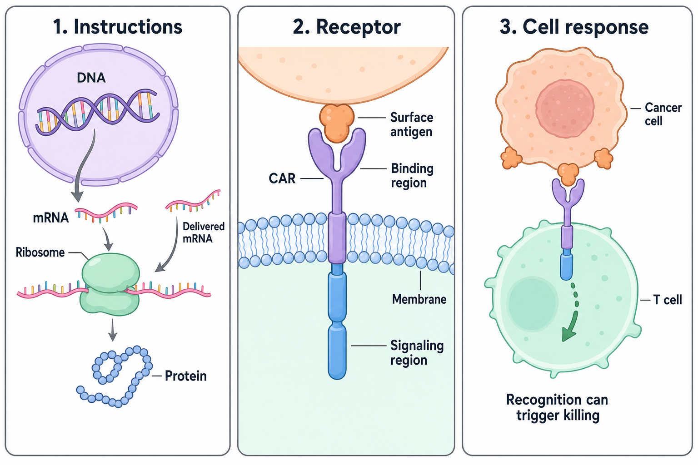

# Building an engineered T cell

**Start with a living cell, give it instructions for a receptor, then ask what that receptor enables it to do.** The cell, the instructions and the receptor protein are different objects.

**Before you start:** [DNA, RNA and protein](/wiki/education/concepts/biology-basics/genetics/central-dogma) separates instructions from products. [Chimeric antigen receptor (CAR) anatomy](/wiki/education/concepts/therapeutics/cell-therapies/car-anatomy) maps receptor parts. [The T-cell receptor (TCR)](/wiki/education/concepts/immunology/t-cells/t-cell-receptor) explains conventional recognition.

## Where this step sits

This is receptor design, step three of the [engineered-cell guide](/wiki/education/guides/engineered-cell-therapy/index). We have chosen a recognition requirement. Now we connect it to a living cell's signaling machinery. “Solid tumors” means cancers that form masses in tissues, including breast and lung cancers.

## From instructions to a receptor

*Genetic instructions must become a functional surface receptor before the cell can use it. The molecular shapes are simplified.*

| Building block | Plain-language meaning | Its role |
|---|---|---|
| Cell | A living unit with internal machinery | Moves, senses, changes state and can kill |
| Deoxyribonucleic acid (DNA) | A molecule that stores genetic information | Can contain a receptor-encoding sequence |
| Gene | Instructions for a functional product | Specifies the receptor protein |
| Messenger RNA (mRNA) | A working message | Gives ribosomes instructions to build protein |
| Protein | A folded molecular tool | The CAR is receptor protein, not a gene or cell |
| Membrane | The cell's boundary | Connects outside recognition to inside signaling |

For a protein-coding gene, **transcription** makes RNA from DNA; **translation** uses RNA to build protein. Delivering mRNA can start at translation. Folding and transport must then put a functional receptor on the membrane. Finding the delivered sequence is an earlier result than finding useful receptor activity.

## Build a contact and a response

A conventional alpha-beta TCR usually reads a peptide displayed by [human leukocyte antigen (HLA)](/wiki/education/concepts/immunology/antigen-presentation/hla). A conventional surface-target CAR binds an accessible antigen directly. Engineering does not erase the cell's other inputs. Compare the [recognition families](/wiki/education/cellular-therapies/02-car-tcr-til-comparison) when these routes are unfamiliar.

| CAR component | What the choice can change | What to test |
|---|---|---|
| Binding region | Target feature, binding strength and unwanted recognition | Target and healthy-tissue binding; finished receptor behavior |
| Hinge or spacer | Reach, flexibility and contact geometry | Accessible recognition for the actual epitope |
| Membrane-spanning region | Receptor assembly, expression and interactions | Surface expression and signaling |
| Internal signaling regions | Activation and costimulatory responses | Useful function, baseline activity and repeated stimulation |

Many binding regions use a [single-chain variable fragment (scFv)](/wiki/education/concepts/engineering-and-manufacturing/binders/scfv-and-vhh-nanobodies). It joins antibody heavy- and light-chain variable domains with a linker. Another option is a nanobody based on the variable domain of a heavy-chain-only antibody (VHH). Format does not determine clinical performance.

An **epitope** is the particular molecular feature recognized. The hinge positions the binder relative to the cell. A membrane-proximal epitope may need different reach from a distant one. A longer spacer is not always better. Primary experiments also found that some antibody-derived spacers created unwanted interactions with immune-cell receptors. Read the binder, epitope and spacer as one contact design. [Hudecek et al.](https://pubmed.ncbi.nlm.nih.gov/25212991/).

## CD28 and 4-1BB are choices, not rankings

Common designs pair CD3-zeta activation with a costimulatory region from **CD28** or **4-1BB**, also called CD137. These are names of signaling proteins. The borrowed internal regions influence how the engineered receptor signals; they are not separate drugs added to the vial.

In defined human CAR-T experiments, CD28-containing constructs favored an effector-associated, glycolytic program. The 4-1BB-containing constructs favored features of central-memory cells and mitochondrial metabolism. These observations help form design hypotheses. They do not prove that one domain is always faster, lasts longer, is safer or benefits patients more. [Kawalekar et al.](https://pubmed.ncbi.nlm.nih.gov/26885860/).

Binder, hinge, expression, cell state, manufacturing, antigen and disease all interact with the signaling region. Adding more regions or a higher “generation” number does not establish an improved therapy. Compare otherwise matched constructs, then assess the complete product in its clinical setting.

## Where companies fit

**A labeled architecture example:** Novartis's Kymriah, or tisagenlecleucel, is an autologous CD19-directed CAR-T product. Section 11 of the [FDA-linked label, revised June 2025](https://www.fda.gov/media/107296/download), specifies a murine scFv, CD8 hinge and transmembrane region, and internal 4-1BB plus CD3-zeta domains. This ties the component map to one real product. It does not show that substituting its parts into a new solid-tumor receptor reproduces its clinical results.

## Worked example: find the broken link

A fictional lab detects CAR DNA, but its cells do not kill X-positive tumor cells. Changing to a stronger binder is proposed immediately.

First ask which cells received instructions, whether they make RNA and surface receptor, and whether that receptor binds and signals. Then test killing under controlled conditions. A delivery measurement has not yet located the failure in receptor design.

## What can go wrong at this step

Poor folding can reduce surface expression. A binder can drive unwanted baseline signaling. Hinge geometry can prevent a useful contact. A receptor can recognize healthy tissue perfectly well. Each failure needs an appropriate measurement; “CAR-positive” is not a complete function result.

## Try it

Two fictional constructs differ only in hinge length. Both bind purified X, but only one kills X-positive cells.

**Answer:** Test receptor expression and cell-contact geometry. A purified-protein binding assay does not reproduce the membrane-bound interaction. Do not infer the outcome solely from binder affinity or costimulatory-domain names.

## Explain it back

“The binder changes ___; the hinge changes ___; signaling regions change ___.” One answer: “recognition; contact geometry; the cellular response to that contact.”

## Takeaway

**Design choices work together, so useful recognition and signaling must be tested in the finished receptor and cell.**

**Next:** [Deliver the instructions](/wiki/education/cellular-therapies/06-in-vivo-delivery).

## Sources and scope

Source check: October 9, 2026; expert and learner review pending. The worked scenarios are fictional. The product box illustrates labeled architecture without comparing efficacy or advising treatment.

- [FDA cell-product development guidance](https://www.fda.gov/regulatory-information/search-fda-guidance-documents/considerations-development-chimeric-antigen-receptor-car-t-cell-products).
- [Hudecek et al., 2015](https://pubmed.ncbi.nlm.nih.gov/25212991/) — spacer effects in specified preclinical constructs.
- [Kawalekar et al., 2016](https://pubmed.ncbi.nlm.nih.gov/26885860/) — matched signaling-domain experiments in human CAR-T cells.
- [FDA Kymriah label](https://www.fda.gov/media/107296/download) — section 11, product description.

<!-- Local illustration sources: [source](./images/instructions-to-car-light.png) [source](./images/instructions-to-car-dark.png) -->
