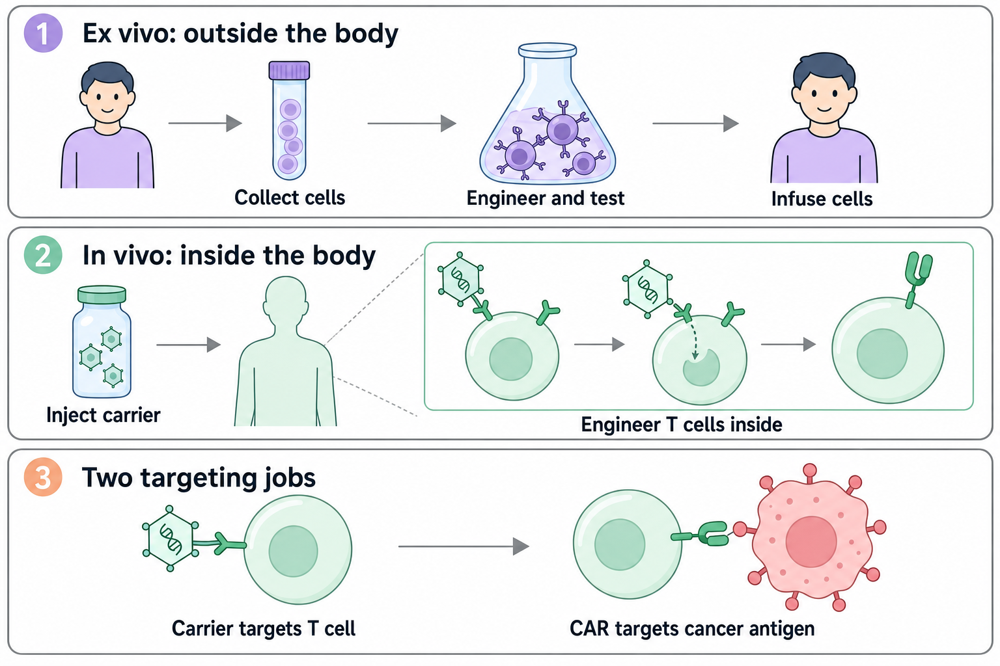
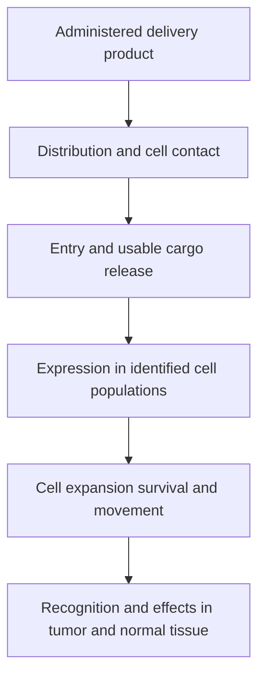

# How to engineer T cells inside the body

**In vivo [chimeric antigen receptor (CAR) T-cell engineering](/wiki/education/concepts/therapeutics/cell-therapies/car-anatomy) describes where T cells are engineered: inside the patient. Delivery, genetic persistence and cancer recognition are separate design questions.**

**Before you start:** [DNA → RNA → protein](/wiki/education/concepts/biology-basics/genetics/central-dogma) explains the instructions; [chimeric antigen receptor (CAR) anatomy](/wiki/education/concepts/therapeutics/cell-therapies/car-anatomy) explains the resulting receptor; [delivery targeting versus cancer targeting](/wiki/education/concepts/engineering-and-manufacturing/delivery-vehicles/delivery-targeting-vs-cancer-targeting) separates the two addresses. [Lipid nanoparticles (LNPs)](/wiki/education/concepts/engineering-and-manufacturing/delivery-vehicles/lipid-nanoparticle) introduce one delivery carrier.

## Where this step sits

After [building an engineered T cell](/wiki/education/cellular-therapies/05-engineered-t-cell-building-blocks), ask how the instructions reach the cell and what is administered. This is step four of the [engineered-cell guide](/wiki/education/guides/engineered-cell-therapy/index). Later lessons ask what the engineered cells do.

## Two manufacturing routes

*What is administered differs from the cells that ultimately perform the work.*

View full-size: [light illustration](./images/where-cells-are-engineered-light.png) · [dark illustration](./images/where-cells-are-engineered-dark.png).

| Route | What happens | What is administered |
|---|---|---|
| **[Ex vivo](/wiki/education/concepts/engineering-and-manufacturing/cell-manufacturing/ex-vivo-vs-in-vivo-engineering)**: outside the body | Collect cells, engineer them in a laboratory, grow and test them, then infuse them | A manufactured population of cells |
| **[In vivo](/wiki/education/concepts/engineering-and-manufacturing/cell-manufacturing/ex-vivo-vs-in-vivo-engineering)**: inside the body | Make and test a delivery product that modifies cells after administration | A product carrying genetic instructions |

In vivo engineering could remove patient-specific cell processing. It still needs [manufacturing and release testing](/wiki/education/concepts/engineering-and-manufacturing/cmc-and-quality/gmp-and-batch-release), monitoring and a defined protocol. Starting T-cell number and state matter. The words “in vivo” do not settle whether a particular protocol requires lymphodepleting treatment.

**[Autologous versus allogeneic](/wiki/education/concepts/engineering-and-manufacturing/cell-manufacturing/autologous-vs-allogeneic-cell-therapy) names the cell source.** A ready-made delivery vial can engineer the patient's own cells. “Off-the-shelf” does not necessarily mean donor cells.

## What changes in the manufacturing calendar?

Picture the ex vivo route as several gates, each answering a different question:

| Gate | Read the manufacturing concept | Question it answers |
| --- | --- | --- |
| Starting material | [Leukapheresis](/wiki/education/concepts/engineering-and-manufacturing/cell-manufacturing/leukapheresis) | Were suitable cells collected and accepted? |
| Growing the population | [Ex vivo expansion](/wiki/education/concepts/engineering-and-manufacturing/cell-manufacturing/ex-vivo-cell-expansion) | Did cell number, composition and state meet the process requirements? |
| Storage and recovery | [Cryopreservation](/wiki/education/concepts/engineering-and-manufacturing/cell-manufacturing/cryopreservation) | Does the recovered product retain suitable properties? |
| Correct material and recipient | [Chain of identity and custody](/wiki/education/concepts/engineering-and-manufacturing/cell-manufacturing/chain-of-identity-and-custody) | Are the source, lot, recipient and handoffs connected? |
| Relevant activity | [Potency assays](/wiki/education/concepts/engineering-and-manufacturing/cmc-and-quality/potency-assays) | Does the tested product perform its specified biological task? |

For patient-derived cells, [vein-to-vein time](/wiki/education/concepts/engineering-and-manufacturing/cell-manufacturing/vein-to-vein-time) includes transport, testing and clinical readiness, beyond time in culture. An in vivo carrier changes the collection-to-return workflow. Its manufacture, traceability, stability and release still need evidence.

A process revision also raises [manufacturing comparability](/wiki/education/concepts/engineering-and-manufacturing/cmc-and-quality/manufacturing-comparability): can earlier quality and clinical evidence still describe the changed product? Removing one production step does not establish an equivalent treatment.

## Two different targeting jobs

The carrier's binding feature can address a T cell, while the resulting CAR recognizes a different antigen on another cell. This is [delivery targeting versus cancer targeting](/wiki/education/concepts/engineering-and-manufacturing/delivery-vehicles/delivery-targeting-vs-cancer-targeting). Successful delivery does not prove tumor recognition, and selective engineering does not make a cancer-associated antigen absent from healthy tissue.

A **carrier** transports material. The **payload** is that material. **Expression** means a recipient cell uses the instructions to make a product. Viral gene delivery is commonly called **transduction**. **Integration** is insertion into chromosomal DNA; it is a different property from cell targeting.

## Compare the instruction paths

| Approach | Instructions and path to protein | Persistence question |
|---|---|---|
| [Targeted lipid nanoparticles (LNPs)](/wiki/education/concepts/engineering-and-manufacturing/delivery-vehicles/targeted-lnps) carrying messenger RNA (mRNA) | RNA must reach the cytoplasm and be translated | Ordinary CAR-encoding RNA is transient; measure RNA, receptor and immune-activity timelines separately |
| Integrating [lentiviral vector](/wiki/education/concepts/engineering-and-manufacturing/delivery-vehicles/lentiviral-vector) | Vector RNA is copied into DNA, which integrates and supplies new RNA transcripts | Expression can persist through division if cells survive and maintain it; assess integration and unintended-cell exposure |
| [AAV (adeno-associated virus) vector](/wiki/education/concepts/engineering-and-manufacturing/delivery-vehicles/aav-vector) | DNA must reach the nucleus and become usable for transcription | Often episomal, outside chromosomes; persistence depends on tissue and division, and possible integration still requires assessment |
| [Engineered DNA transposon](/wiki/education/concepts/engineering-and-manufacturing/delivery-vehicles/transposon) | A cassette and transposase require a separate delivery method before genomic insertion | Insertion can support persistence through cell division; assess sites, copy number and cell behavior |

The table compares mechanisms. It does not mean all four are equally validated for direct T-cell engineering inside patients. A transposon is an insertion system, not a self-sufficient delivery carrier. RNA encoding a genome editor could also produce lasting DNA changes; temporary RNA alone does not guarantee a temporary intervention.

An administration route cannot be read from a carrier's name. The product's route affects distribution. Likewise, [RNA-lipoplex](/wiki/education/concepts/engineering-and-manufacturing/delivery-vehicles/rna-lipoplex) vaccine delivery to antigen-presenting cells does not establish LNP delivery to T cells. Reuse evidence only at the step it actually tested.

## Worked comparison: read what was administered

**Rurik et al., 2022:** In a mouse cardiac-injury model, CD5-directed LNPs carried RNA for a CAR recognizing fibroblast activation protein (FAP). The delivery address was a T-cell marker; the therapeutic address was FAP. The intent was to affect activated fibroblasts in injured tissue. This was not a cancer trial or evidence of human tumor control.

**Kebriaei et al., 2016:** In phase I cancer trials, T cells were collected and engineered using a DNA transposon system outside the body, then expanded and infused. The administered product was engineered cells. This supports a particular ex vivo workflow, not direct patient injection of transposon components.

**Hunter et al., 2025:** Targeted LNP engineering was studied in human cells, humanized mouse tumor models and monkeys. Human-cell experiments are not a clinical treatment result. Tumor control in mice and B-cell depletion in monkeys answer different questions from human solid-tumor benefit.

These examples show why route, recipient cell, payload, genetic fate and model belong in the same evidence note. A result from one column cannot fill every other column.

## Worked example: one vial, an uncertain population

A fictional vial has a measured amount of RNA and a cell-binding feature. The number of successfully engineered cells is a downstream outcome, not the administered input.

*Measure the relevant cell populations at each gate.*

A fluorescent particle signal in an organ is not proof of useful receptor expression in T cells. If a design adds a second receptor, **co-expression** asks whether the relevant cells make both components, rather than one being detected somewhere in the body.

## What can go wrong at this step

Delivery can miss intended cells or reach unintended ones. [Targeted LNPs](/wiki/education/concepts/engineering-and-manufacturing/delivery-vehicles/targeted-lnps) can enter uptake compartments without enough RNA escaping into the cytoplasm. An integrating system needs delayed-effect assessment. A transient system still needs duration and safety evidence: RNA decay is not an instant immune off switch.

## Try it

**Headline:** “CAR T cells eliminate tumors in vivo.” Does that prove they were engineered inside the animal?

**Answer:** No. Laboratory-engineered cells may have been infused and tested in a living animal. Read what was administered. “Tested in vivo” and “generated in vivo” are different claims.

**Second card:** A fictional nonviral product uses a transposon. Does nonviral mean nonintegrating?

**Answer:** No. Engineered DNA transposons are designed to insert cassettes into cellular DNA. The delivery method and genetic fate must be described separately.

**Manufacturing card:** A fictional in vivo product removes patient-specific cell culture. Does that remove potency testing?

**Answer:** No. The carrier needs relevant product-quality testing, while the cells generated later need downstream measurement. Those are different samples at different stages.

## Explain it back

“The product administered is ___; the cell meant to receive it is ___; the resulting receptor recognizes ___; persistence was measured by ___.”

One fictional answer: “an RNA particle; a defined T-cell subset; antigen B; receptor measurements over time in identified cells.” That still leaves tumor and healthy-tissue effects to test.

## Takeaway

**Read the delivery address, therapeutic address and genetic fate separately, then ask which were measured in the relevant model.**

**Next:** [Cytokines and programmable receptors](/wiki/education/cellular-therapies/07-cytokines-and-programmable-receptors).

## Sources and scope

Source check: October 9, 2026; expert and learner review pending. Examples describe their tested models and workflows. They do not validate every carrier for in vivo CAR-T or establish universal targeting, safety or solid-tumor benefit.

- [Rurik et al., Science, 2022: CAR T cells generated in a mouse cardiac-injury model](https://pubmed.ncbi.nlm.nih.gov/34990237/).
- [Hunter et al., Science, 2025: targeted RNA engineering in human-cell experiments and animal models](https://pubmed.ncbi.nlm.nih.gov/40536974/).
- [Kebriaei et al., JCI, 2016: ex vivo transposon-engineered CAR T-cell phase I trials](https://www.jci.org/articles/view/86721).
- [Schnepp et al., 2016: episomal AAV vector genomes in human muscle](https://pubmed.ncbi.nlm.nih.gov/26650966/).
- [Tuerxunyiming et al., Scientific Reports, 2026: a targeted lentiviral vector tested in a lymphoma mouse model](https://www.nature.com/articles/s41598-025-17342-1).
- [FDA, 2020: risk-based long-term follow-up after gene therapy](https://www.fda.gov/regulatory-information/search-fda-guidance-documents/long-term-follow-after-administration-human-gene-therapy-products).
