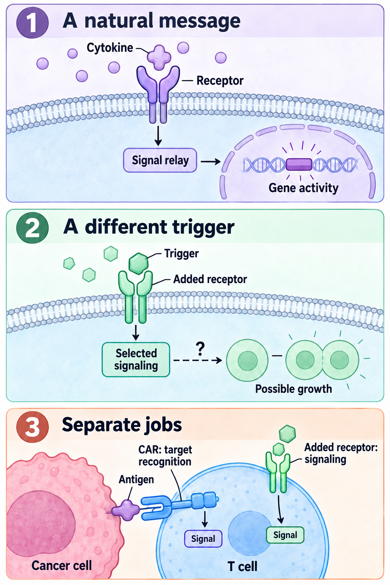

# Cytokines and programmable receptors

**Recognizing a cancer cell, receiving a supportive signal and remaining able to kill are different jobs.** Receptor engineering can change one job while leaving another unresolved.

**Before you start:** [Chimeric antigen receptor (CAR) anatomy](/wiki/education/concepts/therapeutics/cell-therapies/car-anatomy) connects recognition to signaling. [T-cell priming](/wiki/education/concepts/immunology/t-cells/t-cell-priming-three-signals) separates activation inputs. [T-cell states](/wiki/education/concepts/immunology/t-cells/t-cell-states) explains why a signal can produce different responses.

## Where this step sits

After [engineering and delivery](/wiki/education/cellular-therapies/06-in-vivo-delivery), ask what extra functions were added and whether they solve a named obstacle. These functions work alongside the recognition receptor; they do not supply a safe target or prove clinical benefit.

## Message, receiver and response

*The CAR that contacts the target and the added supportive receptor perform separate jobs. A growth response depends on the receptor and cell context; signaling or cell accumulation alone does not establish safe tumor killing. Shapes and relays are schematic.*

View full-size: [light illustration](https://4pdxqyvytfd88yy1.public.blob.vercel-storage.com/sites/diana/files/wiki/education/cellular-therapies/images/cytokine-message-and-receptor-v2-light.png) · [dark illustration](https://4pdxqyvytfd88yy1.public.blob.vercel-storage.com/sites/diana/files/wiki/education/cellular-therapies/images/cytokine-message-and-receptor-v2-dark.png).

[Cytokines](/wiki/education/concepts/immunology/immune-regulation/cytokine-and-chemokine) are signaling proteins. [Receptors](/wiki/education/concepts/biology-basics/signaling/ligand-and-receptor) receive compatible signals, and [signal transduction](/wiki/education/concepts/biology-basics/signaling/signal-transduction-and-kinases) relays them within the cell. The resulting **phenotype** is an observable state or behavior.

Think of a message reaching a receiver. The analogy stops at the response: a cell does not receive a literal order to “cure cancer.” Receptor amount, signal duration, cell state and other inputs affect what happens next. Cytokines are messages, not nutritional fuel; cells still need nutrients and suitable conditions.

Interleukin-2 (IL-2), for example, can support both effector and regulatory T-cell populations. More cytokine signaling is not automatically better antitumor activity. The linked cytokine concept explains these context-dependent effects.

## What happens inside the membrane

Many cytokine receptors use **Janus kinase–signal transducer and activator of transcription (JAK–STAT) signaling**. JAK enzymes associated with the receptor promote [phosphorylation](/wiki/education/concepts/biology-basics/signaling/phosphorylation), addition of phosphate groups. Activated STAT proteins can affect gene expression. Other pathways and feedback also participate; one arrow summarizes a network.

Synthetic-receptor experiments changed the extracellular trigger while retaining selected intracellular signaling components. Engelowski and colleagues used artificial ligand/receptor combinations and measured signaling and growth in specified experimental cells. That is evidence about a constructed signaling system, not proof of cancer-cell killing or an established therapeutic control. [Engelowski et al., 2018](https://pubmed.ncbi.nlm.nih.gov/29789554/).

## What the engineered change actually does

| Added feature | Intended job | Separate failure question |
|---|---|---|
| Drug-triggered signaling | Adjust a named pathway through an administered input | Baseline activity, trigger access and response after withdrawal |
| Antigen-triggered signaling | Link a response to a molecular feature | Where else the trigger occurs and what happens after moving away |
| Constitutive signaling | Provide continuous support | Uncontrolled growth, altered state or persistent harmful activity |
| Cytokine secretion | Change nearby cells as well as the engineered cell | Distribution beyond the intended site and systemic exposure |

An **orthogonal** ligand/receptor pair is designed to interact selectively with its engineered partner. Selectivity needs measurement against relevant natural partners. It cannot be established from the word “orthogonal.”

An added growth receptor need not change the CAR's target. Changing signaling inside the cell also differs from secreting a cytokine that can reach surrounding cells.

## Armoring addresses a named obstacle

[Armoring](/wiki/education/concepts/therapeutics/cell-therapies/armoring) adds functions beyond basic recognition. A **dominant-negative transforming growth factor beta receptor II (dnTGFβRII)** interferes with a specified TGF-β response. Adding this receptor variant differs from deleting its gene, and neither removes every suppressive signal.

A phase 1 study in metastatic castration-resistant prostate cancer tested such armored CAR-T cells. Serious inflammatory events included a fatal event with concurrent sepsis. The complete product and regimen were tested; the study does not isolate the armor's contribution or establish another cancer's safety. [Narayan et al., 2022](https://pubmed.ncbi.nlm.nih.gov/35314843/).

**TRUCKs**, commonly expanded as **T cells redirected for universal cytokine-mediated killing**, use a cytokine payload. An early design coupled activation to an interleukin-12 (IL-12) expression program. In those tumor models, cytokine-supported macrophages helped attack antigen-loss cells. This did not make the CAR recognize the missing antigen. “Universal” is terminology, not a measured clinical guarantee. [Chmielewski et al., 2011](https://pubmed.ncbi.nlm.nih.gov/21742772/).

Payload control matters. An activation-responsive promoter uses a cellular response to control transcription, rather than secreting continuously. It does not prove local-only exposure. In a separate metastatic-melanoma study, engineered tumor-infiltrating lymphocytes produced inducible IL-12; serious systemic toxicity accompanied activity. Those were engineered lymphocytes, not the same CAR/TRUCK product. [Zhang et al., 2015](https://pubmed.ncbi.nlm.nih.gov/25695689/).

## Recognition rules are another layer

[Logic-gated CAR systems](/wiki/education/concepts/therapeutics/cell-therapies/logic-gated-cars) combine inputs. AND-like designs aim to require a combination; OR-like designs can broaden recognition; NOT-like designs add an inhibitory input. Two fully activating CARs do not automatically make an AND gate.

Synthetic Notch (synNotch) circuits can use recognition of A to induce a CAR for B. This is sequential priming: receptor induction and decay take time. Cells may retain the B receptor after moving away from A. Test the missing-input conditions and timing, rather than assuming both antigens must always be on the same cell. [Roybal et al., 2016](https://pubmed.ncbi.nlm.nih.gov/26830879/). Other AND-like designs tune and separate activation from costimulation. [Kloss et al., 2013](https://pubmed.ncbi.nlm.nih.gov/23242161/).

## Worked example: stronger growth, mixed functional results

**Entirely fictional teaching data:** matched cells carry the same CAR, with an added drug-triggered support receptor. Parallel assays start with matched viable cell numbers and use the same 48-hour observation window. Tumor and healthy-cell killing are measured in separate cultures.

| Readout | No support trigger | Support trigger |
|---|---|---|
| Viable engineered cells at 48 hours | 100 | 250 |
| Tumor targets killed in that assay | 20% | 25% |
| Healthy targets killed in the separate assay | 2% | 18% |

The 2.5-fold cell accumulation is not 2.5-fold efficacy. Division, survival and loss can each affect the count. The killing results suggest a tradeoff under these conditions; they do not predict whole-body safety or a patient's response. Measure receptor activation, proliferation and killing separately, using relevant controls.

## What can go wrong at this step

Baseline signaling can occur without the intended trigger. A secreted cytokine can act beyond the triggering site. An AND-like gate can miss cancer lacking one input; an OR-like gate can add normal-tissue recognition. A positive activation marker cannot substitute for killing, distribution or durable clinical outcomes.

## Try it: a growth switch is not a kill switch

The fictional trigger is withdrawn and growth signaling falls. Does that remove the cells or their ability to recognize healthy targets?

**Answer:** Neither is established. [Safety switches](/wiki/education/concepts/therapeutics/cell-therapies/safety-switches) distinguish activity control from cell elimination. Measure remaining viable cells and function after withdrawal. Previously released signals and injury can persist even if one pathway falls.

## Explain it back

“The added feature changes ___; the claim that still needs a separate test is ___.” One answer: “a supportive signal; safe tumor killing by the finished product.”

## Takeaway and next step

**Read each programmable feature as a named hypothesis, with its own function and failure tests.**

**Next:** [The journey through a solid tumor](/wiki/education/cellular-therapies/08-solid-tumor-barriers).

## Sources and scope

Source check: October 10, 2026; expert and learner review pending. The table uses invented data. This lesson teaches mechanisms and evidence-reading, not a clinical dosing or management plan.

- [Engelowski et al., 2018](https://pubmed.ncbi.nlm.nih.gov/29789554/) — artificial cytokine-receptor inputs, signaling and growth in specified experimental systems.
- [Narayan et al., 2022](https://pubmed.ncbi.nlm.nih.gov/35314843/) — TGF-β-resistant PSMA CAR-T phase 1 study in metastatic castration-resistant prostate cancer.
- [Chmielewski et al., 2011](https://pubmed.ncbi.nlm.nih.gov/21742772/) — inducible IL-12 and macrophage-dependent effects in tumor models; not universal clinical killing.
- [Zhang et al., 2015](https://pubmed.ncbi.nlm.nih.gov/25695689/) — inducible IL-12-producing lymphocytes in metastatic melanoma, including systemic toxicity.
- [Roybal et al., 2016](https://pubmed.ncbi.nlm.nih.gov/26830879/) — sequential synNotch-to-CAR circuit experiments.
- [Kloss et al., 2013](https://pubmed.ncbi.nlm.nih.gov/23242161/) — combined recognition with balanced activation and costimulation.

<!-- Local illustration sources: [source](./images/cytokine-message-and-receptor-v2-light.png) [source](./images/cytokine-message-and-receptor-v2-dark.png) -->
