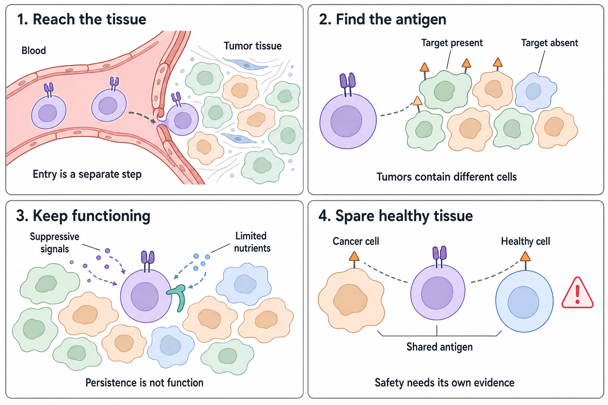

# The journey through a solid tumor

**A T cell bearing a [chimeric antigen receptor (CAR)](/wiki/education/concepts/therapeutics/cell-therapies/car-anatomy) must reach the cancer, recognize it, remain functional, and do enough damage without unacceptable harm.** Increasing the cell count addresses only part of that chain.

**Before you start:** [chimeric antigen receptor (CAR)](/wiki/education/concepts/therapeutics/cell-therapies/car-anatomy), [T-cell states](/wiki/education/concepts/immunology/t-cells/t-cell-states), [immune escape](/wiki/education/concepts/immunology/tumor-immunology/immune-escape).

Before this lesson: [[wiki/education/cellular-therapies/07-cytokines-and-programmable-receptors|Cytokines and programmable receptors]].

## Four obstacles to follow

*Improving one link does not guarantee that the whole treatment chain works.*

View full-size: [light illustration](https://4pdxqyvytfd88yy1.public.blob.vercel-storage.com/sites/diana/files/wiki/education/cellular-therapies/images/solid-tumor-journey-light.png) · [dark illustration](https://4pdxqyvytfd88yy1.public.blob.vercel-storage.com/sites/diana/files/wiki/education/cellular-therapies/images/solid-tumor-journey-dark.png).

### 1. Reach and enter the tumor

**Trafficking** means movement toward a site; **infiltration** means entering the tissue. Cells measured in blood or spleen have not necessarily entered the cancer. Tumor blood vessels, physical tissue structure, and local chemical signals can impede access. [1,2]

The [tumor microenvironment](/wiki/education/concepts/cancer-biology/tumor-microenvironment/tumor-microenvironment) supplies the tissue context for this journey. [Angiogenesis](/wiki/education/concepts/cancer-biology/tumor-microenvironment/angiogenesis), the growth of vessels from existing vessels, is one part of it. A dense vessel network does not by itself establish useful blood flow or immune-cell entry.

### 2. Recognize enough cancer cells

A surface target must be accessible and present at a level the CAR can respond to. A high RNA measurement does not automatically establish high surface-protein expression.

[Tumor heterogeneity](/wiki/education/concepts/cancer-biology/what-cancer-is/tumor-heterogeneity) can leave some cancer cells with much of a target, others with little, and others with none. Different metastases may also differ. **Antigen escape** occurs when cells that are not effectively recognized survive and grow. [Clonal evolution](/wiki/education/concepts/cancer-biology/what-cancer-is/clonal-evolution) explains how pre-existing populations and later changes can contribute; it does not mean treatment deliberately teaches a cell to resist. [1]

Conventional CAR recognition does not require a peptide to be displayed on [human leukocyte antigen (HLA)](/wiki/education/concepts/immunology/antigen-presentation/hla). That removes one recognition dependency; it does not remove the need for an appropriate surface target. See [[wiki/education/cellular-therapies/02-car-tcr-til-comparison|the recognition comparison]]. [Immune escape](/wiki/education/concepts/immunology/tumor-immunology/immune-escape) also separates baseline display from its ability to increase after an interferon signal. A signaling defect is not automatically total display loss. Which dependency matters depends on the receptor and tested target.

### 3. Keep working in a hostile environment

Suppressive signals, limited nutrients, low oxygen, and repeated stimulation can undermine function. **Exhaustion** describes a biological state associated with chronic stimulation and altered function; it is not simply a cell being briefly tired. [Immune checkpoints](/wiki/education/concepts/immunology/immune-regulation/immune-checkpoint) provide several distinct regulatory contacts. PD-1, LAG-3, TIM-3 or TIGIT staining alone does not identify the causal restraint or establish that blocking it restores useful activity. Compare a defined perturbation with appropriate controls before assigning that job to the pathway.

Give a proposed barrier a specific name. [Adenosine and indoleamine 2,3-dioxygenase (IDO) pathways](/wiki/education/concepts/immunology/immune-regulation/adenosine-and-ido) describe different local regulatory mechanisms. [Tumor-associated macrophages](/wiki/education/concepts/cancer-biology/tumor-microenvironment/tumor-associated-macrophages) and [myeloid-derived suppressor cells](/wiki/education/concepts/cancer-biology/tumor-microenvironment/myeloid-derived-suppressor-cells) require careful identity and function measurements. A high cell count or gene-expression signal alone cannot prove which barrier is causing failure.

**Persistence** means cells remain present. **Functional persistence** means they remain capable of useful activity. [armoring](/wiki/education/concepts/therapeutics/cell-therapies/armoring) can add support or resistance to one inhibitory pathway. A supportive cytokine receptor might help with one aspect of this problem; it does not supply oxygen or guarantee access to every cancer cell. Experimental approaches that deliver cytokines locally have improved mouse outcomes, but their results are specific to the tested constructs and models. [2]

### 4. Preserve healthy tissue

The same antigen can appear on cancer and normal cells. Read [on-target, off-tumor toxicity](/wiki/education/concepts/therapeutics/toxicities-and-supportive-care/on-target-off-tumor-toxicity) for direct recognition of healthy tissue. It differs from **off-target recognition**, where binding reacts with an unintended molecular target.

Stronger activation can increase useful killing and harmful activity. The [therapeutic index](/wiki/education/concepts/therapeutics/how-drugs-work/therapeutic-index) relates useful effects to harm; the actual product and setting must supply the evidence. [1,3]

Healthy-tissue recognition is only one safety question. [Cytokine release syndrome (CRS)](/wiki/education/concepts/therapeutics/toxicities-and-supportive-care/cytokine-release-syndrome) and [immune effector cell-associated neurotoxicity syndrome (ICANS)](/wiki/education/concepts/therapeutics/toxicities-and-supportive-care/icans) need distinct clinical assessment. Target binding and tumor killing cannot establish the absence of systemic or neurologic harm. [ASTCT 2026](https://pubmed.ncbi.nlm.nih.gov/42711241/).

## A worked example: target coverage

**Made-up teaching example, not patient data or a prediction:** Imagine 100 cancer cells. Eighty display target X strongly and 20 lack it. A CAR-X treatment kills all 80 target-positive cells in this simplified model.

The tumor has become much smaller, but 20 target-negative cells remain. Making ten times as many CAR-X cells does not create target X on those survivors. Real treatments can recruit other immune effects, but that requires evidence; it should not be assumed from the CAR's specificity.

Now keep target X unchanged and change the neighborhood. A tumor-only culture supports killing, while a tissue model containing additional cells shows less activity. That difference opens a context question. It does not identify one macrophage state, vessel defect or suppressive pathway as the cause. Check the preserved cell populations and the experiment's controls before choosing a mechanism to test.

**What might address the target-coverage gap?** A second recognition target, a tested [logic rule](/wiki/education/concepts/therapeutics/cell-therapies/logic-gated-cars), or a demonstrated broader immune response might help. Ask which rule is proposed before expecting broader coverage.

Continue the **fictional** model: of the 100 cancer cells, 20 display both X and Y, 60 only X, 10 only Y, and 10 neither. An idealized **OR rule**, recognizing X or Y, would cover 90 cells. An idealized **AND rule**, requiring both, would cover 20. These are candidate coverage counts, not measured killing. Neither calculation includes normal tissue, access, signal strength or cell state. Requiring two targets can narrow coverage; it does not automatically make a design safe. [3]

## Match the tool to the problem

| Proposed improvement | Problem it may address | Problem it does not automatically solve |
|---|---|---|
| Better T-cell delivery vector | Generating engineered cells | Choosing a safe cancer antigen |
| Another CAR target | Recognition coverage | Safe expression of both targets in normal tissue |
| Added cytokine receptor | Growth, survival, or functional state | Missing antigen or inaccessible tissue |
| Improved trafficking machinery | Reaching tumor sites | Retaining activity after arrival |
| [safety switches](/wiki/education/concepts/therapeutics/cell-therapies/safety-switches) | Adjusting a pathway or removing expressing cells | Immediate reversal of every downstream injury |

## Try it: read a biopsy and a blood result together

**Scenario:** Engineered T cells rise in blood, but a tumor biopsy contains few of them. What is the next question?

**Answer:** Ask about distribution and infiltration before concluding that more expansion is needed. Blood counts, tumor-cell entry, and tumor killing are separate readouts. Sampling time and biopsy representativeness also matter.

## What “breast cancer” tells us

The indication name is not a molecular target. Even [triple-negative breast cancer (TNBC)](/wiki/education/concepts/breast-cancer/receptors-and-subtypes/tnbc) does not identify one universal CAR antigen. A program needs a defined target, evidence of accessible expression across relevant cancer cells, normal-tissue testing, and a named development or clinical protocol. A pipeline label alone does not establish eligibility or access.

## Explain it back

“Which claim was measured, and which next step remains untested?” Name one measurement from this lesson and the limit beside it.

## Takeaway and next step

**Solid-tumor efficacy is a chain of linked requirements. A result at one link cannot stand in for the whole chain.**

**Next:** [Read the safety plan](/wiki/education/guides/engineered-cell-therapy/07-reading-the-safety-plan).

## Sources and scope

Source check: October 10, 2026; expert and learner review pending. Both numerical target-coverage examples are deliberately fictional. These lessons do not infer eligibility for a particular treatment.

Tissue-ecosystem links, the controlled neighborhood comparison, checkpoint-marker limits and baseline-versus-inducible display distinctions added October 10, 2026. Linked concepts hold the mechanism sources and their measurement limits. [NCI's tumor biology and microenvironment portfolio](https://www.cancer.gov/about-nci/organization/dcb/research-portfolio/tbmr) describes these interacting tissue questions.

1. [NCI: CAR T cells, including barriers in solid tumors](https://www.cancer.gov/about-cancer/treatment/research/car-t-cells).
2. [Rewiring endogenous genes in CAR T cells for tumour-restricted payload delivery, Nature, 2025](https://www.nature.com/articles/s41586-025-09212-7). Preclinical evidence for locally controlled cytokine expression; not in vivo generation of the CAR-T cells.
3. [FDA: CAR T-cell product development considerations](https://www.fda.gov/regulatory-information/search-fda-guidance-documents/considerations-development-chimeric-antigen-receptor-car-t-cell-products).

The recognition-rule extension was checked October 10 against FDA sections V.A and V.D: target recognition and added control elements need product-specific testing. The numerical rules are invented teaching models, not a clinical performance comparison.

4. [Perales et al., 2026: ASTCT immune-effector toxicity consensus](https://pubmed.ncbi.nlm.nih.gov/42711241/) — separate clinical toxicity categories, rather than a universal product safety profile.

<!-- Local illustration sources: [source](./images/solid-tumor-journey-light.png) [source](./images/solid-tumor-journey-dark.png) -->
