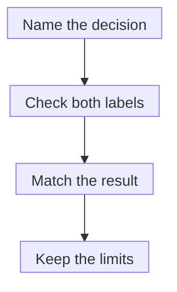

# Companion diagnostics

## In one sentence

A companion diagnostic supplies information essential to the safe and effective use of a corresponding treatment in its specified context.

## The intuition

Think of a treatment and a required information check that belong together. The check might identify a molecular feature needed for the treatment decision. Knowing the feature's name is only part of the task: the assay, specimen and decision rule also matter.

This is not a guarantee that someone with a positive result will benefit. The pairing identifies an essential information requirement, while the clinical team still assesses the whole treatment context.

## How it works

The **Food and Drug Administration (FDA)** defines a companion diagnostic, often abbreviated **CDx**, as a device that provides information essential to the safe and effective use of a corresponding therapeutic product. It is often an **in vitro diagnostic** test performed on a specimen outside the body; FDA's authorized list also includes imaging tools.

The information can identify people more likely to benefit, people at increased risk of serious adverse effects, or a treatment-monitoring circumstance specified in the labeling. Read the actual authorization and instructions rather than assuming that every companion diagnostic performs the same job.

The treatment's label and the device's instructions identify the intended context. That may include a cancer type, biomarker, specimen and decision rule. Some diagnostic devices have appropriate labeling for a group of oncology therapies. Group labeling is a documented scope, not permission to extend the result to every drug with a similar target.

An ordinary molecular report does not become a companion diagnostic because it lists medicines. Likewise, two tests measuring a similarly named feature are not automatically interchangeable. They may examine different material, variants or thresholds.

The [three validity questions](/wiki/education/concepts/measurement/computational-analysis/analytical-validity-clinical-validity-and-utility) remain useful: does the test measure correctly, does its result have clinical meaning here, and does its intended use support helpful care? An authorization applies to its specified use. It does not validate every later claim attached to a report.

*A result-to-treatment match is an information requirement, not a guarantee of response.*

## Why it matters in cancer

A treatment-selection rule may require a particular molecular result. A research score, a broad gene-panel finding and an authorized companion result can each contain useful information while answering different questions. Ask which evidence satisfies the proposed treatment's actual label.

A failed or inadequate test is also a distinct result. It should not silently become biomarker-negative. Sample quality, prior treatment and the intended specimen can matter.

## How it is checked and measured

There is no universal companion-diagnostic unit. Outputs might be a variant detected, a stain category or an imaging assessment. Use the device-specific method, thresholds and limitations.

Use an intended-use card instead of a shared gene name:

| Field | What must stay attached |
|---|---|
| Assay | Device, version, method and current authorization |
| Input | Intended specimen, preparation and adequacy requirements |
| Result | Exact alteration or score, algorithm, units and cutoff |
| Treatment | Corresponding product or authorized group, disease and setting |
| Limits | Invalid/failed results, detection limits and any follow-up instructions |

FDA's device list starts the check; the underlying authorization and both labels supply detail. Laboratory certification and [research-use labels](/wiki/education/concepts/access-and-regulation/approval/ruo-ldt-clia-and-fda-tiers) answer separate questions.

## Common confusions

- A report's drug list is not a companion-diagnostic authorization.
- The same gene name does not establish assay interchangeability.
- A positive label-matched biomarker does not promise response.
- A test can be clinically useful without being a companion diagnostic; the category has a specific regulatory meaning.

## Try it

Fictional Drug A requires a qualifying M alteration in tumor tissue under a defined test context. A research blood assay reports high expression of the same gene. A second report says testing failed. Does either supply a qualifying positive or a valid negative?

**Answer:** Neither. Expression in blood is a different specimen and readout from the stipulated alteration test. Failure is uninformative, not negative. Compare the intended-use cards, labels and supporting validation; the clinical team resolves further testing. Even a qualifying positive would not promise benefit.

## Explain it back

“Two tests naming M can differ in ____, so I must check ____.”

One answer: “specimen, measured feature and cutoff; the exact intended use and evidence supporting the treatment-linked result.”

## Takeaway

**Keep the assay, specimen, result rule and corresponding treatment together when checking a companion diagnostic.**

## Related concepts

[Drug labeling and off-label use](/wiki/education/concepts/access-and-regulation/approval/drug-label-and-off-label-use) explains the proposed use. [Clinical actionability](/wiki/education/concepts/evidence-and-statistics/biomarkers/actionability) connects findings to specific decisions.

## Sources and scope

U.S. source check: October 10, 2026. The example is fictional; no product interchangeability or patient eligibility is decided. Expert and learner review pending.

- [FDA: companion diagnostics](https://www.fda.gov/medical-devices/in-vitro-diagnostics/companion-diagnostics) — definition and purposes.
- [FDA: authorized companion devices](https://www.fda.gov/medical-devices/in-vitro-diagnostics/list-fda-authorized-companion-diagnostic-devices-in-vitro-and-imaging-tools) — specific and group-label contexts.
- [FDA: in vitro companion diagnostics, August 2014 final guidance](https://www.fda.gov/media/81309/download) — definition and both-label intended-use sections checked.
- [FDA: oncology group labeling, April 2020 final guidance](https://www.fda.gov/media/120340/download) — selected sections on specimen, alterations, cutoffs and evidence for broader labeling checked.

<!-- BEGIN GENERATED USED IN -->
## Used in

- [Write the exact claim before judging it](/wiki/education/guides/judging-a-test-or-vendor-claim/01-write-the-exact-claim)
- [Connect evidence to a decision](/wiki/education/guides/judging-a-test-or-vendor-claim/03-connect-evidence-to-a-decision)
- [Judge a test or company claim](/wiki/education/guides/judging-a-test-or-vendor-claim/index)
<!-- END GENERATED USED IN -->
