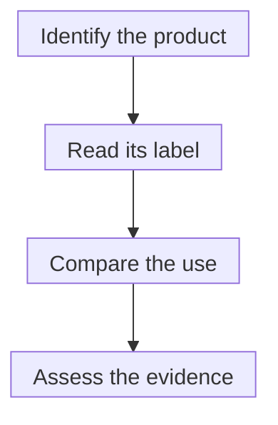

# Drug labeling and off-label use

## In one sentence

Off-label use means a clinician uses an approved drug outside its approved labeling, while the evidence for that particular use must be assessed separately.

## The intuition

A tool can have a well-tested use printed on its box, while someone proposes another use. The printed instructions tell you where the manufacturer and regulator have established a specific basis for use. A different use needs its own reasoning and evidence.

A medicine is more consequential than a household tool. This analogy explains the boundary; it cannot tell you whether a proposed off-label treatment is sensible.

## How it works

The **Food and Drug Administration (FDA)** approves a medicine for specified uses based on a review of its benefits and risks. The prescribing information, often called the label, describes indications, dosing, contraindications, warnings and supporting studies.

An **indication** is the disease or condition and treatment context in which a drug is approved. In oncology, labeling may also specify a biomarker, prior treatments, a disease stage or a combination partner. Finding the drug's name on an approval page is only the beginning of a match.

Off-label use can involve a different disease, dose, route or other use outside approved labeling. Clinicians may generally prescribe approved drugs off label when they judge it appropriate. FDA has not established safety and effectiveness for that unapproved use merely because the drug has an approval elsewhere.

Evidence and labeling are related but distinct. Some off-label uses have substantial evidence and appear in clinical guidance. Others are speculative. “Off label” does not tell you which category you are in. Nor does it guarantee insurance coverage or access through a particular institution.

A drug never approved for any use is investigational, rather than simply off label. Obtaining it involves a different pathway, such as a [clinical trial or expanded access](/wiki/education/concepts/access-and-regulation/trials-and-access/clinical-trial-vs-expanded-access).

*These checks separate regulatory classification from whether the proposed treatment helps.*

## Why it matters in cancer

A gene alteration and a drug targeting that gene's protein do not, together, establish that the drug helps this tumor. Ask whether the relevant alteration changes protein function, whether the drug reaches the target, and whether clinical evidence matches the disease and setting.

Similarly, evidence in metastatic disease does not automatically establish prevention of recurrence after surgery. The proposed goal and acceptable risk may be different.

## Intended-use card

Compare the actual proposal with the current prescribing information, field by field:

| Field | Question |
|---|---|
| Product | Is this exact drug and formulation approved for any use? |
| Population | Does the disease, setting, biomarker and prior treatment match? |
| Administration | Do dose, route, schedule and combination match the labeling? |
| Evidence and practical access | What supports the proposed use, and what do the clinician, institution and payer require? |

The classification has no biological unit. It comes from documents; a laboratory signal cannot rewrite a drug label.

## Worked example

In a fictional report, Drug A is approved for advanced Cancer X with Alteration Y. The report names Drug A for a person with early Cancer Z and a different alteration in the same gene. The drug is real and approved, but the reported match crosses several evidence gaps. An oncology review must assess the actual variant, cancer, setting and alternatives.

## Common confusions

- A drug's approval is not approval of every molecular match a report proposes.
- Off-label prescribing is not proof that the use works, and it is not the same as expanded access.
- Insurance authorization answers a payment question, rather than establishing a treatment's effectiveness.
- A label change can alter the regulatory status of a use. Check the current prescribing information.

## Try it

Fictional Drug A is approved as a tablet at a specified dose for Cancer X. A proposal uses the same approved tablet at a different dose for Cancer Y. Product B has never been approved. Are both simply off label?

**Answer:** A's proposed disease and dose differ from its label: these are off-label features requiring separate assessment. The example retains the same approved product. B is investigational, requiring an applicable access pathway. Neither category tells us that treatment will help. Consent, institutional and payment requirements need plan-specific answers.

## Explain it back

“The product is approved for ____, but the proposed use differs in ____; the supporting evidence is ____.”

One answer: “Cancer X; disease and dose; still a separate question.”

## Takeaway

**Approval of a medicine and evidence for its proposed use must travel as separate statements.**

## Related concepts

- [Actionability](/wiki/education/concepts/evidence-and-statistics/biomarkers/actionability)
- [Clinical trials versus expanded access](/wiki/education/concepts/access-and-regulation/trials-and-access/clinical-trial-vs-expanded-access)
- [Prognostic versus predictive biomarkers](/wiki/education/concepts/evidence-and-statistics/biomarkers/prognostic-vs-predictive)

## Sources and scope

U.S. source check: October 10, 2026. The drug example is fictional. This page explains categories, not the suitability of an individual prescription. Expert and learner review remain pending.

- [FDA: understanding unapproved use of approved drugs](https://www.fda.gov/patients/learn-about-expanded-access-and-other-treatment-options/understanding-unapproved-use-approved-drugs-label) — meaning and boundaries of off-label use.
- [FDA: learn about expanded access and other treatment options](https://www.fda.gov/patients/learn-about-expanded-access-and-other-treatment-options) — separate paths for approved and investigational products.
- [FDA: about Drugs@FDA](https://www.fda.gov/drugs/drug-approvals-and-databases/about-drugsfda) — approval letters and labeling records; a starting point rather than a claim that this database covers every biological product.

<!-- BEGIN GENERATED USED IN -->
## Used in

- [Name the access route](/wiki/education/guides/accessing-experimental-therapy/01-name-the-access-route)
- [Build the readiness picture](/wiki/education/guides/accessing-experimental-therapy/03-build-the-readiness-picture)
- [Understand access to an experimental therapy](/wiki/education/guides/accessing-experimental-therapy/index)
- [Connect evidence to a decision](/wiki/education/guides/judging-a-test-or-vendor-claim/03-connect-evidence-to-a-decision)
- [Judge a test or company claim](/wiki/education/guides/judging-a-test-or-vendor-claim/index)
<!-- END GENERATED USED IN -->
