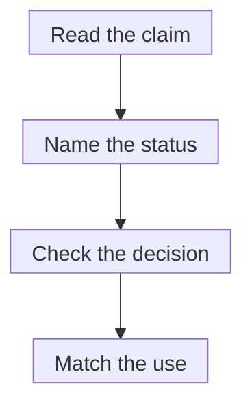

# Drug approval pathways and expedited designations

## In one sentence

Drug approval authorizes a specified use, while expedited designations change parts of development or review without themselves authorizing marketing.

## The intuition

Imagine a permit and a faster appointment for discussing the permit. They answer different questions. Approval is the decision about a specified product and use. An expedited designation can help development or review happen more efficiently.

The analogy breaks because drug review evaluates benefits, risks and manufacturing quality, and some approval pathways leave a specific benefit question to be confirmed. Speed alone tells you little about the remaining uncertainty.

## How it works

*An expedited designation can support the work or its review. Look separately for an actual approval and its specified use; accelerated approval is an approval with benefit confirmation required.*

The **Food and Drug Administration (FDA)** evaluates a drug for a defined indication and conditions of use. Read the current [drug label](/wiki/education/concepts/access-and-regulation/approval/drug-label-and-off-label-use), including disease, biomarker, treatment setting and combination requirements.

**Traditional approval**, often called full approval, and **accelerated approval** are approval pathways. Traditional approval can rely on direct clinical benefit or a validated [surrogate endpoint](/wiki/education/concepts/evidence-and-statistics/endpoints/surrogate-endpoints). A surrogate substitutes for the clinical outcome of interest; its evidentiary role depends on context. Traditional approval does not always require a demonstrated survival increase.

Accelerated approval can use a surrogate or intermediate endpoint reasonably likely to predict clinical benefit for a serious condition with unmet need. Confirmatory studies must verify the anticipated benefit. The indication can later receive traditional approval or be withdrawn through the applicable process. Check the current indication rather than relying on an old announcement.

**Fast track** supports development for serious conditions where a drug has potential to address unmet medical need. **Breakthrough therapy** designation requires preliminary clinical evidence suggesting substantial improvement over available therapy on a clinically significant endpoint. Both support development and communication with FDA. Neither authorizes marketing; later evidence can fail to support the early promise.

**Priority review** concerns the review of a marketing application. A shorter review goal does not guarantee a favorable decision or a date when a particular person can receive treatment. These programs can overlap.

| Wording | Main question it answers | Still needed |
|---|---|---|
| Traditional approval | Is this use authorized on the reviewed evidence? | Label match, clinical suitability and access |
| Accelerated approval | Is this use authorized with benefit confirmation required? | Current status and confirmatory evidence |
| Fast track or breakthrough designation | Does the development program qualify for particular expedited support? | A separate marketing decision |
| Priority review | Does this application receive an expedited review goal? | The actual decision and labeling |

*This is a document-reading sequence, not a drug-development timeline or a promise of approval.*

## Why it matters in cancer

A headline may combine several statuses. Write each on its own line, then return to the exact proposed use. Approval does not establish individual eligibility for a study, institutional availability or payment.

Device clearance, device approval and emergency authorization use other frameworks. This page concerns drugs and biologics; [test-status labels](/wiki/education/concepts/access-and-regulation/approval/ruo-ldt-clia-and-fda-tiers) have their own owner.

## How status is checked

This is a document check, without a biological unit or a personal response probability. Keep a small intended-use card:

| Field | What to record |
|---|---|
| Product and proposed use | Exact product, disease, biomarker, setting and combination |
| Decision | Approval letter and current label, or a designation/application awaiting a decision |
| Evidence basis | Clinical outcome or specified surrogate, its population and remaining uncertainty |
| Follow-up | Indication-specific confirmatory evidence, conversion or withdrawal record; check date |

A press release is a lead. The underlying decision and label establish its actual scope.

## Common confusions

- Accelerated approval is an approval; breakthrough designation alone is not.
- Priority review is not a stronger efficacy result.
- Traditional approval does not mean every patient benefits.
- A withdrawn indication and another continuing indication for the same drug are different records.

## Try it

A fictional announcement gives Drug A breakthrough designation and priority review, with a decision still pending. Drug B has accelerated approval for a specified use, with benefit confirmation still required. Which is approved?

**Answer:** B has an approval for that use; its uncertainty and confirmatory requirement remain. A's designation and review do not supply an approval decision. Neither description establishes individual benefit, eligibility or practical access.

## Explain it back

“An expedited designation tells me ____. An approval tells me ____.”

One answer: “how development or review is supported; which product and use have been authorized on the reviewed evidence.”

## Takeaway

**Name the program, the actual decision and the exact use before interpreting an approval headline.**

## Related concepts

[Investigational New Drug (IND) versus marketing applications](/wiki/education/concepts/access-and-regulation/trials-and-access/ind-vs-bla) separates permission to investigate from permission to market. [Clinical trials versus expanded access](/wiki/education/concepts/access-and-regulation/trials-and-access/clinical-trial-vs-expanded-access) explains investigational routes.

## Sources and scope

U.S. source check: October 10, 2026. The example is fictional. Expert and learner review pending. These are durable distinctions, not an inventory of current approvals or every expedited initiative.

- [FDA: expedited development and review programs](https://www.fda.gov/patients/learn-about-drug-and-device-approvals/fast-track-breakthrough-therapy-accelerated-approval-priority-review).
- [FDA: accelerated approval program](https://www.fda.gov/drugs/nda-and-bla-approvals/accelerated-approval-program).
- [FDA: expedited-programs final guidance, May 2014](https://www.fda.gov/media/86377/download) — designation criteria and validated versus reasonably likely surrogate distinction; selected relevant sections checked. Current accelerated-approval status comes from the program records above.

<!-- BEGIN GENERATED USED IN -->
## Used in

- [Name the access route](/wiki/education/guides/accessing-experimental-therapy/01-name-the-access-route)
- [Understand access to an experimental therapy](/wiki/education/guides/accessing-experimental-therapy/index)
- [Write the exact claim before judging it](/wiki/education/guides/judging-a-test-or-vendor-claim/01-write-the-exact-claim)
- [Judge a test or company claim](/wiki/education/guides/judging-a-test-or-vendor-claim/index)
<!-- END GENERATED USED IN -->
