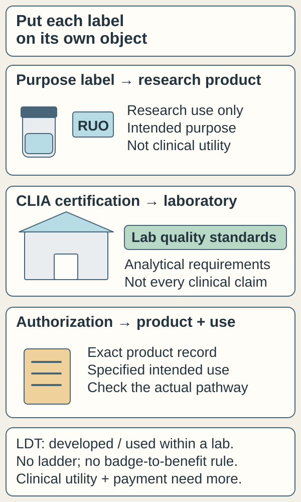
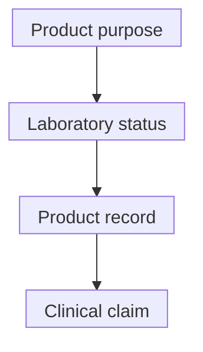

# Research-use, laboratory certification and test authorization

## In one sentence

Research-use labeling, laboratory certification and product authorization answer different questions about a test and do not form one universal ladder of clinical usefulness.

## The intuition

A driver's license, a vehicle inspection and a route map answer different questions. Testing labels likewise describe intended use, laboratory standards or product status.

This is a memory aid. Actual rules depend on the test, jurisdiction and intended use. Ask what each label belongs to.

## How it works

*Ask what the label belongs to: purpose, laboratory or product and use. These objects can have overlapping statuses; a badge alone cannot supply evidence of useful treatment selection or payment.*

**Research use only (RUO)** is an intended-use label on a research product. For an in vitro diagnostic product, it identifies a research purpose, not established clinical diagnostic suitability. The actual intended use and distribution matter; printing RUO does not settle every applicable requirement. A research result may motivate a question without becoming a validated treatment-selection report.

A **laboratory-developed test (LDT)** describes a test developed and used within a laboratory. It describes the test's origin rather than its usefulness. LDT does not mean research-only, and does not mean the Food and Drug Administration (FDA) approved it. A laboratory test can have more than one relevant status; these labels are not sequential stages.

The **Clinical Laboratory Improvement Amendments (CLIA)** program sets laboratory standards for testing human specimens for health assessment, diagnosis, prevention or treatment. Certification concerns laboratory quality, including applicable analytical-performance requirements. It does not establish [clinical validity or clinical utility](/wiki/education/concepts/measurement/computational-analysis/analytical-validity-clinical-validity-and-utility) for every claimed test use.

**FDA authorization** concerns a product and intended use through a specific pathway. Clearance, approval and emergency authorization differ. For an “FDA-approved” claim, request the product record and labeling: specimen, disease, biomarker, purpose and limitations.

For treatment-linked requirements, check the exact [companion diagnostic](/wiki/education/concepts/access-and-regulation/approval/companion-diagnostics) and both labels. A report's drug list alone does not meet a label-defined testing requirement.

| Label or status | What to check | What it does not establish alone |
|---|---|---|
| RUO | Which product or component carries the label? | Clinical diagnostic suitability |
| LDT | Which laboratory developed and performs the test? | FDA approval or demonstrated patient benefit |
| CLIA | Which laboratory and certification scope? | Every clinical claim about its reports |
| FDA-cleared or approved test | Exact product, pathway and intended use | Uses outside the labeling |
| Companion diagnostic | Corresponding treatment and label-defined context | Benefit from any drug sharing a target name |

The dated LDT legal-status note in Sources and scope identifies which historical rule changed. The procedural history does not determine a particular test's evidence, permitted use or every applicable requirement.

*Read these as separate questions. Their order is a reading aid, not ranked tiers or an approval pipeline.*

## Why it matters in cancer

The same company may offer separate research and clinical services. Both reports can look polished. Ask which service produced the result and which decision its evidence supports.

## How status is checked

These categories have no shared biological unit or quality score. A compact status card keeps the objects straight:

| Object | Record |
|---|---|
| Laboratory | Exact site, certificate and testing scope |
| Product/service | Exact version, specimen, research or clinical purpose |
| Authorization | Actual product record and intended use, if applicable |
| Evidence | Analytical performance, clinical claim and studies of the proposed decision |

Keep a check date. The assay defines units and thresholds; a status badge does not. Certification also cannot guarantee payment.

## Worked example

A fictional laboratory has CLIA certification and offers a new research score. Its brochure says the score predicts benefit from Drug A. Certification identifies a laboratory-quality framework. It does not supply the missing study of that particular score, population and treatment.

The reader asks which service produced the result and which study supports choosing Drug A with it in this setting. Research value can remain while that clinical claim is open.

## Try it

The laboratory says, “Our CLIA certificate confirms that this new score chooses the best treatment.” Which part needs more evidence?

**Answer:** The treatment-selection claim. Request studies of the actual score, population, comparator and clinical action. The certificate concerns laboratory standards; it does not replace that evaluation.

## Common confusions

- Laboratory certification belongs to the laboratory; product authorization belongs to the product and intended use.
- LDT and RUO are not interchangeable.
- A regulatory label is not a universal evidence grade.
- “FDA registered” is not the same claim as an approved or cleared test.

## Explain it back

“The certificate belongs to ____. The product label describes ____. Evidence of useful treatment selection requires ____.”

One answer: “the laboratory; intended use; studies of the actual test-guided decision in its clinical context.”

## Takeaway

**Ask what each label applies to before asking what evidence supports the clinical claim.**

## Related concepts

- [The three validity questions](/wiki/education/concepts/measurement/computational-analysis/analytical-validity-clinical-validity-and-utility)
- [Drug labeling and off-label use](/wiki/education/concepts/access-and-regulation/approval/drug-label-and-off-label-use)

## Sources and scope

U.S. regulatory source check: October 10, 2026. Expert and learner review remain pending. Rules can change, so verify a specific test's current status before using it.

**LDT legal-status check, October 10, 2026:** FDA's current notice confirms its May 2024 rule was vacated on March 31, 2025. The September 19, 2025 final rule removed the added laboratory-manufacturer wording from the regulation, restoring prior text. The vacated phaseout schedule is not a current requirement. This procedural history does not decide every test's permitted use or establish validity, utility, payment or patient benefit.

- [FDA: laboratory-developed tests](https://www.fda.gov/medical-devices/in-vitro-diagnostics/laboratory-developed-tests) — current vacatur and regulatory-text update.
- [CMS: Clinical Laboratory Improvement Amendments](https://www.cms.gov/medicare/quality/clinical-laboratory-improvement-amendments) — laboratory-quality program.
- [CMS: LDT and CLIA questions](https://www.cms.gov/regulations-and-guidance/legislation/clia/downloads/ldt-and-clia_faqs.pdf) — 2013 explanation of analytical oversight versus clinical validity; its old FDA-authority/enforcement discussion is not used to state current LDT law.
- [FDA: research-use-only diagnostic-product final guidance, November 2013](https://www.fda.gov/media/87374/download) — selected intended-use and labeling sections checked; not a legal determination for an individual test.
- [September 19, 2025 final rule implementing vacatur](https://www.govinfo.gov/content/pkg/FR-2025-09-19/pdf/2025-18239.pdf) — operative restoration of regulatory text.

<!-- BEGIN GENERATED USED IN -->
## Used in

- [Write the exact claim before judging it](/wiki/education/guides/judging-a-test-or-vendor-claim/01-write-the-exact-claim)
- [Read the validation behind the claim](/wiki/education/guides/judging-a-test-or-vendor-claim/02-read-the-validation)
- [Judge a test or company claim](/wiki/education/guides/judging-a-test-or-vendor-claim/index)
- [Build an integrated claim without skipping the clinical question](/wiki/education/molecular-profiling/07-from-data-to-care-plan)
<!-- END GENERATED USED IN -->
