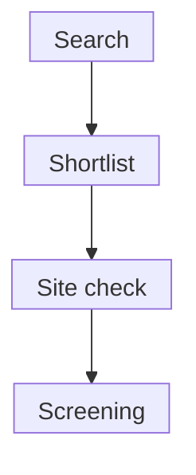

# Finding and checking a clinical trial

## In one sentence

Finding a trial means identifying a study and then confirming its protocol, relevant cohort, site availability and formal eligibility with the study team.

## The intuition

A trial registry is like a directory of possible appointments. It helps you find a study and reach its team. It cannot reserve a place or complete screening.

The analogy breaks because a study is research. Its protocol controls who may join, treatment and follow-up. A useful shortlist therefore keeps two jobs separate: finding plausible studies and checking whether someone can actually participate.

## How it works

Start with the disease and treatment setting, then add intervention, biomarker and location terms. Search sensible synonyms. A target-name search can miss studies filed under a drug name and find studies in unrelated cancers. The **National Cancer Institute (NCI)** and ClinicalTrials.gov offer complementary search routes; a center's list may provide additional leads.

Use the registry identifier to distinguish similar titles. ClinicalTrials.gov numbers begin with **NCT**, the registry's study-identifier prefix, followed by digits. This is a record key, not an approval or eligibility certificate.

Read the protocol summary, study groups, [phase and assignment design](/wiki/education/concepts/evidence-and-statistics/study-design/trial-phases-and-randomization), outcomes and contacts. Record the protocol version when available, registry verification/update dates and search date. A registry record and site answer may be updated at different times.

“Recruiting” describes the study as a whole. For a multisite record, one recruiting facility can make the overall status recruiting. It does not confirm a slot in the relevant cohort at a nearby site. “Active, not recruiting” means follow-up or treatment continues without recruiting or enrolling new participants. Contact the team to check the exact site and cohort.

*These are successive checks, not a promise that a search result will reach enrollment.*

### Check eligibility separately

**Eligibility criteria** are protocol rules defining who may participate. A matching cancer type or molecular feature is only part of the check.

| Check | What to carry into the conversation |
|---|---|
| Disease and setting | Diagnosis, stage, measurable disease or postoperative requirements |
| Prior treatment and time | Treatments received, recovery, protocol-defined washouts and enrollment windows |
| Biomarker | Exact result, assay and specimen; ask whether the study accepts that method |
| Safety and current health | Medical history, medicines and required organ-function or laboratory tests |
| Participation | Visits, sample needs, randomization and practical costs |

This worksheet prepares questions. The study team interprets the current protocol and performs formal screening. Pre-screening is an initial fit discussion; screening reviews history and required tests around the consent process. An invitation to screen is not enrollment. Do not change treatment or medicines to satisfy a guessed rule.

## Why it matters in cancer

The same target can appear in early-disease and advanced-disease trials with very different entry rules. Also, [eligibility is separate from evidence that a treatment helps](/wiki/education/concepts/evidence-and-statistics/reasoning-tools/transportability-and-eligibility). In a randomized study, enrollment may not mean receiving the experimental arm.

## How the search is documented

Keep one row per study: identifier, search terms/date, protocol/cohort, site, recorded status, dated team answer and unresolved questions. Estimated enrollment is a planned participant count, not open slots.

## Common confusions

- Overall recruiting status is not local availability.
- A biomarker match is not complete eligibility.
- Consent does not guarantee successful screening.
- A closed cohort does not by itself qualify someone for [expanded access](/wiki/education/concepts/access-and-regulation/trials-and-access/clinical-trial-vs-expanded-access).

## Try it

A fictional record says “Recruiting.” The nearby hospital says its relevant cohort is closed. The protocol also requires Assay X, while the applicant has Assay Y. What can the shortlist say?

**Answer:** This is a scientific lead with a closed local cohort and an unresolved assay requirement. Record the dated hospital answer. Ask whether another site has availability and whether the study team accepts Assay Y. Neither availability elsewhere nor eligibility has been established.

## Explain it back

“The search found ____, but we still need ____.”

**One possible answer:** “A plausible study; dated cohort/site confirmation and formal eligibility screening.”

## Takeaway

**Keep search results, current availability and formal eligibility as separate checks.**

## Related concepts

- [Investigator-initiated trials](/wiki/education/concepts/access-and-regulation/trials-and-access/investigator-initiated-trials)
- [IND investigation versus marketing review](/wiki/education/concepts/access-and-regulation/trials-and-access/ind-vs-bla)
- [Trial-access worksheet](/wiki/education/guides/accessing-experimental-therapy/02-check-a-real-trial-opportunity)

## Sources and scope

U.S. source check: October 10, 2026. The exercise is fictional. No actual recruitment, screening result or individual eligibility is asserted. Expert and learner review remain pending.

- [NCI: steps to find a clinical trial](https://www.cancer.gov/research/participate/clinical-trials-search/steps) — search preparation, protocol questions and team contact.
- [NCI: what to expect during a clinical trial](https://www.cancer.gov/research/participate/clinical-trials/what-to-expect) — pre-screening, consent and screening.
- [ClinicalTrials.gov: protocol data definitions](https://clinicaltrials.gov/policy/protocol-definitions) — overall/site status, record dates and estimated enrollment.

<!-- BEGIN GENERATED USED IN -->
## Used in

- [Check a real trial opportunity](/wiki/education/guides/accessing-experimental-therapy/02-check-a-real-trial-opportunity)
- [Understand access to an experimental therapy](/wiki/education/guides/accessing-experimental-therapy/index)
<!-- END GENERATED USED IN -->
