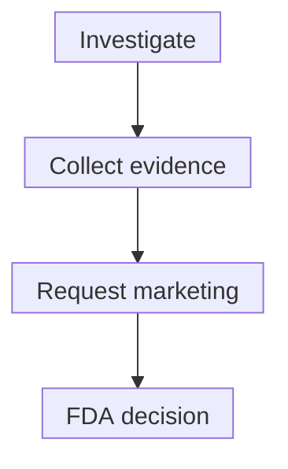

# IND investigation versus BLA marketing review

## In one sentence

An investigational application supports defined human use during research or access, while a marketing application asks for authorization to market a product for a specified use.

## The intuition

Permission to investigate and permission to market are different doors. Passing through the first can let researchers gather evidence for the second. It does not mean the second door will open.

This memory aid is not a universal straight line. Some investigations concern marketed products. Treatment access outside a trial can also use an investigational application.

## How it works

An **Investigational New Drug (IND) application** is a U.S. mechanism supporting specified investigational use of a drug or biologic. It contains relevant nonclinical information, manufacturing information and clinical protocols. The **Food and Drug Administration (FDA)** evaluates whether the proposed investigation can proceed under the applicable framework without unreasonable risk.

An IND becoming effective is **not marketing approval**. A **clinical hold** can prevent or interrupt an investigation. The application number does not establish benefit, enrollment or authorization for every later product version and protocol. The new-IND clock is ordinarily 30 calendar days after FDA receipt, absent a hold, or earlier FDA notification that investigation may begin. [Expanded-access submissions have route-specific rules](/wiki/education/concepts/access-and-regulation/trials-and-access/clinical-trial-vs-expanded-access).

A **Biologics License Application (BLA)** asks for authorization to market an applicable biological product. Its package addresses safety, effectiveness, manufacturing quality and proposed labeling. Examples include vaccines and certain cell or gene therapy products. The actual product determines the regulatory pathway; a broad “biological” description is not enough to classify every product.

A **New Drug Application (NDA)** is another drug marketing application. It is an alternative marketing route, not an earlier milestone every BLA must pass through. Submission, acceptance for filing and an approval decision are separate events.

| Document or milestone | What it tells you | What it does not tell you |
|---|---|---|
| IND in effect | Defined investigation may proceed, subject to applicable requirements | Product is approved for marketing or benefits this person |
| BLA or NDA submitted | Marketing review is being requested | Request was filed for substantive review or approved |
| Approval and current label | Authorized marketing and the approved conditions of use | Every proposed use is supported, suitable or covered |

*This is a simplified development sequence. The arrows represent work and review, not guaranteed advancement or approval.*

Both IND and marketing review address product quality. “They reviewed manufacturing” therefore cannot identify which decision occurred. A changed formulation or manufacturing process needs its applicable assessment; sharing an ingredient or platform name does not automatically transfer authorization.

## Why it matters in cancer

A sponsor may mention an active IND when discussing a proposed therapy. Ask which product, protocol and sponsor it covers. A single-patient IND can support treatment through expanded access without granting a marketing license.

For a marketed product, read the actual decision and [label](/wiki/education/concepts/access-and-regulation/approval/drug-label-and-off-label-use). Approval status, evidence for a different proposed use and feasibility of delivering treatment are separate questions.

## How the status is checked

This is a documentary check with no biological unit. Record the application type, sponsor, product/use, decision date and current limitations. A submitted dossier or application number alone is insufficient. An IND is not a public catalogue guaranteeing product availability; the responsible sponsor and clinical team confirm the applicable protocol and permissions.

## Common confusions

- “IND allowed to proceed” is not “FDA-approved product.”
- “BLA filed” is not “BLA approved.”
- [Off-label use](/wiki/education/concepts/access-and-regulation/approval/drug-label-and-off-label-use) concerns an approved product, whereas a never-approved product needs an investigational route.
- An expedited designation and a [marketing approval pathway](/wiki/education/concepts/access-and-regulation/approval/fda-approval-types) answer different questions.

## Try it

A fictional sponsor says, “Our IND may proceed. We plan to submit a BLA next year, so the biologic is approved.” Which parts can the reader retain?

**Answer:** Retain the stated investigational milestone and planned marketing request as separate attributed facts. Neither is an issued marketing approval. Ask for the actual approval decision and label before calling the product approved, and verify the exact protocol before assuming a particular use is permitted.

## Explain it back

“An IND asks about ____, while a BLA asks about ____.”

**One possible answer:** “Defined investigational use; authorization to market an applicable biological product.”

## Takeaway

**Investigational permission, a marketing request and marketing approval are different milestones.**

## Related concepts

- [Investigator-initiated trials](/wiki/education/concepts/access-and-regulation/trials-and-access/investigator-initiated-trials)
- [Manufacturing comparability](/wiki/education/concepts/engineering-and-manufacturing/cmc-and-quality/manufacturing-comparability)

## Sources and scope

U.S. source check: October 10, 2026. Fictional exercise. No individual application status or authorization is asserted. Expert and learner review pending.

- [FDA: Investigational New Drug application](https://www.fda.gov/drugs/types-applications/investigational-new-drug-application-ind) — contents and calendar-day clock.
- [21 CFR 312.40](https://www.ecfr.gov/current/title-21/chapter-I/subchapter-D/part-312/subpart-C/section-312.40) — IND becoming effective, earlier notification and holds.
- [FDA: BLA process for CBER-regulated products](https://www.fda.gov/vaccines-blood-biologics/development-approval-process-cber/biologics-license-applications-blas-cber-regulated-products) — biologic marketing and quality review; CBER is the Center for Biologics Evaluation and Research.
- [FDA: New Drug Application](https://www.fda.gov/drugs/types-applications/new-drug-application-nda) — drug marketing, labeling and manufacturing review.

<!-- BEGIN GENERATED USED IN -->
## Used in

- [Name the access route](/wiki/education/guides/accessing-experimental-therapy/01-name-the-access-route)
- [Build the readiness picture](/wiki/education/guides/accessing-experimental-therapy/03-build-the-readiness-picture)
- [Understand access to an experimental therapy](/wiki/education/guides/accessing-experimental-therapy/index)
<!-- END GENERATED USED IN -->
