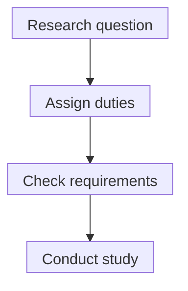

# Investigator-initiated trials

## In one sentence

An investigator-initiated trial starts with a researcher's study proposal, while sponsor responsibilities, product oversight and participant protections still depend on the actual protocol and regulatory arrangement.

## The intuition

Think of a teacher proposing a classroom study. Starting the idea does not tell you who funds it, approves it or runs every part. Similarly, an investigator can originate a clinical question without personally holding every responsibility.

The analogy stops at oversight. Clinical research has formal safety duties and records. A familiar academic setting does not remove them.

## How it works

**Investigator-initiated trial (IIT)** describes a study's origin. It is not a separate [trial phase](/wiki/education/concepts/evidence-and-statistics/study-design/trial-phases-and-randomization), an efficacy grade or a general exemption from drug regulation. Its protocol specifies the question, participants, interventions, measurements and follow-up.

A **sponsor** initiates and takes responsibility for the clinical investigation. An **investigator** conducts it and directs investigational treatment at the site. A **sponsor-investigator** is an individual who both initiates and conducts the investigation and has both sets of duties. An academic institution can sponsor an IIT; do not infer the sponsor from the brochure's title.

| Role | Question to verify |
|---|---|
| Sponsor | Who holds overall study responsibility and any required application? |
| Investigator | Who conducts the protocol and directs treatment at this site? |
| Product supplier | Who provides product and supporting information? |
| Funder | Who pays for which study activities? |

One organization or individual may perform several roles. Manufacturer funding or donated drug does not by itself identify the regulatory sponsor. The protocol and agreements settle that question.

*The map orders planning questions. It does not imply that an academic proposal is authorized to proceed.*

For U.S. drug and biologic research, the team determines whether an [Investigational New Drug (IND) application](/wiki/education/concepts/access-and-regulation/trials-and-access/ind-vs-bla) is required. Certain studies of lawfully marketed drugs can be exempt only when **all applicable conditions** are met. These include the study's labeling/advertising intent, whether route, dose or population significantly changes risk, and compliance with review, consent and investigational-promotion rules. Neither approved-drug status nor academic origin alone establishes exemption.

An **institutional review board (IRB)** reviews participant protections under the applicable framework. Informed consent addresses known risks, uncertainty, alternatives and participation. An IND exemption does not mean exemption from the IRB and consent conditions required for that route.

## Why it matters in cancer

Investigators can ask about combinations, biomarkers or disease settings overlooked by larger development programs. Their question can be valuable while the answer remains unknown.

Read the design, comparison group, [endpoint](/wiki/education/concepts/evidence-and-statistics/endpoints/response-rates) and conduct directly. A small academic trial is not automatically either independent, poorly controlled or effective. Funding, conflicts, manufacturing and monitoring need their own assessment.

## How responsibilities are checked

This is a documentary category without a biological unit. Record the sponsor, responsible investigator, protocol/version, registry identifier, IND or documented exemption rationale, applicable review, supply and reporting arrangements. Confirm site/cohort availability through the [trial-search process](/wiki/education/concepts/access-and-regulation/trials-and-access/finding-a-trial).

## Common confusions

- Originating an idea is not the same as holding the IND.
- Providing drug is not the same as sponsoring the study.
- A marketed drug does not automatically make a proposed study IND-exempt.
- One participant does not convert research into [expanded access](/wiki/education/concepts/access-and-regulation/trials-and-access/clinical-trial-vs-expanded-access). Purpose and arrangement matter.

## Try it

A fictional university proposes an IIT using a marketed drug by a new route. The manufacturer will supply it. The protocol team says the route significantly increases risk. Is the study automatically IND-exempt, and is the manufacturer the sponsor?

**Answer:** Neither conclusion follows. A significantly risk-increasing route fails one marketed-drug exemption condition, so that exemption cannot be assumed. The team must determine the required regulatory arrangement. Supply also does not establish sponsorship; verify who accepts the sponsor duties and holds any required IND.

## Explain it back

“Investigator initiated tells me ____. To understand responsibility, I still need ____.”

**One possible answer:** “Who originated the question; the actual sponsor, investigator, supplier and applicable regulatory route.”

## Takeaway

**Study origin, funding, supply and regulatory responsibility are separate facts.**

## Related concepts

- [Trial phases and randomization](/wiki/education/concepts/evidence-and-statistics/study-design/trial-phases-and-randomization)
- [Good manufacturing practice and batch release](/wiki/education/concepts/engineering-and-manufacturing/cmc-and-quality/gmp-and-batch-release)

## Sources and scope

U.S. source check: October 10, 2026. Fictional exercise. This page explains roles; it does not determine any actual protocol's exemption, approval or site readiness. Expert and learner review pending.

- [21 CFR 312.3](https://www.ecfr.gov/current/title-21/chapter-I/subchapter-D/part-312/subpart-A/section-312.3) — sponsor, investigator and sponsor-investigator definitions.
- [21 CFR 312.2](https://www.ecfr.gov/current/title-21/chapter-I/subchapter-D/part-312/subpart-A/section-312.2) — applicability and marketed-drug exemption conditions.
- [FDA: exemptions from IND requirements](https://www.fda.gov/drugs/investigational-new-drug-application-ind/ind-application-procedures-exemptions-ind-requirements) — how to assess a proposed investigation, including limits of educational decision tools.

<!-- BEGIN GENERATED USED IN -->
## Used in

- [Check a real trial opportunity](/wiki/education/guides/accessing-experimental-therapy/02-check-a-real-trial-opportunity)
- [Build the readiness picture](/wiki/education/guides/accessing-experimental-therapy/03-build-the-readiness-picture)
- [Understand access to an experimental therapy](/wiki/education/guides/accessing-experimental-therapy/index)
<!-- END GENERATED USED IN -->
