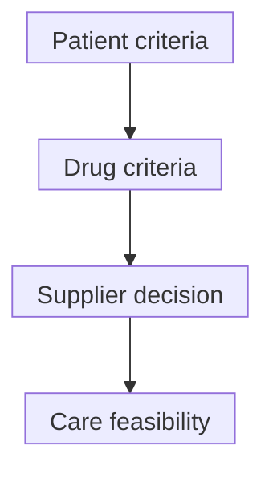

# Federal right to try

## In one sentence

Federal Right to Try is a U.S. route to request eligible investigational drugs without individual Food and Drug Administration (FDA) review, but it guarantees neither supply nor benefit.

## The intuition

Think of a pathway with two eligibility cards: one for the patient and one for the drug. Both must fit. Even then, the pathway is permission to consider a request, not a promise that a company will provide treatment.

The analogy stops at clinical judgment. The cards do not calculate whether the treatment is a good choice or how to deliver it safely.

## How it works

The federal Right to Try Act provides a route distinct from [clinical trials and expanded access](/wiki/education/concepts/access-and-regulation/trials-and-access/clinical-trial-vs-expanded-access). It concerns certain investigational drugs, including eligible biologics. It is not ordinary prescribing of an approved drug [outside its label](/wiki/education/concepts/access-and-regulation/approval/drug-label-and-off-label-use).

### The patient criteria

Under the federal pathway, the patient must have a life-threatening disease or condition. They must have exhausted approved treatment options and be unable to participate in a clinical trial involving the eligible drug. A physician certifies these latter conditions, must be in good standing with the licensing organization or board, and cannot be compensated directly by the manufacturer for that certification. The patient or legally authorized representative provides written informed consent to the treating physician.

These are specific criteria. “The disease is serious” or “the nearest trial is inconvenient” cannot replace a complete assessment.

### The drug criteria

The eligible investigational drug must meet all of these requirements:

- A [phase 1 clinical trial](/wiki/education/concepts/evidence-and-statistics/study-design/trial-phases-and-randomization) has been completed.
- It has not been approved or licensed by the **Food and Drug Administration (FDA)** for any use.
- A marketing application has been filed, **or** it is being investigated in a trial intended to provide the primary effectiveness evidence for approval and covered by an active [Investigational New Drug (IND) application](/wiki/education/concepts/access-and-regulation/trials-and-access/ind-vs-bla).
- Active development or production is ongoing, not discontinued by the manufacturer, and the drug is not on FDA clinical hold.

The marketing-application option and qualifying-trial option are alternatives within one requirement. Merely having an IND number or completing a small safety study is not the whole eligibility test. The sponsor is the appropriate source for the product's status.

*Each box is a separate check. The arrows do not promise access, a start date or a treatment response.*

### Review and practical responsibility

FDA does not review or approve individual federal Right to Try requests. Those requests also do not require **institutional review board (IRB)** review under the federal pathway. Written informed consent is still required. Manufacturers or sponsors have annual reporting responsibilities, including serious adverse events; “no individual FDA review” does not mean no remaining responsibilities.

A supplier is not required to provide the drug. The treating team still needs to assess risks, alternatives, administration and monitoring. The absence of individual FDA/IRB request review does not establish what a particular institution can deliver. Nor does this page determine state-law requirements, reimbursement or access outside the United States. Those questions require their own applicable rules and confirmations.

## Why it matters in cancer

Phase 1 completion does not demonstrate benefit in every cancer or treatment setting. These products remain investigational. A legal access route cannot supply missing efficacy evidence, assure product quality for every formulation, or guarantee insurance payment.

## How the route is checked

Document both eligibility assessments, physician certification, written consent, exact product/development status, supplier willingness and the proposed clinical service. Mark unresolved items as unknown. Compare with the separate expanded-access route rather than using the names interchangeably.

## Common confusions

- Federal Right to Try is not the same as a state law with a similar name.
- A completed phase 1 trial is not FDA marketing approval.
- Eligible patient plus eligible drug does not compel supply.
- A personalized product does not automatically inherit another product's development history.

## Try it

A fictional patient meets the patient criteria. Drug A completed phase 1, but the manufacturer discontinued its development and production. Is Drug A eligible through the described federal pathway? What if it were eligible but the supplier declined?

**Answer:** Discontinued development/production fails a drug criterion, so patient eligibility alone cannot establish this route. If both were eligible, the supplier would still not be required to provide Drug A. Neither scenario establishes benefit.

## Explain it back

“Right to Try requires ____ and ____, and it still does not guarantee ____.”

**One possible answer:** “An eligible patient and eligible drug; supply, clinical feasibility or benefit.”

## Takeaway

**Federal Right to Try changes the individual-request pathway, not the uncertainty of an investigational treatment.**

## Related concepts

- [Finding and checking a trial](/wiki/education/concepts/access-and-regulation/trials-and-access/finding-a-trial)
- [IND investigation versus marketing review](/wiki/education/concepts/access-and-regulation/trials-and-access/ind-vs-bla)

## Sources and scope

Federal U.S. source check: October 10, 2026. The example is fictional. State laws, institutional acceptance and individual eligibility are not determined here. Expert and learner review pending.

- [FDA: Right to Try](https://www.fda.gov/patients/learn-about-expanded-access-and-other-treatment-options/right-try) — current patient/product criteria, FDA/IRB request rules, consent, reporting and supply limits.
- [21 U.S.C. 360bbb–0a, official 2024 U.S. Code edition](https://www.govinfo.gov/content/pkg/USCODE-2024-title21/pdf/USCODE-2024-title21-chap9-subchapV-partE-sec360bbb-0a.pdf) — statutory criteria and reporting; read with current FDA guidance.
- [FDA: Right to Try fact sheet](https://www.fda.gov/media/133864/download) — request process and remaining safety/effectiveness uncertainty.

<!-- BEGIN GENERATED USED IN -->
## Used in

- [Name the access route](/wiki/education/guides/accessing-experimental-therapy/01-name-the-access-route)
- [Understand access to an experimental therapy](/wiki/education/guides/accessing-experimental-therapy/index)
<!-- END GENERATED USED IN -->
