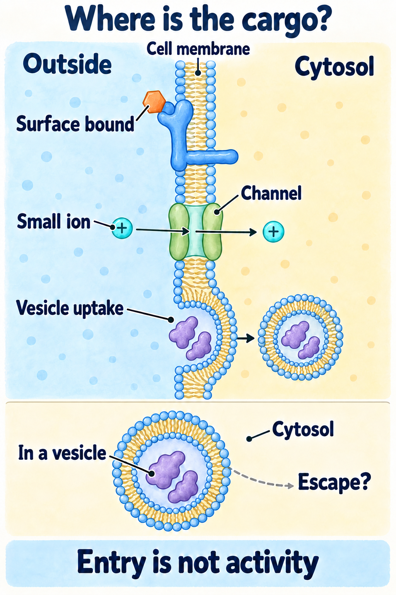
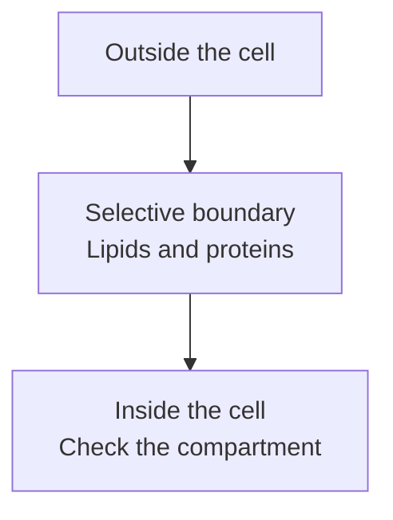

# The cell and its membrane

## In one sentence

A cell is a living unit enclosed by a membrane that separates its contents from its surroundings and controls exchange.

## The intuition

Picture a home with walls, doors and doorbells. Its boundary keeps an inside distinct from an outside while allowing supplies and messages through. A cell's membrane does similar jobs. The comparison stops at the building: a membrane is a flexible molecular layer, and movement follows chemistry rather than a doorman's decisions.

## How it works

Human tissues contain cells with different shapes and jobs. Inside a cell, **cytosol** is the fluid in which many reactions occur. **Cytoplasm** includes that fluid and structures outside the nucleus. [Organelles](/wiki/education/concepts/biology-basics/cells/organelles-overview) organize particular tasks. A tissue also contains material between cells; that material is not another part of every cell's interior.

The **plasma membrane**, or cell membrane, forms the outer boundary. Its main framework is a **lipid bilayer**: two layers of lipid molecules whose water-avoiding portions face inward. Embedded proteins provide transport, attachment and signaling functions. Human cells have this membrane without the rigid cell wall found in plants.

**Selective permeability** means that substances cross with different ease. Small uncharged molecules such as oxygen can cross the lipid layer. Charged ions and many larger or water-soluble molecules require other routes. Size alone does not determine access; charge, chemical properties and available transport proteins matter.

*Surface attachment, channel passage and vesicle uptake put molecules in different places. The illustrative small-ion route follows a favorable electrochemical gradient. Cargo enclosed by a vesicle remains separate from cytosol; the dashed question does not show escape. Shapes and counts are schematic, and entry alone does not establish activity or benefit.*

| Route | What makes it different |
|---|---|
| Passive transport | Net movement follows a favorable gradient, directly through lipids or through a channel or carrier |
| Active transport | Energy drives movement against a gradient; a pump may use energy directly or exploit another gradient |
| Vesicle transport | Membrane encloses cargo for uptake, or fuses to release cargo; the cargo does not simply pass through the lipid layer |

A **gradient** is a difference across space. For an ion, both concentration and electrical charge influence its movement. A carrier protein can support passive or active transport depending on its mechanism; “uses a protein” does not mean “uses energy directly.”

*Crossing a boundary and reaching the right internal compartment are separate questions. Vesicle uptake can leave cargo enclosed in a membrane compartment.*

## Why it matters in cancer

Some treatments recognize a surface protein; others need an intracellular target. [A ligand and receptor](/wiki/education/concepts/biology-basics/signaling/ligand-and-receptor) can bind at the surface and send a signal without the ligand entering the cytosol. Surface attachment therefore does not establish delivery to an internal target.

The same membrane feature may occur on normal cells. Neither visible binding nor entry alone proves cancer selectivity or useful treatment activity.

## How it is measured

Microscopy can locate a labeled molecule. [Flow cytometry](/wiki/education/concepts/measurement/immune-monitoring/flow-cytometry) can measure cell-associated fluorescence under a defined staining method. Controls must distinguish surface attachment from internal signal, exclude damaged cells and account for background.

A dye-exclusion test asks whether the membrane excludes that dye under those conditions. It does not prove that every cellular function is healthy. Likewise, total cell-associated signal does not identify how much cargo reached the cytosol or acted on its target.

## Common confusions

- **Membrane versus wall:** human cells have a flexible membrane, not a plant-like cell wall.
- **Binding versus entry:** a molecule can attach without crossing.
- **Entry versus delivery:** cargo inside a vesicle may not reach an intracellular target.
- **Transport protein versus active transport:** some channels and carriers support passive movement.

## Try it

A fictional experiment labels an antibody and finds bright cells. The researcher calls this proof that the antibody reached the nucleus. What is missing?

**Answer:** Brightness shows association under that assay. Location controls must distinguish surface binding, vesicle uptake and nuclear localization. Target activity needs its own measurement.

## Explain it back

“A membrane separates ___ from ___; crossing it depends on ___.”

**One possible answer:** “The cell's interior; its surroundings; the molecule's properties and the available transport route.”

## Takeaway

**Ask where a molecule is and how it got there before calling cell association successful delivery.**

## Related concepts

- [Organelles overview](/wiki/education/concepts/biology-basics/cells/organelles-overview)
- [Epithelium and stroma](/wiki/education/concepts/biology-basics/cells/epithelium-and-stroma)

## Sources

Source-checked October 9, 2026; expert and learner review pending. The experiment is fictional. This is general cell biology, not a delivery-performance claim.

- [NCI SEER: cell structure](https://training.seer.cancer.gov/anatomy/cells_tissues_membranes/cells/structure.html) — cell boundary and internal structures.
- [Cooper, *The Cell*, chapter 12: the cell surface](https://www.ncbi.nlm.nih.gov/books/NBK9873/) — membrane structure and exchange.
- [Cooper: transport of small molecules](https://www.ncbi.nlm.nih.gov/books/NBK9847/) — permeability, channels, carriers and gradients.
- [OpenStax, *Biology 2e*, active transport](https://openstax.org/books/biology-2e/pages/5-3-active-transport) — direct and gradient-coupled energy use.
- [OpenStax: bulk transport](https://openstax.org/books/biology-2e/pages/5-4-bulk-transport) — uptake and release using membrane compartments.

<!-- BEGIN GENERATED USED IN -->
## Used in

Browse the [concept index](/wiki/education/concepts/index) for related learning paths.
<!-- END GENERATED USED IN -->
