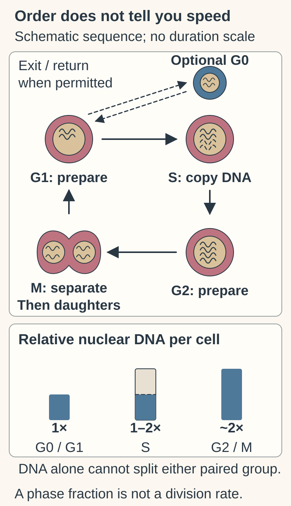
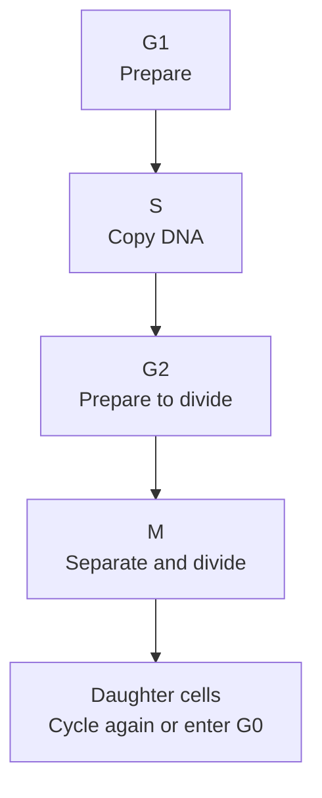

# The cell cycle: preparing, copying and dividing

## In one sentence

The cell cycle is a regulated sequence in which a cell prepares, copies its genetic material and divides; some cells remain outside that sequence.

## The intuition

Imagine preparing a shared document, making a complete copy and distributing the copies to two new desks. Checks help prevent an unfinished copy being handed out. Cells also coordinate preparation, copying and separation. The analogy is a sequence, not a clock: the duration varies with cell type, conditions and damage.

## How it works

DNA (deoxyribonucleic acid) glyphs show relative nuclear material, not a human chromosome count or microscopy image. G0 is an optional noncycling condition; return depends on context. The separate per-cell key applies before cell separation: G0/G1 share a baseline, S lies between baseline and roughly double, and G2/M share roughly double. Neither the drawing’s spacing nor a measured phase fraction is a division rate.

Begin with [organelles](/wiki/education/concepts/biology-basics/cells/organelles-overview), including the nucleus. In a typical dividing human cell, **DNA (deoxyribonucleic acid)** must be copied before its packages, called chromosomes, separate into daughter nuclei.

| Phase | Main task |
|---|---|
| G1, first gap | Growth and preparation before copying DNA |
| S, synthesis | Replication of nuclear DNA |
| G2, second gap | Preparation after replication and before nuclear division |
| M, mitotic phase | Chromosome separation, usually followed by division of the cell |
| G0, outside active cycling | A noncycling condition; cells can still perform important metabolic and tissue functions |

**Mitosis** separates chromosomes into daughter nuclei. **Cytokinesis** divides the cell's contents. They are coordinated but distinct processes; abnormal or specialized cells may complete nuclear division without splitting into two cells.

G0 is not a mandatory extra step between every round. Some cells can return from a noncycling state when conditions permit. Others are stably specialized. A paused cell, a senescent cell with a durable arrest, and a dead cell are not interchangeable categories.

**Checkpoints** are control responses that can delay progression when conditions are unsuitable. These include responses to damaged or incompletely copied DNA and to chromosomes that are not properly attached for separation. They do not guarantee error-free division. [Cyclin-dependent kinases (CDKs)](/wiki/education/concepts/therapeutics/targeted-small-molecules/cdk-inhibitors) and their partner proteins help regulate transitions; different CDKs have different roles.

*A simplified sequence. G0 is optional, and some noncycling cells can re-enter G1. Checkpoint responses can pause progression; equal-sized boxes do not imply equal durations.*

## Why it matters in cancer

Cancer can involve disrupted controls over division. That does not mean every cancer cell is dividing at every moment or that all tumors use an identical schedule. Population growth reflects both production and loss of cells, as well as the sampled setting.

[Cell division and chemotherapy](/wiki/education/concepts/biology-basics/cells/cell-division-and-why-chemo-hits-dividing-cells) explain why copying and separation can create vulnerabilities. Arresting the cycle is an observed effect, not automatic proof of cell death or durable cancer control.

## How it is measured

[Flow cytometry](/wiki/education/concepts/measurement/immune-monitoring/flow-cytometry) can measure DNA-associated fluorescence. In a suitable population, pre-replication cells have one baseline amount; post-replication cells have roughly twice that amount. DNA content alone usually groups G0 with G1 and G2 with M. Extra markers help distinguish them. Cell clumps, dead material and abnormal chromosome content can distort the pattern.

[Ki-67](/wiki/education/concepts/breast-cancer/grade-and-stage/ki-67) identifies a measured fraction of actively cycling cells under a specified scoring method. A short labeling experiment can measure DNA synthesis during a defined window. Neither percentage is, by itself, a division rate or tumor doubling time. Repeated observations or live tracking help establish dynamics.

## Common confusions

- **S phase versus M phase:** copying DNA precedes chromosome separation.
- **G0 versus dead:** noncycling cells can remain functional.
- **Phase fraction versus speed:** more cells in a phase may reflect entry, delayed exit or both.
- **Arrest versus killing:** cells can pause and later resume.

## Try it

A fictional culture has more cells with doubled DNA content after a drug exposure. Has the drug made the cells divide faster?

**Answer:** Not necessarily. Cells may be delayed in G2 or M. Check the phase markers, exclude clumps, count viable cells and follow divisions over time.

## Explain it back

“S phase copies ___; a phase percentage tells us ___ rather than ___.”

**One possible answer:** “DNA; where sampled cells were at that moment; how quickly they completed divisions.”

## Takeaway

**Use phase measurements to locate cells in a process, then use time and outcome measurements to learn what happened.**

## Related concepts

- [Cell division and chemotherapy](/wiki/education/concepts/biology-basics/cells/cell-division-and-why-chemo-hits-dividing-cells)
- [Ki-67 proliferation index](/wiki/education/concepts/breast-cancer/grade-and-stage/ki-67)

## Sources

Source-checked October 9, 2026; expert and learner review pending. The exercise is fictional. The map describes typical mammalian cycling, not a universal timetable.

- [OpenStax, *Biology 2e*, the cell cycle](https://openstax.org/books/biology-2e/pages/10-2-the-cell-cycle) — phases, mitosis and cytokinesis.
- [OpenStax: control of the cell cycle](https://openstax.org/books/biology-2e/pages/10-3-control-of-the-cell-cycle) — checkpoints and regulation.
- [Cooper, *The Cell*: the eukaryotic cell cycle](https://www.ncbi.nlm.nih.gov/books/NBK9876/) — growth conditions and noncycling states.
- [Kim and Sederstrom, 2015: assaying cell-cycle status](https://pubmed.ncbi.nlm.nih.gov/26131851/) — combined markers distinguish status from proliferation measurements.
- [Wersto and colleagues, 2001: doublet discrimination](https://pubmed.ncbi.nlm.nih.gov/11746105/) — two cells can mimic one cell with doubled DNA.

<!-- BEGIN GENERATED USED IN -->
## Used in

- [Why a T-cell count does not tell the whole story](/wiki/education/oncology-101/3-t-cell-states)
<!-- END GENERATED USED IN -->
