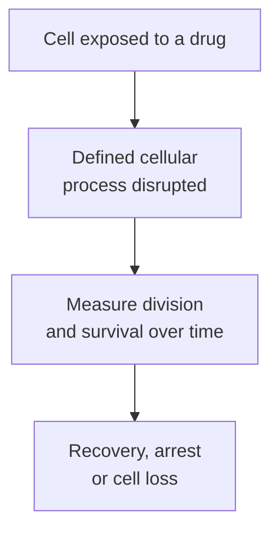
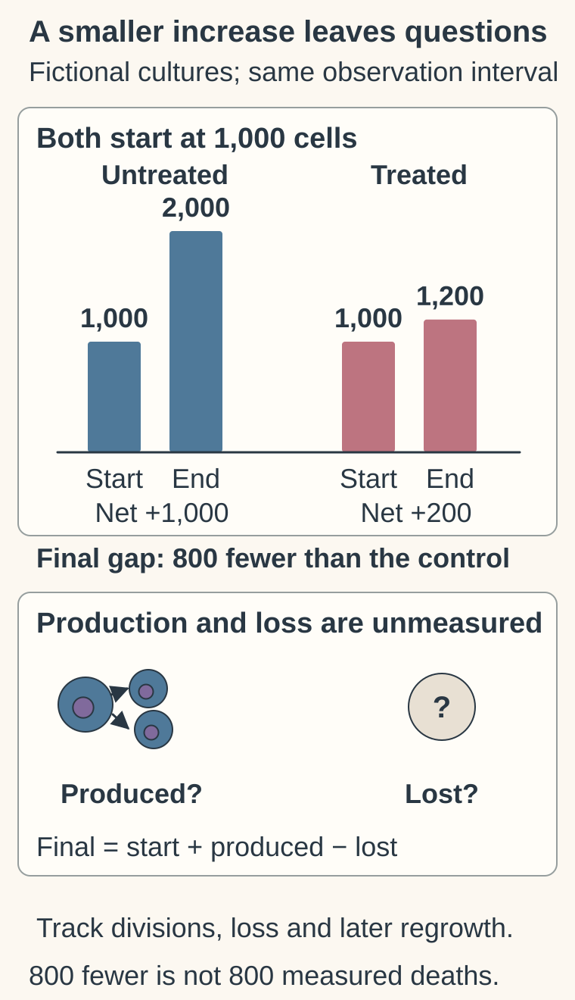

# Cell division and why chemotherapy can disrupt it

## In one sentence

Cell division produces daughter cells by copying and separating cellular material; chemotherapy can disrupt these tasks without affecting only dividing cells.

## The intuition

Imagine making two functioning workshops from one. You must copy the instructions, distribute equipment and finish the separation. Interrupting those jobs can make expansion difficult. That helps explain one chemotherapy vulnerability. The analogy has a boundary: the same machinery can have other jobs, and a drug does not recognize a cell as cancerous simply because it is busy.

## How it works

[The cell cycle](/wiki/education/concepts/biology-basics/cells/cell-cycle) places DNA copying before division. **DNA (deoxyribonucleic acid)** carries genetic information. **Mitosis** separates the copied chromosomes into daughter nuclei. **Cytokinesis** separates the cell's contents, usually completing the formation of two daughter cells.

Producing cells is part of normal tissue maintenance. Blood-forming cells, the intestinal lining and growing hair follicles contain renewing populations. Repeated copying and division can make these populations vulnerable to some of the same drugs used against cancer.

[Cytotoxic chemotherapy](/wiki/education/concepts/therapeutics/chemotherapy/chemotherapy) includes several mechanisms. [Platinum agents](/wiki/education/concepts/therapeutics/chemotherapy/platinum-agents) attach to DNA and can obstruct its use and copying. [Taxanes](/wiki/education/concepts/therapeutics/chemotherapy/taxanes) stabilize microtubules, the changing protein structures that help organize chromosome separation. These are different molecular actions, even when both interfere with successful cell production.

Drugs vary in how their effects relate to cell-cycle phase, concentration and exposure time. A phase label is not a complete treatment rule. Uptake, repair, damage tolerance and cell-death responses also matter. A cell can pause, recover, divide abnormally or die after an exposure.

Crucially, **nondividing does not mean protected from every chemotherapy effect**. Microtubules also serve functions outside mitosis. Paclitaxel's prescribing information describes interference with both interphase and mitotic functions. In a primary experiment using adult mouse sensory-neuron cultures, paclitaxel altered distal axon growth. That model illustrates vulnerability outside cell division; it does not establish every mechanism of nerve toxicity in people.

*The outcome must be measured. The map does not say that every exposed cell dies.*

## Why it matters in cancer

“Cancer grows quickly” is a starting explanation, not a universal description. Cancer cells within one tumor can occupy different states. [Tumor heterogeneity](/wiki/education/concepts/cancer-biology/what-cancer-is/tumor-heterogeneity), exposure and resistance can affect the result.

A proliferation marker alone does not choose a chemotherapy drug or predict its benefit. Side effects also do not measure how well a tumor is responding. Cancer control and normal-tissue harm require separate evidence for the treatment and setting.

## How it is measured

Live imaging can follow completed divisions. Cell counts track population size over a specified interval. Death assays and regrowth experiments ask whether cells were lost and whether survivors can resume growth. Cell number reflects the balance of production and loss; a smaller increase than the control is not automatically proof of killing.

Document the cell population, concentration, exposure duration, untreated comparison and follow-up. A cell-cycle snapshot or a short metabolic assay cannot substitute for all of these outcomes. Laboratory effects also cannot establish a safe clinical exposure or patient benefit.

## Common confusions

- **Cell growth versus division:** becoming larger is different from producing daughter cells.
- **Arrest versus death:** a cell may stop cycling and later resume.
- **Dividing versus cancerous:** healthy tissues also renew through division.
- **Chemotherapy versus one mechanism:** drug classes disrupt different processes.
- **Nondividing versus invulnerable:** some drug effects involve functions outside division.

## Try it

Both fictional cultures start at 1,000 cells, with final counts of 2,000 untreated and 1,200 treated. The bars show endpoints, not an observed growth trajectory. The final 800-cell difference leaves production and loss unresolved; the icons ask about those processes rather than record events. The nondividing-cell vulnerability discussed above remains a separate point.

A fictional culture starts with 1,000 cells. After treatment it contains 1,200; the untreated culture contains 2,000. Has treatment proved that 800 cells were killed?

**Answer:** No. The difference could involve reduced production, increased loss or both. Track division and death over time, then test whether surviving cells regrow.

## Explain it back

“Chemotherapy can interfere with ___, but division status alone does not establish ___.”

**One possible answer:** “Tasks needed to make daughter cells; drug sensitivity or clinical benefit.”

## Takeaway

**Connect the drug to its mechanism, then distinguish slower cell production from cell loss and durable control.**

## Related concepts

- [Chemotherapy](/wiki/education/concepts/therapeutics/chemotherapy/chemotherapy)
- [Ki-67 proliferation index](/wiki/education/concepts/breast-cancer/grade-and-stage/ki-67)
- [Therapeutic index](/wiki/education/concepts/therapeutics/how-drugs-work/therapeutic-index)

## Sources

Source-checked October 9, 2026; expert and learner review pending. The exercise is fictional. The neuronal experiment retains its mouse-culture scope; no drug or schedule is selected here.

- [NCI: chemotherapy to treat cancer](https://www.cancer.gov/about-cancer/treatment/types/chemotherapy) — renewing normal tissues and treatment effects.
- [NCI Drug Dictionary: carboplatin](https://www.cancer.gov/publications/dictionaries/cancer-drug/def/carboplatin) — platinum–DNA attachments and cross-links.
- [Albumin-bound paclitaxel prescribing information, version 5](https://dailymed.nlm.nih.gov/dailymed/lookup.cfm?setid=15ca4829-8fee-45f9-b4bc-b31c15732cd6&version=5) — section 12.1: microtubule functions in interphase and mitosis.
- [Gornstein and Schwarz, 2017](https://pubmed.ncbi.nlm.nih.gov/27894788/) — primary adult mouse sensory-neuron experiment; local axon effects, not a universal clinical toxicity model.

<!-- BEGIN GENERATED USED IN -->
## Used in

Browse the [concept index](/wiki/education/concepts/index) for related learning paths.
<!-- END GENERATED USED IN -->
