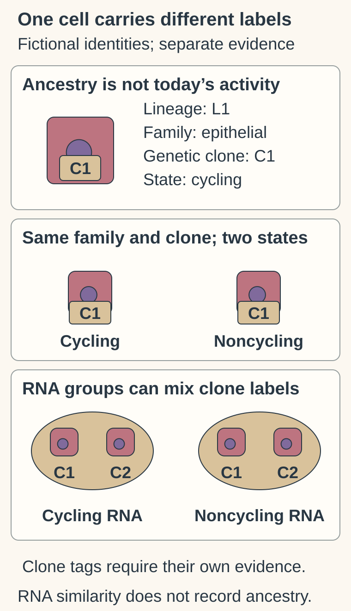
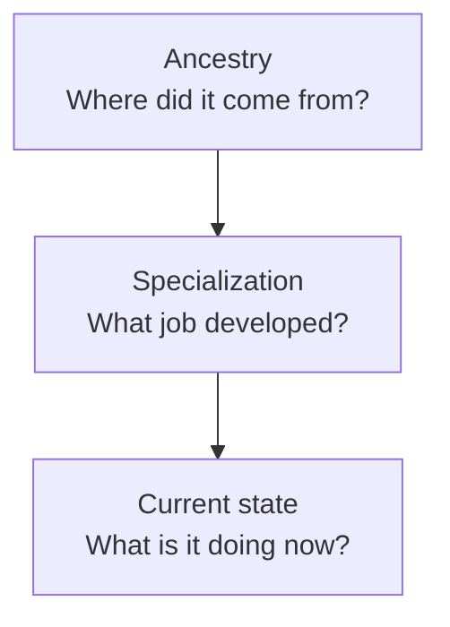

# Cell lineage and differentiation

## In one sentence

Cell lineage describes developmental ancestry, while differentiation is the process through which cells acquire specialized features and functions.

## The intuition

Your family tree, your training and what you are doing this afternoon tell different stories. Cells also have ancestry, specialized roles and current activities. The comparison is useful for separating those questions. It has limits: cells do not choose careers, and their roles are shaped by molecular regulation and their surroundings.

## How it works

The cell labels are stipulated independently in this fictional example, rather than inferred from appearance or RNA (ribonucleic acid). L1 denotes an ancestry label, epithelial a broad family, C1 a genetic tumor-clone label, and cycling a state. One family/clone contains different states, while state-based RNA groups can contain different clone labels. No snapshot establishes ancestry, malignancy or permanent commitment.

**Read the clone labels:** Does putting C1 cells in two RNA-state groups create two genetic clones?

**Answer:** No. The stipulated clone identity stays C1. The RNA grouping describes measured similarity or state, not a new ancestry or genetic relationship.

During development and tissue renewal, cells produce descendants. **Lineage** refers to those ancestry relationships. In sample descriptions, a “lineage” label may instead name a broad family, such as epithelial or immune cells. That classification is useful, but it does not reconstruct an individual cell's family tree.

**Differentiation** involves acquiring specialized features: the structures, molecular programs and functions that support a particular job. A blood-forming stem cell can produce descendants that become distinct blood-cell types. **Stem cells** can renew themselves and generate other cells within a defined biological context. **Progenitor cells** are descendants with more restricted developmental potential. These words do not imply that every stem or progenitor can produce any tissue.

[Gene expression](/wiki/education/concepts/biology-basics/genetics/central-dogma), meaning the production of **RNA (ribonucleic acid)** or protein from genetic information, helps build specialized functions. Cells can use different parts of similar inherited **DNA (deoxyribonucleic acid)** information. This does not mean every cell has identical DNA: acquired changes and specialized rearrangements can also exist.

**Identity** is an evidence-based description of what kind of cell it is. **State** describes its current program or activity, such as cycling, responding to stress or secreting signals. A cell can change state while remaining in the same broad cell family. Some changes are reversible; others persist. Neither reversibility nor permanent commitment follows from a single measurement.

*Three connected questions, not a claim that a present-day marker reveals every earlier step.*

## Why it matters in cancer

Cancer can change differentiation and activity programs. Describing an RNA pattern as “progenitor-like” means it resembles a reference program under that analysis. It does not prove the tumor came from that exact progenitor or that the measured cell functions as a stem cell.

[Epithelium and stroma](/wiki/education/concepts/biology-basics/cells/epithelium-and-stroma) identify tissue compartments, not a malignancy test. An epithelial marker can occur in normal or cancerous cells. A marker shared with another cell family may reflect a changed state or a mixture of cells.

Developmental lineage also differs from a **tumor clone**, a population related by descent from a common cancer-cell ancestor. One clone can contain different states; unrelated populations can share an expression pattern. [Tumor heterogeneity](/wiki/education/concepts/cancer-biology/what-cancer-is/tumor-heterogeneity) explains why these distinctions matter.

## How it is measured

Morphology, location and combinations of markers help identify cell families. [Single-cell and single-nucleus RNA sequencing](/wiki/education/molecular-profiling/02-rna-the-activity-layer) measure expression patterns in individual cells or nuclei. Computational clusters group similar measurements; their membership depends on the assay and analysis.

To investigate ancestry directly, researchers can follow labels or inherited experimental barcodes through descendants. A snapshot ordered into a proposed developmental path is an inference, not direct observation of every transition. In a primary mouse blood-development study, combining barcodes with expression measurements revealed fate information missed by RNA snapshots alone. That research does not make every computational trajectory a proven human tumor lineage.

## Common confusions

- **Marker versus identity:** one marker rarely settles every classification question.
- **Identity versus state:** “epithelial” and “cycling” describe different axes.
- **Progenitor-like versus proven origin:** resemblance does not establish ancestry.
- **RNA cluster versus clone:** molecular similarity is not proof of common cancer-cell descent.
- **Differentiation versus stage:** specialization does not describe how far cancer has spread.

## Try it

A fictional RNA analysis divides epithelial cells into cycling and noncycling clusters. Are these necessarily two developmental lineages or two tumor clones?

**Answer:** No. They may represent different states within a cell family. Establish malignancy and genetic relationships with appropriate additional evidence; do not infer ancestry from the cluster names.

## Explain it back

“Lineage asks ___; differentiation asks ___; state asks ___.”

**One possible answer:** “About ancestry; how specialization develops; what the cell is doing now.”

## Takeaway

**Keep ancestry, specialization and present activity separate until the evidence connects them.**

## Related concepts

- [Epithelium and stroma](/wiki/education/concepts/biology-basics/cells/epithelium-and-stroma)
- [Cell cycle](/wiki/education/concepts/biology-basics/cells/cell-cycle)
- [Histologic grade](/wiki/education/concepts/breast-cancer/grade-and-stage/histologic-grade)

## Sources

Source-checked October 9, 2026; expert and learner review pending. The exercise is fictional. Reference atlases classify measured cell features; they do not establish an individual tumor's origin.

- [NIGMS: what are stem cells?](https://www.nigms.nih.gov/biobeat/2024/11/what-are-stem-cells) — differentiation, renewal and restricted developmental potential.
- [Weinreb and colleagues, 2020](https://pubmed.ncbi.nlm.nih.gov/31974159/) — barcoded lineage tracing combined with transcriptional measurements in mouse hematopoiesis.
- [Kumar and colleagues, 2023](https://pubmed.ncbi.nlm.nih.gov/37380767/) — distinct cell types and states in a normal adult human breast atlas.
- [Wu and colleagues, 2021](https://pubmed.ncbi.nlm.nih.gov/34493872/) — cellular diversity and malignant-cell classification in a human breast-cancer atlas.

<!-- BEGIN GENERATED USED IN -->
## Used in

- [Separate cell identity from cell state](/wiki/education/multi-omics-foundations/02-cell-identity-and-state)
<!-- END GENERATED USED IN -->
