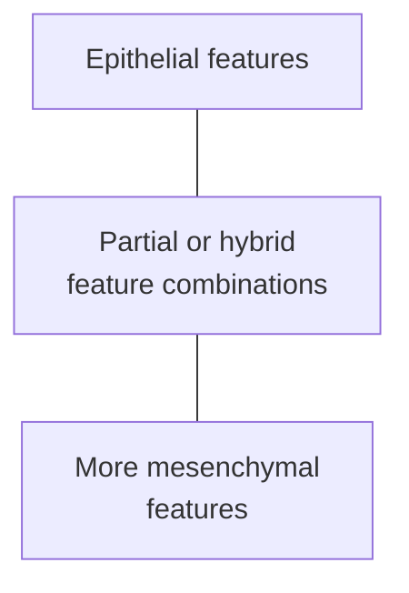

# Epithelial–mesenchymal transition: changing cell programs

## In one sentence

Epithelial–mesenchymal transition is a context-dependent process in which epithelial cells lose some epithelial features and acquire some mesenchymal features, often through intermediate states.

## The intuition

Picture a team loosening some of its connections and changing how its members move and work. Members need not all change in the same way or at the same time. This helps explain a coordinated program with intermediate states. Cells are not making conscious choices, and the analogy cannot establish which properties actually changed.

## How it works

Start with [epithelium and stroma](/wiki/education/concepts/biology-basics/cells/epithelium-and-stroma). Epithelial cells often maintain connections with neighbors and an organized orientation, called **polarity**. **Mesenchymal features** can include altered shape, attachments and movement. This term describes properties; it does not mean that every cell with one such feature has become a fibroblast.

**Epithelial–mesenchymal transition (EMT)** involves coordinated changes in cellular organization and behavior. Signals influence proteins that regulate gene activity and the machinery governing cell connections, shape and movement. The particular program depends on the tissue and conditions. No one signal or marker defines every version.

Cells may retain epithelial features while acquiring others. These **partial or hybrid states** make an all-or-nothing switch a poor default picture. Different cells can occupy different states at the same time. In some contexts, cells can move back toward epithelial properties through **mesenchymal–epithelial transition (MET)**. Reversibility is a possibility to test, not a promise for every cell or condition.

EMT-related programs also occur outside cancer, including embryonic development and aspects of tissue repair. They can contribute to disease processes too. Their presence alone therefore does not identify malignancy.

*A simplified feature continuum, not a compulsory route. Lines do not prove that a measured cell made a transition or will reverse it.*

## Why it matters in cancer

Cancer cells can use changing programs that affect tissue interactions. Primary work in mouse skin and mammary tumors identified several intermediate populations with differing behavior. It supports biological diversity in those models, not a universal ordering of human tumors by danger.

Invasion, formation of distant metastases and resistance to a particular drug are distinct outcomes. An EMT-associated program may contribute to them in a defined setting, but a marker or score alone proves none of them. Nor does an EMT-like expression pattern establish a tumor's developmental origin.

The experiment matters. One mouse mammary-tumor study used selected lineage reporters and perturbations to investigate lung metastasis and cyclophosphamide resistance. Its conclusions depend on the model, reporter coverage and treatment. They cannot establish that EMT is always necessary, always dispensable or always predictive of resistance in a person.

## How it is measured

The 2020 research guidelines recommend assessing cellular properties together with multiple molecular features. These can include cell connections, polarity, shape and movement, supported by suitable protein and expression measurements. **E-cadherin**, a cell-adhesion protein, and **vimentin**, a structural protein, are commonly used features; neither supplies a universal EMT test alone.

[Bulk RNA (ribonucleic acid) sequencing](/wiki/education/concepts/measurement/transcriptomics/bulk-rna-seq) may combine malignant epithelium with fibroblasts and other cells. A higher mesenchymal-associated signal can therefore reflect a changed mixture. Cell-level measurements and spatial context help attribute the features. Time-resolved observations or suitable tracing are needed to demonstrate a transition rather than infer it from one snapshot.

A computational trajectory proposes an order from measured similarity. It does not directly prove movement along that path, malignancy, invasion or a clinical drug response. Functional and clinical questions need their own appropriately controlled evidence.

## Common confusions

- **One marker versus EMT:** marker expression is a feature, not the whole process.
- **Partial EMT versus failure to change:** intermediate combinations can be biologically meaningful.
- **EMT versus malignancy:** normal developmental and repair contexts also exist.
- **EMT versus metastasis:** altered cell behavior is not proof of distant disease.
- **Trajectory versus observed transition:** an inferred ordering is not a filmed history.

## Try it

A fictional biopsy's [bulk RNA](/wiki/education/concepts/measurement/transcriptomics/bulk-rna-seq) contains more vimentin than an earlier sample. The writer concludes that its cancer cells underwent EMT and became resistant to all chemotherapy. Is that supported?

**Answer:** No. First establish which cells contributed the signal and whether several relevant properties changed. Resistance requires evidence for a defined drug and exposure; clinical resistance needs clinical assessment. Neither conclusion follows from one mixed-sample marker.

## Explain it back

“EMT concerns changes in ___; a marker alone cannot establish ___.”

**One possible answer:** “Cellular organization and properties; a transition, malignancy or a clinical outcome.”

## Takeaway

**Describe the measured features and model before assigning a transition or an outcome to EMT.**

## Related concepts

- [Cell lineage and differentiation](/wiki/education/concepts/biology-basics/cells/cell-lineage-and-differentiation)
- [Cancer-associated fibroblasts](/wiki/education/concepts/cancer-biology/tumor-microenvironment/cancer-associated-fibroblasts-and-stroma)

## Sources

Source-checked October 9, 2026; expert and learner review pending. The exercise is fictional. Mouse experiments retain their model and assay boundaries; no EMT score is used to select treatment.

- [Yang and colleagues, 2020: research guidelines and definitions](https://pmc.ncbi.nlm.nih.gov/articles/PMC7250738/) — consensus terminology, intermediate states and measurement requirements; DOI [10.1038/s41580-020-0237-9](https://doi.org/10.1038/s41580-020-0237-9).
- [Pastushenko and colleagues, 2018](https://pubmed.ncbi.nlm.nih.gov/29670281/) — primary study of transition states in skin and mammary tumor models.
- [Fischer and colleagues, 2015](https://pubmed.ncbi.nlm.nih.gov/26560033/) — model- and reporter-defined experiments on lung metastasis and chemotherapy resistance.

<!-- BEGIN GENERATED USED IN -->
## Used in

- [Separate cell identity from cell state](/wiki/education/multi-omics-foundations/02-cell-identity-and-state)
<!-- END GENERATED USED IN -->
