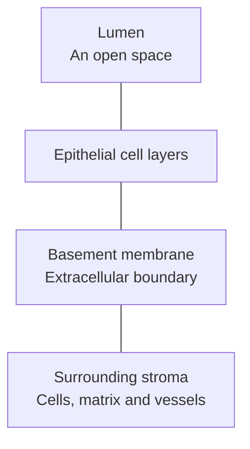
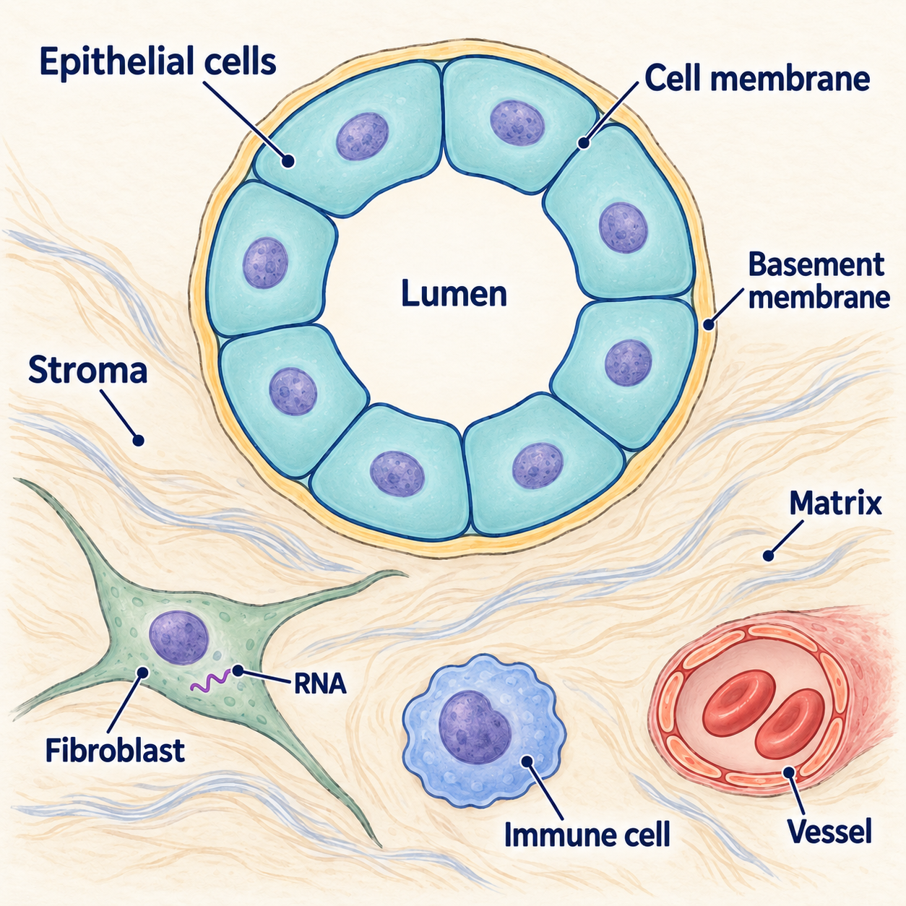

# Epithelium and stroma: reading tissue compartments

## In one sentence

Epithelium forms tissue coverings, linings and glands; stroma is the supporting tissue around and between those structures, containing cells and extracellular material.

## The intuition

Picture a building's occupied spaces and the surrounding paths, plumbing and supports. Both contribute to how the whole place functions. A tissue also combines specialized structures with support systems. The analogy stops at the architecture: stromal cells actively exchange signals, remodel their surroundings and influence neighboring cells.

## How it works

**Epithelial cells** form coverings and linings and make up many glands. They can protect a surface, absorb material or secrete products. Their arrangement depends on the tissue. “Epithelial” describes a cell family and organization; it does not mean “cancerous.”

A typical epithelial structure has a surface facing a space or lumen and a basal side connected to underlying tissue. A **basement membrane** is a thin layer of extracellular material at that boundary. It is not the [plasma membrane](/wiki/education/concepts/biology-basics/cells/cell-and-membrane) around each individual cell.

**Stroma** includes supporting connective tissue, vessels and other structures around and between tissue units. [Extracellular matrix](/wiki/education/concepts/cancer-biology/tumor-microenvironment/extracellular-matrix), material outside cells, contributes to that support. Fibroblasts produce and remodel matrix; vascular cells form vessel structures. Immune cells can also occupy stromal regions. Stroma is therefore broader than fibroblasts or collagen alone.

In normal breast ducts, luminal epithelial cells line the inner space. [Myoepithelial cells and the basement membrane](/wiki/education/concepts/breast-cancer/anatomy-and-histology/myoepithelial-cells-and-basement-membrane) define different parts of that normal tissue boundary. This is a useful tissue example, not a blueprint for every gland, every sampled region or every cancer.

*A simplified normal epithelial arrangement. Lines show neighboring compartments, not invasion or a flow of molecules.*

*The basement membrane borders the epithelial structure; a plasma membrane surrounds each cell. This generic normal lining and its representative stromal neighbors are a schematic, not measured cell proportions, a breast-duct blueprint or an invasion test.*

The RNA (ribonucleic acid) mark sits inside the fibroblast: a tissue RNA signal can come from a stromal cell. The [primary normal-breast atlas by Kumar and colleagues](https://pubmed.ncbi.nlm.nih.gov/37380767/) distinguishes epithelial, immune and stromal cell populations; this drawing uses a simpler generic lining rather than reproducing that atlas’s tissue architecture.

## Why it matters in cancer

**Carcinoma** is a cancer of epithelial origin. Other cancers arise in other cell families, so epithelial architecture is not a universal cancer map. Within a carcinoma specimen, normal epithelium, malignant epithelial cells, immune cells and supporting tissue can coexist.

Pathologists assess tissue architecture, cell features and suitable stains together. A disrupted boundary or an epithelial marker on its own is not a universal invasion or malignancy test. The organ, specimen preparation and diagnostic criteria matter.

[Cancer-associated fibroblasts](/wiki/education/concepts/cancer-biology/tumor-microenvironment/cancer-associated-fibroblasts-and-stroma) provide one example of stromal biology. Their amount does not establish a single tumor-promoting function. Signals from a stromal compartment may concern support cells rather than the cancer cells themselves.

## How it is measured

Histology preserves cell arrangement in tissue sections. Marker-based stains and [multiplex immunofluorescence](/wiki/education/concepts/measurement/proteins-and-spatial/multiplex-immunofluorescence) can help identify cells and their locations. Document which regions were sampled and how compartments were assigned. A computer-generated tumor mask needs checking against the underlying tissue.

[Bulk RNA (ribonucleic acid) sequencing](/wiki/education/concepts/measurement/transcriptomics/bulk-rna-seq) combines RNA from the sampled cells. A higher signal may reflect more contributing cells, more RNA per cell or altered expression. It is not automatically a percentage of malignant cells. Dissociated single-cell measurements add cell-level information but lose some original spatial relationships and can recover cell types unequally.

## Common confusions

- **Epithelium versus malignancy:** normal epithelial cells also exist.
- **Stroma versus fibroblasts:** one cell type is not the whole compartment.
- **Basement membrane versus plasma membrane:** a tissue boundary and a cell boundary are different structures.
- **Bulk signal versus tumor-cell signal:** mixed tissue needs cell attribution.
- **Epithelial region versus pure tumor:** a region can contain several cell populations.

## Try it

A fictional breast biopsy has high RNA for a protein made by fibroblasts. A writer concludes that the cancer cells express a strong drug target. What should change?

**Answer:** Attribute the signal to the contributing cells before calling it a cancer-cell target. Examine suitable cell-level or spatial measurements and normal-tissue comparators. A whole-sample signal alone cannot establish target location or selectivity.

## Explain it back

“Epithelial describes ___; stromal describes ___; a biopsy can contain ___.”

**One possible answer:** “A tissue cell family and arrangement; the supporting compartment; malignant cells, normal cells and extracellular material.”

## Takeaway

**Locate the cells and tissue compartment before assigning a molecular signal to the cancer.**

## Related concepts

- [Cell lineage and differentiation](/wiki/education/concepts/biology-basics/cells/cell-lineage-and-differentiation)
- [Extracellular matrix](/wiki/education/concepts/cancer-biology/tumor-microenvironment/extracellular-matrix)

## Sources

Source-checked October 10, 2026; expert and learner review pending. The exercise is fictional. Normal breast architecture and research atlases do not replace diagnostic pathology.

- [NCI SEER: epithelial tissue](https://training.seer.cancer.gov/anatomy/cells_tissues_membranes/tissues/epithelial.html) — tissue organization and basement membrane.
- [NCI Dictionary: stroma](https://www.cancer.gov/publications/dictionaries/cancer-terms/def/stroma) — supporting tissue and its components.
- [Kumar and colleagues, 2023](https://pubmed.ncbi.nlm.nih.gov/37380767/) — normal adult breast cell types, states and spatial organization.
- [Wu and colleagues, 2021](https://pubmed.ncbi.nlm.nih.gov/34493872/) — epithelial, immune and stromal diversity in human breast cancers.

<!-- BEGIN GENERATED USED IN -->
## Used in

- [See what is inside a tissue sample](/wiki/education/multi-omics-foundations/01-epithelial-and-breast-tissue)
<!-- END GENERATED USED IN -->
