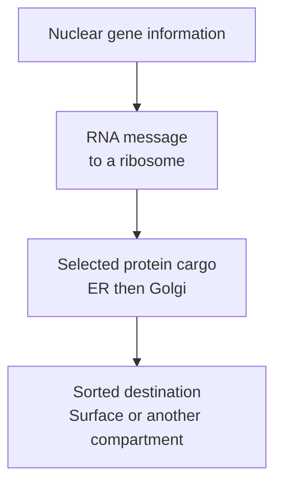

# Organelles: the cell's working compartments

## In one sentence

Organelles are structures inside a cell that organize particular jobs, including storing genetic information, processing cargo, recycling material and supporting metabolism.

## The intuition

Think of rooms in a shared workspace. A kitchen and a document archive need different equipment and conditions. Compartments let a cell maintain different local environments too. The analogy has limits: organelles exchange material, change shape and interact continually; they are not independent rooms running separate businesses.

## How it works

Start with [the cell and its membrane](/wiki/education/concepts/biology-basics/cells/cell-and-membrane). Within most human cells, additional membranes separate specialized spaces. The word organelle is also used broadly for structures such as ribosomes, which have no surrounding membrane. The table focuses on the compartments most often encountered in cancer explanations. **DNA** means deoxyribonucleic acid; **RNA** means ribonucleic acid.

| Structure | A central job | A useful boundary |
|---|---|---|
| Nucleus | Holds the nuclear chromosomes and supports copying and reading genetic information | Most cellular DNA is here, but mitochondria contain DNA too |
| Endoplasmic reticulum | Helps produce and process many secreted and membrane proteins; also supports lipid production and calcium handling | Not every protein is made through this route |
| Golgi apparatus | Modifies and sorts cargo received from the endoplasmic reticulum | Sorting is different from copying a gene |
| Lysosome | Breaks down delivered material in an acidic compartment | More accumulated cargo need not mean faster recycling |
| Mitochondrion | Supports energy conversion, metabolism and cell-death regulation | It is not simply a fuel tank, and cells also make energy outside it |

[The central dogma](/wiki/education/concepts/biology-basics/genetics/central-dogma) connects gene information with RNA and protein. RNA messages can leave the nucleus; **ribosomes** assemble proteins from those messages. Ribosomes on the **rough endoplasmic reticulum (ER)** produce many proteins destined for secretion or membranes. Ribosomes elsewhere produce many other proteins.

Here, ER means endoplasmic reticulum. In breast pathology, the same letters often mean [estrogen receptor](/wiki/education/concepts/breast-cancer/receptors-and-subtypes/estrogen-receptor). Context matters.

The ER and Golgi exchange cargo through small membrane compartments called **vesicles**. Some cargo reaches the cell surface; some goes elsewhere. Material taken up from outside can pass through sorting compartments called **endosomes** and reach lysosomes. [Autophagy](/wiki/education/concepts/cancer-biology/cell-death-and-survival/autophagy) supplies another route for internal material to reach lysosomes.

Mitochondria convert chemical energy into **adenosine triphosphate (ATP)**, a molecule that powers many reactions. Their membranes and proteins also participate in **apoptosis**, a regulated cell-death process. More mitochondria do not automatically mean more useful energy output.

*One route for selected proteins. This is not the route of every protein or an assembly line through every organelle.*

## Why it matters in cancer

Location changes what a molecule can do. A surface-targeting treatment must encounter its target outside the cell. Another drug may need to reach a nuclear enzyme. Cargo can enter a cell yet remain trapped in a compartment where it cannot perform its intended job.

Recycling, energy use and cell-death control can help explain a cancer-cell response. A compartment's appearance alone does not prove that the cancer depends on its function.

## How it is measured

Microscopy with validated compartment labels can show location and shape. Biochemical assays can examine activity, while time-series experiments can follow cargo movement. Document preparation, cell viability, label specificity and resolution. Overlapping signals in an image do not by themselves prove direct interaction.

Counts, brightness and function are different outputs. A lysosome full of material may be receiving more cargo or clearing it poorly. Establish movement or activity with appropriate controls before assigning a mechanism.

## Common confusions

- **Nucleus versus whole cell:** a nucleus is one compartment, not the entire cell.
- **ER versus estrogen receptor:** the abbreviation has two distinct meanings.
- **Ribosome versus ER:** the ribosome assembles the protein; the ER provides a route and processing environment for selected proteins.
- **Lysosome versus mitochondrion:** recycling and energy conversion are different jobs.

## Try it

A fictional cell shows more lysosome-associated fluorescent cargo after treatment. Does this prove that recycling became faster?

**Answer:** No. Increased delivery, reduced clearance or altered labeling could increase the signal. Follow cargo over time and measure breakdown with suitable controls.

## Explain it back

“The nucleus stores ___; lysosomes break down ___; mitochondria help with ___.”

**One possible answer:** “Nuclear genetic information; delivered cellular material; metabolism and energy conversion.”

## Takeaway

**Name the compartment, then ask what activity was measured there.**

## Related concepts

- [Autophagy](/wiki/education/concepts/cancer-biology/cell-death-and-survival/autophagy)
- [Cell cycle](/wiki/education/concepts/biology-basics/cells/cell-cycle)

## Sources

Source-checked October 9, 2026; expert and learner review pending. The exercise is fictional. The diagram is a simplified route for selected protein cargo.

- [OpenStax, *Biology 2e*, eukaryotic cells](https://openstax.org/books/biology-2e/pages/4-3-eukaryotic-cells) — compartment roles, ribosomes and mitochondria.
- [OpenStax: the endomembrane system](https://openstax.org/books/biology-2e/pages/4-4-the-endomembrane-system-and-proteins) — ER, Golgi and cargo trafficking.
- [Cooper, *The Cell*: lysosomes](https://www.ncbi.nlm.nih.gov/books/NBK9953/) — acidic degradation and delivery routes.
- [NHGRI: DNA fact sheet](https://www.genome.gov/about-genomics/fact-sheets/Deoxyribonucleic-Acid-Fact-Sheet) — nuclear and mitochondrial DNA.
- [Liu and colleagues, 1996](https://pubmed.ncbi.nlm.nih.gov/8689682/) — primary cell-free experiments identifying a role for mitochondrial cytochrome c in apoptosis.

<!-- BEGIN GENERATED USED IN -->
## Used in

Browse the [concept index](/wiki/education/concepts/index) for related learning paths.
<!-- END GENERATED USED IN -->
