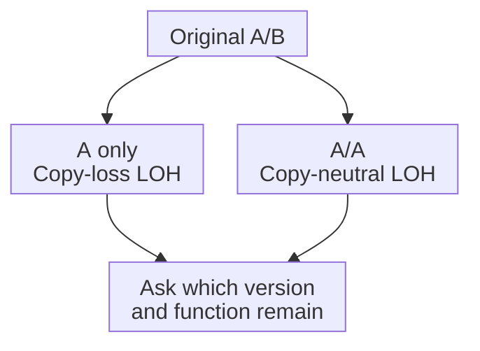

# Alleles and zygosity: versions are different from copies

## In one sentence

An allele is a version of DNA at a particular location; zygosity describes whether the versions present at that location are the same or different.

## The intuition

Imagine having two editions of the same instruction. The editions can be identical or differ at one word. “Which version?” and “How many copies?” are separate questions. The analogy has limits: a tumor can contain several cell populations with different copy numbers, so there may be more than a tidy pair of editions.

## How it works

A **locus** is a genomic location. An [allele](https://www.genome.gov/genetics-glossary/Allele) can describe a single base or a larger sequence version at that location. In an ordinary two-copy **autosomal** region, on a chromosome other than a sex chromosome, one inherited copy comes from each parent.

If the versions at a locus are identical, the genotype is **homozygous**. If they differ, it is **heterozygous**. These labels describe sequence state; they do not themselves say “healthy” or “damaging.” A **hemizygous** region has only one copy in an otherwise diploid setting, where most chromosome sets are paired. [NCI hemizygous](https://www.cancer.gov/publications/dictionaries/genetics-dictionary/def/hemizygous).

In cancer, [copy number and loss of heterozygosity (LOH)](/wiki/education/concepts/measurement/sequencing-basics/copy-number-and-loh) describe how many copies and which parental contributions remain. Two copies do not guarantee two different alleles. Here, use the sequence labels to distinguish zygosity from a change relative to the original state. [Ciani 2022](https://pubmed.ncbi.nlm.nih.gov/34731645/).

Use these fictional states to keep the axes separate:

| State at one locus | Total copies | Versions present |
|---|---|---|
| A/B | 2 | Two different versions: heterozygous |
| A/A | 2 | One version in two copies: homozygous |
| A only after loss | 1 | One remaining copy: hemizygous |
| A/A after loss of B | 2 | Copy-neutral LOH relative to the original A/B state |

The letters are sequence labels, not functional labels. The same state could have different biological consequences at different loci.

*Loss of allele diversity need not reduce the total copy count.*

## Why it matters in cancer

A [tumor-suppressor gene](/wiki/education/concepts/cancer-biology/what-cancer-is/oncogene-and-tumor-suppressor) may lose useful function through changes involving multiple copies. A variant plus LOH can support a hypothesis of disruption, but retain which allele was lost and whether the remaining allele is damaging. The DNA state does not independently establish RNA or protein function.

**Phase** describes which variants occur together on the same DNA copy. Two variants in one gene are not automatically one on each copy. **Biallelic disruption**, damage involving both alleles, is a stronger biological claim than “two variants found.”

## How it is measured

[Variant allele fraction](/wiki/education/concepts/measurement/sequencing-basics/variant-allele-fraction-and-cancer-cell-fraction) is the fraction of informative sequencing reads supporting a variant. It is not zygosity by itself. Normal-cell mixture, copy number and tumor populations affect that fraction. **Purity**, the malignant-cell proportion, and **ploidy**, the chromosome-copy context, help interpret it. [Carter 2012](https://pmc.ncbi.nlm.nih.gov/articles/PMC4383288/).

## Common confusions

- **Allele versus copy:** a sequence version can exist in several copies.
- **Homozygous versus damaging:** identical versions need not be harmful.
- **LOH versus deletion:** LOH can be copy-neutral.
- **High read fraction versus biallelic loss of function:** mixture, copies, phase and consequence still matter.

## Try it

A fictional matched normal sample is A/B. The malignant cells are inferred to be A/A with two total copies. Did the normal total copy count rule out an allele change?

Show the answer

No. This is a copy-neutral LOH state relative to A/B. The consequence depends on the actual sequence and function of A. Neither its label nor the copy count establishes drug sensitivity.

## Explain it back

“Copy number tells me ______; allele state tells me ______.”

One answer: “how many copies are present; which sequence versions those copies carry.”

## Takeaway

**Track versions, copy count and biological consequence separately, especially in a mixed tumor sample.**

## Related concepts

- [Germline versus somatic](/wiki/education/concepts/biology-basics/genetics/germline-vs-somatic).
- [Tumor heterogeneity](/wiki/education/concepts/cancer-biology/what-cancer-is/tumor-heterogeneity).

## Sources and scope

Source check: October 9, 2026. General allele reasoning; the letters and copy-state exercise are fictional. Expert and learner review remain pending.

- [NHGRI: allele](https://www.genome.gov/genetics-glossary/Allele).
- [NCI: hemizygous](https://www.cancer.gov/publications/dictionaries/genetics-dictionary/def/hemizygous).
- [Ciani and colleagues, published online 2021 / issue 2022: allele-specific genomic analysis and copy-neutral LOH](https://pubmed.ncbi.nlm.nih.gov/34731645/).
- [Carter and colleagues 2012: purity, ploidy and absolute allelic copy inference](https://pmc.ncbi.nlm.nih.gov/articles/PMC4383288/).

<!-- BEGIN GENERATED USED IN -->
## Used in

- [Connect repair biology to PARP sensitivity](/wiki/education/guides/from-variant-to-drug/02-connect-repair-biology-to-parp-sensitivity)
- [Separate DNA copies from cancer-cell fractions](/wiki/education/multi-omics-foundations/04-copies-alleles-and-clones)
<!-- END GENERATED USED IN -->
