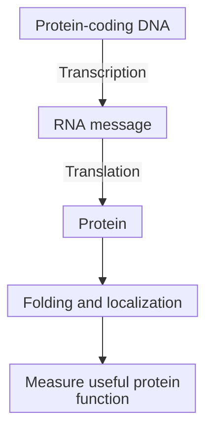

# Central dogma: from DNA to RNA to protein

## In one sentence

For a protein-coding gene, cells transcribe DNA into RNA and translate the RNA into protein.

## The intuition

A stored recipe, a working copy and a finished dish are different objects. [Deoxyribonucleic acid (DNA)](/wiki/education/concepts/biology-basics/molecules/dna) stores information; [messenger ribonucleic acid (mRNA)](/wiki/education/concepts/biology-basics/molecules/rna-and-mrna) carries a readable message; a ribosome assembles a [protein](/wiki/education/concepts/biology-basics/molecules/protein-and-peptide). The analogy ends there: cells regulate every step, and many RNA molecules do jobs without becoming proteins.

## How it works

A [gene](/wiki/education/concepts/biology-basics/molecules/gene) is a sequence used to make a functional product. For a protein-coding gene, **transcription** uses DNA as a template to produce RNA. Processing can remove intervening sequences and join the remaining segments through [splicing](/wiki/education/concepts/biology-basics/genetics/splicing). **Translation** reads the coding sequence of the message in three-base units called **codons** and joins the matching amino acids into a protein. Most human proteins are made by ribosomes in the cytoplasm, including those on the [endoplasmic reticulum](/wiki/education/concepts/biology-basics/cells/organelles-overview). Mitochondria are the exception: they carry their own small DNA and their own ribosomes, which make a handful of proteins used in energy production.

The [**genetic code**](/wiki/education/concepts/biology-basics/genetics/genetic-code) is the lookup table from codon to amino acid: 61 of the 64 codons specify amino acids, three (UAA, UAG and UGA) mean stop, and translation usually starts at AUG. The start fixes the **reading frame**, so one-letter changes and frameshifts have very different effects:

| Message | Read in triplets | Protein result |
|---|---|---|
| Normal | AUG · GAA · UCC · GCU · UAA | Met-Glu-Ser-Ala, then stop |
| One-letter substitution | AUG · G**C**A · UCC · GCU · UAA | Met-**Ala**-Ser-Ala: one amino acid changed (missense) |
| One-letter deletion | AUG · AAU · CCG · CUU · AA… | Met-Asn-Pro-Leu…: every later triplet changes (frameshift) |

*A fictional message. Deleting one letter shifts every later triplet, so the rest of the protein changes and an early stop often appears; deleting three letters would remove one amino acid and keep the frame.*

A protein can then fold, be modified, move to a particular compartment or be degraded. These steps help explain why a DNA change does not guarantee an altered protein on the cell surface. RNA abundance also reflects both production and loss; protein abundance reflects translation and turnover. There is no fixed conversion from a DNA copy count or RNA count into a protein count.

“Central dogma” concerns transfer of sequence information, rather than every signal that regulates a cell. Proteins can regulate transcription without their amino-acid sequence being copied back into genetic sequence. **Reverse transcription** can copy RNA into DNA. Noncoding RNAs can regulate genes, form structures or help catalyze reactions without supplying a protein recipe. The familiar DNA → RNA → protein route is therefore useful, but not a complete map of every gene product.

*A sequence, a message and a functional protein are separate measurement targets. The last steps concern the protein's fate, rather than additional transfers of genetic sequence.*

## Why it matters in cancer

- **How a tumor mutation changes a protein.** Reading a DNA report means following a change through this chain. A missense change swaps one amino acid, as many TP53 mutations do; a nonsense or frameshift change, common in inherited BRCA1 and BRCA2 variants, usually produces a shortened protein or a message the cell destroys by [nonsense-mediated decay](/wiki/education/concepts/biology-basics/genetics/nonsense-mediated-decay). See [mutation types](/wiki/education/concepts/biology-basics/genetics/mutation-types). TP53 is one of only three genes mutated in more than 10% of breast cancers in The Cancer Genome Atlas (TCGA). [TCGA 2012](https://pubmed.ncbi.nlm.nih.gov/23000897/).
- **Why each layer needs its own test.** DNA sequencing finds the change; RNA measurements show whether the gene is being read; protein tests such as immunohistochemistry show whether the product is present and where. Breast cancer receptor status (ER, PR and HER2) is reported from protein and gene-copy tests, not inferred from DNA sequence alone.
- **New targets.** A changed protein can be cut into fragments that the immune system may recognize as foreign, the starting point for [neoantigen](/wiki/education/concepts/immunology/antigen-presentation/neoantigen) vaccines.
- **Drugs that use the chain.** mRNA vaccines supply a message for the cell's ribosomes to translate; an ordinary non-replicating mRNA does not need to enter the nucleus.

## Worked example

A fictional tumor report lists a one-letter deletion near the start of a tumor-suppressor gene's coding sequence. The deletion shifts the reading frame, so every later codon changes and an early stop codon appears. The message may be destroyed by nonsense-mediated decay, or a shortened protein may be made. Either way, a gene's function is probably lost, but the report has measured only DNA. RNA and protein tests would show which outcome happened.

## Try it

A coding sequence reads AUG · UGG · CAU · GA… One letter, the G in UGG, changes to A. What happens to the protein?

Show answer

UGG (tryptophan) becomes UGA, a stop codon. This is a nonsense change: translation ends after the first amino acid, so the full-length protein cannot be made from this message. Whether a short fragment is made or the message is destroyed needs RNA or protein evidence.

## Common confusions

- A gene is an instruction sequence, not the receptor protein itself.
- High RNA abundance does not prove abundant functional protein.
- Reverse transcription does not mean a protein's sequence is copied back into DNA.
- A noncoding RNA can have an important function even though it is not translated.

## How it is measured

[RNA sequencing](/wiki/education/concepts/measurement/transcriptomics/bulk-rna-seq) measures captured messages under a stated preparation and analysis method. Protein assays ask about abundance, placement or activity. Keep the specimen, time and measurement layer beside each result; none alone establishes all the other layers.

## Explain it back

DNA is ______ into RNA, which ribosomes ______ in steps of three letters called ______; changing one letter can swap an amino acid or create an early ______.

**One possible answer:** transcribed; translate; codons; stop.

## Takeaway

**A DNA change matters through the message and protein it alters, so follow it through each layer and measure the layer your question is about.**

## Related concepts

- [The genetic code](/wiki/education/concepts/biology-basics/genetics/genetic-code) explains codons, start and stop signals, and the reading frame.
- [Mutation types](/wiki/education/concepts/biology-basics/genetics/mutation-types) and [splicing](/wiki/education/concepts/biology-basics/genetics/splicing) show how edits change the message.
- [Gene regulation](/wiki/education/concepts/biology-basics/genetics/gene-regulation) explains how cells decide how much of each message to make.
- [mRNA construct anatomy](/wiki/education/concepts/engineering-and-manufacturing/nucleic-acid-design/mrna-construct-anatomy)
- [Chimeric antigen receptor (CAR) anatomy](/wiki/education/concepts/therapeutics/cell-therapies/car-anatomy)

## Sources and scope

Source check: November 7, 2026. General molecular teaching; expert and learner review remain pending.

- [NHGRI RNA fact sheet](https://www.genome.gov/about-genomics/educational-resources/fact-sheets/ribonucleic-acid-fact-sheet): transcription, processing, translation, noncoding functions and reverse transcription.
- [NHGRI transcription definition](https://www.genome.gov/genetics-glossary/Transcription): the protein-coding example of making and using a message.
- [NHGRI codon definition](https://www.genome.gov/genetics-glossary/Codon): 64 codons, 61 specifying amino acids and three stop signals.
- [Hinnebusch (2017)](https://pubmed.ncbi.nlm.nih.gov/28442192/): eukaryotic translation initiation scans the message for an AUG start codon read by initiator methionine transfer RNA.
- [MedlinePlus Genetics, mitochondrial DNA](https://medlineplus.gov/genetics/chromosome/mitochondrial-dna/): mitochondria carry 37 genes, 13 of them for proteins used in oxidative phosphorylation.
- [TCGA Network (2012)](https://pubmed.ncbi.nlm.nih.gov/23000897/): TP53, PIK3CA and GATA3 as the only genes mutated in more than 10% of breast cancers.
- [Crick, central dogma of molecular biology (1970)](https://doi.org/10.1038/227561a0): sequence-information scope; the publisher's indexed abstract was checked, not the full article.
- [Schwanhäusser et al. (2011), mRNA and protein abundance/turnover measurements](https://pubmed.ncbi.nlm.nih.gov/21593866/), with its [2013 correction](https://www.nature.com/articles/nature11848): abstract and correction notice checked; no numerical copy estimates or universal correlation rule are adopted.

<!-- BEGIN GENERATED USED IN -->
## Used in

- [Cell therapies as living drugs](/wiki/education/guides/engineered-cell-therapy/01-cell-therapy-primer)
- [Building an engineered T cell](/wiki/education/guides/engineered-cell-therapy/03-engineered-t-cell-building-blocks)
- [How to engineer T cells inside the body](/wiki/education/guides/engineered-cell-therapy/04-in-vivo-delivery)
- [How engineered immune cells can attack a solid tumor](/wiki/education/guides/engineered-cell-therapy/index)
- [PI3K, AKT, and mTOR: competing effects on repair and recycling](/wiki/education/guides/from-variant-to-drug/06-pi3k-akt-mtor-and-repair)
- [Reading a functional experiment](/wiki/education/guides/from-variant-to-drug/07-reading-a-functional-experiment)
- [How dendritic cells help start a T-cell response](/wiki/education/guides/how-the-immune-system-fights-cancer/02-start-a-response)
- [Match each measurement to its claim](/wiki/education/guides/local-therapy-and-the-immune-system/05-tissue-and-sample-budget)
- [Read tumor and normal data before choosing targets](/wiki/education/guides/personalized-cancer-vaccine/02-reading-tumor-and-normal-data)
- [How a personalized cancer vaccine is designed](/wiki/education/guides/personalized-cancer-vaccine/index)
- [Read each label as an answer to a question](/wiki/education/guides/start-here/01-read-the-labels)
- [Follow the route to immune recognition](/wiki/education/guides/start-here/02-follow-immune-recognition)
- [Start with genes, RNA and protein](/wiki/education/guides/what-multi-omics-tells-us/01-genes-rna-and-protein)
- [See what is inside a tissue sample](/wiki/education/guides/what-multi-omics-tells-us/02-what-is-inside-a-tissue-sample)
- [Read protein: presence, place and activation](/wiki/education/guides/what-multi-omics-tells-us/06-read-protein)
- [Read one report with the six-question card](/wiki/education/guides/what-multi-omics-tells-us/11-read-one-report)
- [What does multi-omics tell us about a tumor?](/wiki/education/guides/what-multi-omics-tells-us/index)
<!-- END GENERATED USED IN -->
