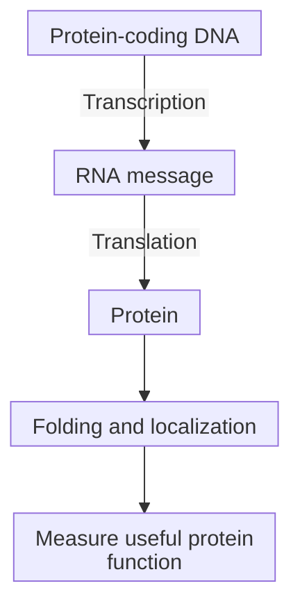

# Central dogma: from DNA to RNA to protein

## In one sentence

For a protein-coding gene, cells transcribe DNA into RNA and translate the RNA into protein.

## The intuition

A stored recipe, a working copy and a finished dish are different objects. [Deoxyribonucleic acid (DNA)](/wiki/education/concepts/biology-basics/molecules/dna) stores information; [messenger ribonucleic acid (mRNA)](/wiki/education/concepts/biology-basics/molecules/rna-and-mrna) carries a readable message; a ribosome assembles a [protein](/wiki/education/concepts/biology-basics/molecules/protein-and-peptide). The analogy ends there: cells regulate every step, and many RNA molecules do jobs without becoming proteins.

## How it works

A [gene](/wiki/education/concepts/biology-basics/molecules/gene) is a sequence used to make a functional product. For a protein-coding gene, **transcription** uses DNA as a template to produce RNA. Processing can remove intervening sequences and join the remaining segments through [splicing](/wiki/education/concepts/biology-basics/genetics/splicing). **Translation** reads a coding sequence in three-base units and joins amino acids into a protein. In human cells, ribosomes in the cytoplasm, including those associated with the [endoplasmic reticulum](/wiki/education/concepts/biology-basics/cells/organelles-overview), perform translation.

A protein can then fold, be modified, move to a particular compartment or be degraded. These steps help explain why a DNA change does not guarantee an altered protein on the cell surface. RNA abundance also reflects both production and loss; protein abundance reflects translation and turnover. There is no fixed conversion from a DNA copy count or RNA count into a protein count.

“Central dogma” concerns transfer of sequence information, rather than every signal that regulates a cell. Proteins can regulate transcription without their amino-acid sequence being copied back into genetic sequence. **Reverse transcription** can copy RNA into DNA. Noncoding RNAs can regulate genes, form structures or help catalyze reactions without supplying a protein recipe. The familiar DNA → RNA → protein route is therefore useful, but not a complete map of every gene product.

*A sequence, a message and a functional protein are separate measurement targets. The last steps concern the protein's fate, rather than additional transfers of genetic sequence.*

## Why it matters in cancer

RNA vaccines supply a message for translation. Gene-delivery products may supply a route to making that message. Sequencing DNA, measuring RNA and measuring a surface protein answer different questions. An ordinary non-replicating mRNA message does not need to enter the nucleus to be translated.

## Worked example

A fictional laboratory finds a receptor gene in an engineered cell but no receptor on its surface. Delivery succeeded at one level. The next checks concern transcription, translation, folding and transport. A positive DNA result cannot replace those measurements.

## Try it

The laboratory now detects many receptor RNA messages. Has it demonstrated a working surface receptor? What would you check next?

**Answer:** It has added evidence for the message layer. It still needs a validated surface-protein measurement and, separately, a functional test appropriate to the receptor. Translation, folding and transport could each limit the final result. Many messages are not a count of functioning receptors.

## Common confusions

- A gene is an instruction sequence, not the receptor protein itself.
- High RNA abundance does not prove abundant functional protein.
- Reverse transcription does not mean a protein's sequence is copied back into DNA.
- A noncoding RNA can have an important function even though it is not translated.

## How it is measured

[RNA sequencing](/wiki/education/concepts/measurement/transcriptomics/bulk-rna-seq) measures captured messages under a stated preparation and analysis method. Protein assays ask about abundance, placement or activity. Keep the specimen, time and measurement layer beside each result; none alone establishes all the other layers.

## Explain it back

Explain why finding a receptor gene, finding its RNA and finding an active surface receptor are three different observations.

## Takeaway

Follow the instruction through the message to the product, then measure the location and function needed for your question.

## Related concepts

- [mRNA construct anatomy](/wiki/education/concepts/engineering-and-manufacturing/nucleic-acid-design/mrna-construct-anatomy)
- [Chimeric antigen receptor (CAR) anatomy](/wiki/education/concepts/therapeutics/cell-therapies/car-anatomy)

## Sources and scope

Source check: October 10, 2026. General molecular teaching; expert and learner review remain pending.

- [NHGRI RNA fact sheet](https://www.genome.gov/about-genomics/educational-resources/fact-sheets/ribonucleic-acid-fact-sheet): transcription, processing, translation, noncoding functions and reverse transcription.
- [NHGRI transcription definition](https://www.genome.gov/genetics-glossary/Transcription): the protein-coding example of making and using a message.
- [Crick, central dogma of molecular biology (1970)](https://doi.org/10.1038/227561a0): sequence-information scope; the publisher's indexed abstract was checked, not the full article.
- [Schwanhäusser et al. (2011), mRNA and protein abundance/turnover measurements](https://pubmed.ncbi.nlm.nih.gov/21593866/), with its [2013 correction](https://www.nature.com/articles/nature11848): abstract and correction notice checked; no numerical copy estimates or universal correlation rule are adopted.

<!-- BEGIN GENERATED USED IN -->
## Used in

- [Cell therapies as living drugs](/wiki/education/cellular-therapies/01-cell-therapy-primer)
- [Building an engineered T cell](/wiki/education/cellular-therapies/05-engineered-t-cell-building-blocks)
- [How to engineer T cells inside the body](/wiki/education/cellular-therapies/06-in-vivo-delivery)
- [How engineered immune cells can attack a solid tumor](/wiki/education/guides/engineered-cell-therapy/index)
- [Autophagy: traffic, flow, and dependence](/wiki/education/guides/from-variant-to-drug/05-autophagy-flux-and-dependence)
- [PI3K, AKT, and mTOR: competing effects on repair and recycling](/wiki/education/guides/from-variant-to-drug/06-pi3k-akt-mtor-and-repair)
- [Reading a functional experiment](/wiki/education/guides/from-variant-to-drug/07-reading-a-functional-experiment)
- [Read tumor and normal data before choosing targets](/wiki/education/guides/personalized-cancer-vaccine/02-reading-tumor-and-normal-data)
- [How a personalized cancer vaccine is designed](/wiki/education/guides/personalized-cancer-vaccine/index)
- [Check what the experiment actually tests](/wiki/education/guides/predicting-response-before-treating/02-check-the-experiment)
- [Understand what a tumor model can predict](/wiki/education/guides/predicting-response-before-treating/index)
- [Read each label as an answer to a question](/wiki/education/guides/start-here/01-read-the-labels)
- [Follow the route to immune recognition](/wiki/education/guides/start-here/02-follow-immune-recognition)
- [Match each measurement to its claim](/wiki/education/local-treatment-modalities/05-tissue-and-sample-budget)
- [Choose a tumor model for the question](/wiki/education/modeling-tumor-response/index)
- [Use RNA to test the message and its source](/wiki/education/molecular-profiling/02-rna-the-activity-layer)
- [Ask whether protein is present, placed and active](/wiki/education/molecular-profiling/03-protein-expression-and-activation)
- [Test a mechanism in a living model](/wiki/education/molecular-profiling/05-functional-drug-response)
- [Start with genes, RNA and protein](/wiki/education/multi-omics-foundations/00-genes-rna-and-protein)
- [See what is inside a tissue sample](/wiki/education/multi-omics-foundations/01-epithelial-and-breast-tissue)
- [Read RNA counts without counting proteins](/wiki/education/multi-omics-foundations/03-reading-rna-counts)
- [Follow a splice change toward repair function](/wiki/education/multi-omics-foundations/05-splicing-and-dna-repair)
- [How dendritic cells help start a T-cell response](/wiki/education/oncology-101/2-dendritic-cells)
- [Understand multi-omics, one question at a time](/wiki/education/reading-a-tumor/omics-and-multi-omics)
<!-- END GENERATED USED IN -->
