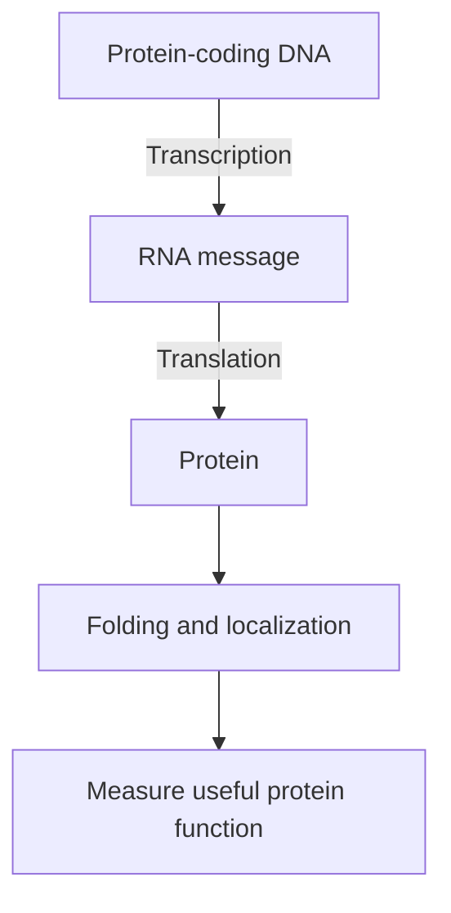

# Central dogma: from DNA to RNA to protein

## In one sentence

For a protein-coding gene, cells transcribe DNA into RNA and translate the RNA into protein.

## The intuition

A stored recipe, a working copy and a finished dish are different objects. DNA stores information; messenger RNA carries a readable copy; a ribosome assembles a protein. The analogy ends there: cells regulate every step, and many RNA molecules do jobs without becoming proteins.

## How it works

DNA means deoxyribonucleic acid; RNA means ribonucleic acid. A gene is a sequence used to make a functional product. For a protein-coding gene, transcription produces RNA. Processing can remove intervening sequences and join the remaining segments. Translation reads a coding sequence to join amino acids into a protein.

A protein can then fold, be modified, move to a particular compartment or be degraded. These steps help explain why a DNA change does not guarantee an altered protein on the cell surface.

“Central dogma” describes information transfer. It is not a rule that every gene is active or that every RNA encodes protein. Reverse transcription can copy RNA into DNA; it does not mean a cell reconstructs genetic sequence from a protein.

*A sequence, a message and a functional protein are separate measurement targets.*

## Why it matters in cancer

RNA vaccines supply a message for translation. Gene-delivery products may supply a route to making that message. Sequencing DNA, measuring RNA and measuring a surface protein answer different questions.

## Worked example

A fictional laboratory finds a receptor gene in an engineered cell but no receptor on its surface. Delivery succeeded at one level. The next checks concern transcription, translation, folding and transport. A positive DNA result cannot replace those measurements.

## Common confusions

- A gene is an instruction sequence, not the receptor protein itself.
- High RNA abundance does not prove abundant functional protein.
- An ordinary non-replicating mRNA message does not need to enter the nucleus to be translated.

## Related concepts

- [mRNA construct anatomy](/wiki/education/concepts/engineering-and-manufacturing/nucleic-acid-design/mrna-construct-anatomy)
- [Chimeric antigen receptor (CAR) anatomy](/wiki/education/concepts/therapeutics/cell-therapies/car-anatomy)

## Sources and scope

Source check: October 8, 2026. This is a mechanism explanation, not a treatment recommendation. Expert and learner review remain pending.

- [NHGRI RNA fact sheet](https://www.genome.gov/about-genomics/educational-resources/fact-sheets/ribonucleic-acid-fact-sheet).
- [NHGRI transcription definition](https://www.genome.gov/genetics-glossary/Transcription).

<!-- BEGIN GENERATED USED IN -->
## Used in

- [Cell therapies as living drugs](/wiki/education/cellular-therapies/01-cell-therapy-primer)
- [Building an engineered T cell](/wiki/education/cellular-therapies/05-engineered-t-cell-building-blocks)
- [How to engineer T cells inside the body](/wiki/education/cellular-therapies/06-in-vivo-delivery)
- [How engineered immune cells can attack a solid tumor](/wiki/education/guides/engineered-cell-therapy/index)
- [Read tumor and normal data before choosing targets](/wiki/education/guides/personalized-cancer-vaccine/02-reading-tumor-and-normal-data)
- [How a personalized cancer vaccine is designed](/wiki/education/guides/personalized-cancer-vaccine/index)
- [Check what the experiment actually tests](/wiki/education/guides/predicting-response-before-treating/02-check-the-experiment)
- [Understand what a tumor model can predict](/wiki/education/guides/predicting-response-before-treating/index)
- [Read each label as an answer to a question](/wiki/education/guides/start-here/01-read-the-labels)
- [Follow the route to immune recognition](/wiki/education/guides/start-here/02-follow-immune-recognition)
- [Choose a tumor model for the question](/wiki/education/modeling-tumor-response/index)
- [Use RNA to test the message and its source](/wiki/education/molecular-profiling/02-rna-the-activity-layer)
- [Ask whether protein is present, placed and active](/wiki/education/molecular-profiling/03-protein-expression-and-activation)
- [Autophagy: traffic, flow, and dependence](/wiki/education/molecular-profiling/parp-and-cell-survival/02-autophagy-flux-and-dependence)
- [PI3K, AKT, and mTOR: competing effects on repair and recycling](/wiki/education/molecular-profiling/parp-and-cell-survival/03-pi3k-akt-mtor-and-repair)
- [Reading a functional experiment](/wiki/education/molecular-profiling/parp-and-cell-survival/04-reading-a-functional-experiment)
- [PARP, recycling, and cell survival](/wiki/education/molecular-profiling/parp-and-cell-survival/index)
- [Start with genes, RNA and protein](/wiki/education/multi-omics-foundations/00-genes-rna-and-protein)
- [See what is inside a tissue sample](/wiki/education/multi-omics-foundations/01-epithelial-and-breast-tissue)
- [Read RNA counts without counting proteins](/wiki/education/multi-omics-foundations/03-reading-rna-counts)
- [Follow a splice change toward repair function](/wiki/education/multi-omics-foundations/05-splicing-and-dna-repair)
- [How dendritic cells help start a T-cell response](/wiki/education/oncology-101/2-dendritic-cells)
- [Understand multi-omics, one question at a time](/wiki/education/reading-a-tumor/omics-and-multi-omics)
<!-- END GENERATED USED IN -->
