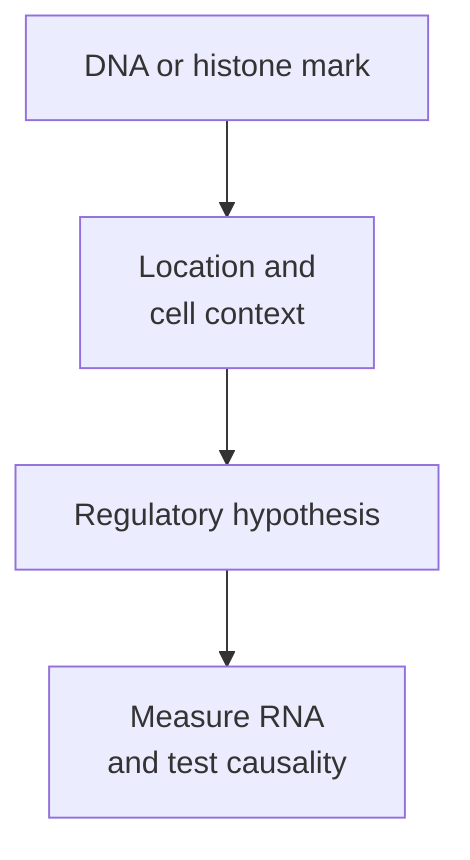

# Epigenetics and DNA methylation

## In one sentence

Epigenetic regulation changes how cells use DNA without rewriting its base sequence; DNA methylation is one chemical mark that can influence that regulation.

## The intuition

Think of a text with bookmarks and notes that affect how it is used. The words can stay the same while access and interpretation change. The analogy has limits: an epigenetic mark is a physical chemical feature, not a reader's intention. Its effect depends on where it occurs and which proteins and cells are involved.

## How it works

Nuclear DNA is packaged with proteins as **chromatin**. Regulatory processes can alter DNA-associated marks and chromatin organization without changing the sequence of A, C, G and T. Some states persist through cell division, while others change with cell state or signals. Epigenetics does not mean every mark is permanently inherited, or inherited between generations. [NHGRI epigenomics](https://www.genome.gov/about-genomics/fact-sheets/Epigenomics-Fact-Sheet).

**DNA methylation** adds a methyl chemical group to DNA. In human genomes, much of the methylation studied is **5-methylcytosine (5mC)** at **CpG sites**, where a cytosine is followed by a guanine along one strand. This describes an added chemical group, rather than a C-to-T sequence mutation.

Position matters. Methylation around some promoters, regions involved in starting transcription, can help maintain reduced gene activity. It can interfere with regulatory interactions or recruit proteins associated with repression. Experiments on a methylated-DNA-binding protein linked repression to recruitment of a histone deacetylase complex. That is a demonstrated mechanism in its tested systems, rather than a rule for every gene. [Nan 1998](https://www.nature.com/articles/30764).

Methylation elsewhere does not carry the same simple meaning. Human stem-cell and fibroblast maps showed different patterns across genomic regions and cell types. “Methylated” is therefore not a universal synonym for “switched off.” [Lister 2009](https://pubmed.ncbi.nlm.nih.gov/19829295/).

**Histone modifications** place chemical groups on the proteins around which DNA wraps. Different marks and their combinations can affect protein recruitment and chromatin access. [BET bromodomain proteins](/wiki/education/concepts/cancer-biology/signaling-pathways/bet-bromodomain-proteins), for example, recognize certain acetyl marks. Histone methylation, histone acetylation and DNA methylation are different molecular features.

*A mark can suggest a regulatory explanation; its consequence needs the relevant context and evidence.*

## Why it matters in cancer

A gene can be less active even when its DNA coding sequence remains present. Epigenetic regulation is one possible explanation. A tumor sample can also differ because its cell mixture changed. The observation “more methylation and less RNA” does not alone show that methylation caused the RNA change, drove the cancer or predicts a treatment response.

A stronger causal experiment changes the proposed regulatory feature in a suitable model, checks the effect and considers alternative explanations. Its conclusion remains tied to that model and manipulation. Reading a chemical mark is a different claim from demonstrating a current biological dependence.

## How it is measured

Ordinary sequencing of unmodified, amplified DNA does not preserve a direct readout of these chemical marks. A method must be designed to detect them. **Bisulfite sequencing** converts unmodified cytosine so it is read differently, while protected cytosines retain a C signal. The original method enabled site-specific methylation mapping. [Frommer 1992](https://pubmed.ncbi.nlm.nih.gov/1542678/).

Standard bisulfite methods cannot distinguish 5mC from **5-hydroxymethylcytosine (5hmC)**, a related modification. Approaches such as oxidative bisulfite sequencing address that distinction. Retain which chemical features a method resolves, its conversion controls and the cell populations sampled. A percentage at a site in mixed tissue is not a percentage of cancer cells with a silenced gene. [Booth 2013](https://www.nature.com/articles/nprot.2013.115).

## Common confusions

- **Methylation versus mutation:** a chemical mark differs from a base-sequence change.
- **Any methylation versus gene silencing:** position, regulatory context and measurement matter.
- **Association versus cause:** a mark and low RNA can share another explanation.
- **A mark versus treatment sensitivity:** chemical state alone does not establish clinical benefit.

## Try it

A fictional mixed-tissue sample shows higher promoter-region methylation and lower gene R RNA than a comparison sample. Can you say methylation silenced R in every malignant cell?

Show the answer

No. The samples may differ in cell composition, and the measurements are averages. Confirm the assayed sites and cell source, then test the proposed regulatory effect. The two observations support a hypothesis, not a cell-by-cell causal conclusion.

## Explain it back

“A methylation result tells me ______ under this method; it does not alone establish ______.”

One answer: “about captured chemical marks at specified sites; their causal effect on expression or a treatment response.”

## Takeaway

**Read an epigenetic mark with its location, cell source and assay, then measure the proposed consequence.**

## Related concepts

- [Genes and transcripts](/wiki/education/concepts/biology-basics/molecules/gene).
- [Bulk RNA sequencing](/wiki/education/concepts/measurement/transcriptomics/bulk-rna-seq).

## Sources and scope

Source check: October 9, 2026. General regulation and method boundaries; the example is fictional. Expert and learner review remain pending. No methylation threshold or treatment selection is proposed.

- [NHGRI: epigenomics fact sheet](https://www.genome.gov/about-genomics/fact-sheets/Epigenomics-Fact-Sheet).
- [Nan and colleagues 1998: methylated-DNA recognition connected to a repression complex](https://www.nature.com/articles/30764).
- [Lister and colleagues 2009: human methylome patterns in stem cells and fibroblasts](https://pubmed.ncbi.nlm.nih.gov/19829295/).
- [Frommer and colleagues 1992: bisulfite-based mapping of methylated cytosines](https://pubmed.ncbi.nlm.nih.gov/1542678/).
- [Booth and colleagues 2013: oxidative bisulfite sequencing and the 5mC/5hmC distinction](https://www.nature.com/articles/nprot.2013.115).

<!-- BEGIN GENERATED USED IN -->
## Used in

Browse the [concept index](/wiki/education/concepts/index) for related learning paths.
<!-- END GENERATED USED IN -->
