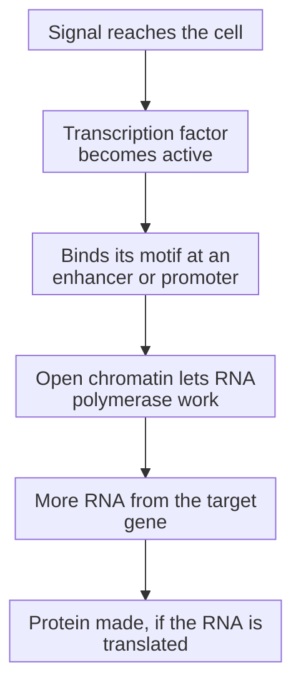

# Gene regulation: promoters, enhancers and transcription factors

## In one sentence

Gene regulation is how a cell controls when, where and how much each gene is read, mainly through transcription factors that bind DNA at promoters and enhancers.

## The intuition

Every cell in the body carries nearly the same DNA, yet a breast duct cell and a T cell make very different proteins. Think of the genome as a huge cookbook in every kitchen. Each kitchen opens only some recipes, and decides how many copies of each to print. Gene regulation is that choice. The analogy breaks in one way: there is no cook reading the book. The choice emerges from proteins binding DNA and from how tightly the DNA is packed.

## How it works

The first step of the [central dogma](/wiki/education/concepts/biology-basics/genetics/central-dogma), transcription, is where most regulation happens.

- A **promoter** is the stretch of DNA at the start of a gene where the RNA-making enzyme, RNA polymerase, assembles and begins reading.
- An **enhancer** is a regulatory stretch that raises a gene's transcription from a distance along the DNA. The DNA bends so that the enhancer and promoter come close in space.
- A **transcription factor** is a protein that recognizes a short DNA sequence, called its binding motif, and helps switch nearby genes on or off. A catalog of the human genome lists more than 1,600 likely transcription factors. [Lambert 2018](https://pubmed.ncbi.nlm.nih.gov/29425488/).
- **Chromatin**, DNA wrapped around histone proteins, controls access. Tightly packed regions are hard for transcription factors to reach; open regions are easier. Chemical marks on DNA and histones, described on the [epigenetics](/wiki/education/concepts/biology-basics/genetics/epigenetics-and-methylation) page, help keep regions open or closed through cell divisions.

*Regulation usually acts on how much RNA is made; whether more protein follows still depends on translation and turnover.*

Regulation does not stop at transcription. [Splicing](/wiki/education/concepts/biology-basics/genetics/splicing) chooses which pieces of an RNA are kept, RNA can be destroyed early, and proteins can be modified or degraded. Many signaling pathways end by changing a transcription factor: a hormone receptor, a growth signal or a stress sensor turns a cell's outside conditions into a new set of active genes.

## Why it matters in cancer

- **The estrogen receptor is a transcription factor.** When estrogen binds the [estrogen receptor (ER)](/wiki/education/concepts/breast-cancer/receptors-and-subtypes/estrogen-receptor), the receptor binds DNA and switches on growth genes. That is why ER status, tested on every breast cancer, matters, and why triple-negative tumors lack this route.
- **Oncogenes can be regulators.** [MYC](/wiki/education/concepts/cancer-biology/signaling-pathways/myc) is a transcription factor whose deregulation drives many cancers; in multiple myeloma models, a drug that displaces the chromatin reader BRD4 switched MYC transcription down ([Delmore et al., 2011](https://pubmed.ncbi.nlm.nih.gov/21889194/)). Similarly, [NRF2](/wiki/education/concepts/cancer-biology/signaling-pathways/nrf2-keap1) runs a stress-defense program.
- **RNA tests read regulation.** RNA sequencing and gene-expression classifiers measure the result of regulation, which is why two tumors with similar mutations can look different.

## Common confusions

- **Gene present versus gene expressed:** a gene in the DNA may be silent in a given cell.
- **Binding versus regulating:** a transcription factor bound at a site does not prove it changes that gene's output.
- **Open chromatin versus active gene:** an accessible region shows potential, not that transcription is happening.
- **More RNA versus more protein:** translation and protein turnover can break the link.
- **Mutation versus regulation change:** expression can change without any change in the DNA sequence.

## How it is measured

RNA sequencing measures how much of each message is present. Chromatin-accessibility methods map open regions, and chromatin immunoprecipitation maps where a chosen protein is bound. Reporter experiments test whether a stretch of DNA can drive expression. Each answers a different question, and only perturbation experiments show that a regulator causes a change.

## Try it

A fictional cell line has a normal-sequence gene for a growth protein but produces ten times more of its RNA than a related line. Give two explanations that need no mutation in the gene itself.

Show answer

More of an activating transcription factor could be present or active, or the gene's promoter or enhancer could be in more open chromatin. A third possibility is that a DNA rearrangement moved a strong enhancer next to the gene; that is a DNA change, but not in the gene's own coding sequence. Each explanation predicts a different follow-up test.

## Explain it back

Transcription factors bind short DNA ______ at promoters and ______, and packaging called ______ controls whether they can reach them.

**One possible answer:** motifs; enhancers; chromatin.

## Takeaway

**Cells share one genome but read different parts of it; transcription factors, regulatory DNA and chromatin decide which genes are read and how much.**

## Related concepts

- [Central dogma](/wiki/education/concepts/biology-basics/genetics/central-dogma), the DNA to RNA to protein route being regulated.
- [Epigenetics and methylation](/wiki/education/concepts/biology-basics/genetics/epigenetics-and-methylation), marks that help keep regions open or closed.
- [Signal transduction and kinases](/wiki/education/concepts/biology-basics/signaling/signal-transduction-and-kinases), how outside signals reach transcription factors.
- [Cell lineage and differentiation](/wiki/education/concepts/biology-basics/cells/cell-lineage-and-differentiation), how stable regulation creates cell identity.

## Sources and scope

Source check: November 7, 2026. General molecular teaching; the exercise is fictional. Expert and learner review pending.

- [Lambert et al. (2018), *The Human Transcription Factors*](https://pubmed.ncbi.nlm.nih.gov/29425488/): transcription factors recognize specific DNA sequences to control chromatin and transcription; a catalog of more than 1,600 likely human factors.
- [NHGRI promoter definition](https://www.genome.gov/genetics-glossary/Promoter): the region where RNA polymerase and transcription factors bind to start transcription, working with enhancers that DNA bending brings close.
- [NHGRI transcription definition](https://www.genome.gov/genetics-glossary/Transcription): making RNA from a DNA template.
- [Delmore et al. (2011)](https://pubmed.ncbi.nlm.nih.gov/21889194/): chromatin readers support MYC transcription in multiple myeloma models.

<!-- BEGIN GENERATED USED IN -->
## Used in

Browse the [concept index](/wiki/education/concepts/index) for related learning paths.
<!-- END GENERATED USED IN -->
