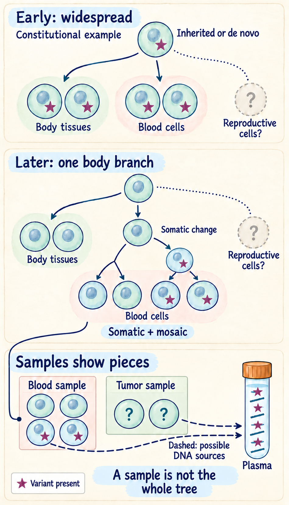

# Germline vs somatic: where a variant belongs

## In one sentence

Germline variants can be passed through eggs or sperm, while somatic variants arise in other cell lineages.

## The intuition

Imagine a book distributed to many rooms. A change in the original edition can appear across those rooms. A change made in one room's copy stays in that branch of copies. This helps distinguish a person's **constitutional** [deoxyribonucleic acid (DNA)](/wiki/education/concepts/biology-basics/molecules/dna)—present broadly across tissues—from an acquired cell-lineage change. The analogy has limits: mosaicism can place a variant in only some tissues, and a new germline variant need not have come from a parent.

## How it works

An **inherited germline variant** came through a parent's egg or sperm and is generally present across many tissues. **De novo** means newly arisen rather than a known inherited variant in a parent's constitutional DNA. A change in an egg, sperm or fertilized egg can become constitutional. Constitutional origin does not therefore mean a variant must have been inherited.

A change after fertilization can instead produce **mosaicism**: some descendant cells carry it and others do not. Timing and cell lineage affect its distribution. If reproductive cells carry a variant, transmission may be possible; testing one body tissue does not map every reproductive cell.

**Somatic** changes arise in other cell lineages. Cancer cells acquire them, but normal cells do too. Finding a change in a tumor therefore establishes neither its origin nor its harmfulness.

A [matched-normal sample](/wiki/education/concepts/measurement/sequencing-basics/tumor-normal-vs-tumor-only-sequencing) supplies non-tumor DNA from the same person for comparison. The same variant in tumor and suitable normal material may support constitutional origin. A tumor-only result may need [clinical germline testing](/wiki/education/concepts/breast-cancer/hereditary-risk/germline-testing) to resolve a hereditary question. Neither a database label nor a large read fraction independently settles origin.

Blood is often convenient as the normal sample, but blood cells can have acquired variants of their own. This is [clonal hematopoiesis (CH)](/wiki/education/concepts/measurement/liquid-biopsy/chip). A blood-cell clone can also contribute DNA to plasma. Low-level mosaicism, contamination and assay limits further complicate interpretation. A blood match is evidence to assess, not an instruction to classify or subtract every matching variant automatically.

*Follow the branches before naming the distribution: an early constitutional variant can be inherited or de novo; a later body-cell change can be both somatic and mosaic. The normal-blood clone is one example, and dashed plasma arrows indicate possible DNA contributors. Solid arrows trace cell ancestry; dotted question branches remain unmeasured, and long-dashed arrows show possible plasma DNA sources. Cell counts are illustrative. These sample windows do not map all reproductive cells or establish a variant’s effect or transmissibility.*

A variant mark means presence in an illustrative cell, not harmfulness. [MedlinePlus explains inherited, de novo and somatic mosaic changes](https://medlineplus.gov/genetics/understanding/mutationsanddisorders/genemutation/); [Razavi and colleagues’ paired plasma/blood study](https://pubmed.ncbi.nlm.nih.gov/31768066/) shows why a plasma finding needs source attribution. The diagram is a set of possible histories, not a rule for diagnosing one specimen.

### Compare origin, distribution and open attribution

| Question | Germline or constitutional context | Somatic context |
|---|---|---|
| What origin evidence matters? | Suitable normal/tumor comparisons can support constitutional origin; inherited versus de novo is a further question | Suitable comparisons can support an acquired body-cell lineage; tumor location alone does not establish it |
| Where might it occur? | Constitutional variants are often broad across tissues; reproductive-cell mosaicism is a separate distribution question | A later lineage may be restricted, while an early mosaic change can span several tissues; normal cells can carry somatic variants |
| When does attribution stay open? | A small blood/plasma signal without suitable comparison cannot establish inherited or whole-person origin | The same signal cannot establish tumor origin; acquired blood clones, mosaicism and assay limits need assessment |
| What does neither label establish? | Harmfulness, the full reproductive-cell distribution or treatment benefit | Harmfulness, the full reproductive-cell distribution or treatment benefit |

These are evidence contexts, not exclusive inheritance-versus-distribution boxes. A constitutional change can be de novo; a body-cell change can be both somatic and mosaic. Keep an uncertain sample uncertain.

## Why it matters in cancer

Tumor profiling asks about the sampled cancer. Hereditary testing asks about constitutional susceptibility and possible family implications. Origin, pathogenicity and treatment eligibility remain separate. A biologically relevant tumor variant does not automatically establish a hereditary finding or satisfy an eligibility rule requiring a germline result.

## Worked example

A fictional tumor test finds a repair-gene variant. The report cannot yet say whether it is inherited. An appropriate clinical normal-sample test then fails to find that variant within its validated detection scope. This supports a somatic interpretation under those conditions; it does not prove that every possible hereditary cause was excluded.

Now reverse the scenario: the variant is found in normal tissue. Its presence alone still does not establish that it is harmful. The laboratory must interpret both the origin evidence and the disease-specific meaning.

## Try it

A small variant signal appears in blood cells and plasma, but no suitable non-blood comparison has been tested. Must it be inherited or tumor-derived?

**Answer:** Neither conclusion follows. An acquired blood-cell clone is one possibility; mosaicism and technical limits also require consideration. Compartment, detection depth and appropriate comparison material matter. The observation does not map the whole person or establish the variant's effect.

## Common confusions

- **Germline** does not mean necessarily inherited from a parent.
- **De novo** does not mean tumor-only or necessarily nontransmissible.
- **Somatic** does not mean cancer-specific.
- A negative tumor assay is not a comprehensive negative hereditary test.
- Research matched-normal analysis is not automatically a clinical hereditary report.

## How it is measured

Laboratories compare tumor and normal material or perform a dedicated hereditary assay. Reports differ in coverage, detection limits, specimen suitability and what they disclose. Keep the actual reported classification and unresolved uncertainty. A negative result is bounded by the tested genes, change classes and method; uncertain blood results may require appropriate alternate-tissue assessment.

## Explain it back

Explain why “where the variant came from” and “whether it is harmful” need separate answers, even when it is detected in normal tissue.

**One possible answer:** suitable evidence may support a lineage, but origin alone does not establish pathogenicity, reproductive-cell distribution or treatment relevance. An uncertain origin remains open.

## Takeaway

Attribute a variant to a lineage using suitable evidence, then interpret its effect and clinical relevance separately.

## Related concepts

- [Variant type versus consequence](/wiki/education/concepts/biology-basics/genetics/mutation-types)
- [Read fractions and cancer-cell fractions](/wiki/education/concepts/measurement/sequencing-basics/variant-allele-fraction-and-cancer-cell-fraction)

## Sources and scope

Source check: October 10, 2026. General genetics teaching; expert and learner review remain pending.

- [MedlinePlus variant origins](https://medlineplus.gov/genetics/understanding/mutationsanddisorders/genemutation/): inherited, de novo and mosaic changes.
- [NHGRI mosaicism](https://www.genome.gov/genetics-glossary/Mosaicism).
- [NCI genetic testing for inherited cancer risk](https://www.cancer.gov/about-cancer/causes-prevention/genetics/genetic-testing-fact-sheet): distinct tumor/hereditary tests, bounded negatives and alternate specimens.
- [Jones et al. (2015), paired and tumor-only genomic interpretation](https://pubmed.ncbi.nlm.nih.gov/25877891/): a retrospective assay study, not a universal error rate for modern tests.
- [Razavi et al. (2019), paired plasma and blood-cell sequencing](https://pubmed.ncbi.nlm.nih.gov/31768066/): source attribution in a defined metastatic-cancer/control study, not an automatic blood-subtraction rule.

<!-- BEGIN GENERATED USED IN -->
## Used in

- [Compare related ideas](/wiki/education/comparisons/index)
- [Authenticate and attribute the finding](/wiki/education/guides/from-variant-to-drug/01-authenticate-and-attribute-the-finding)
- [Connect repair biology to PARP sensitivity](/wiki/education/guides/from-variant-to-drug/02-connect-repair-biology-to-parp-sensitivity)
- [PARP trapping and recycling](/wiki/education/guides/from-variant-to-drug/04-parp-trapping-and-recycling)
- [From a variant to a drug claim](/wiki/education/guides/from-variant-to-drug/index)
- [Read tumor and normal data before choosing targets](/wiki/education/guides/personalized-cancer-vaccine/02-reading-tumor-and-normal-data)
- [Read a DNA assay as a coverage-and-confidence claim](/wiki/education/molecular-profiling/01-dna-the-blueprint)
- [Build an integrated claim without skipping the clinical question](/wiki/education/molecular-profiling/07-from-data-to-care-plan)
- [Separate DNA copies from cancer-cell fractions](/wiki/education/multi-omics-foundations/04-copies-alleles-and-clones)
- [What does multi-omics tell us about a tumor?](/wiki/education/reading-a-tumor/omics-and-multi-omics)
<!-- END GENERATED USED IN -->
