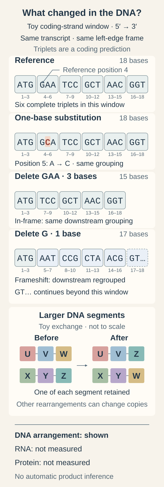

# Mutation types: what changed in the DNA?

## In one sentence

A DNA variant describes a difference in sequence or copy structure; its biological effect is a separate question.

## The intuition

Editing a recipe can change one letter, remove a word, duplicate a page or join two recipes. The size of the edit tells us what happened to the text. It does not tell us how the dish will taste. [Deoxyribonucleic acid (DNA)](/wiki/education/concepts/biology-basics/molecules/dna) changes work similarly, though a cell's response is much more complicated than cooking.

A **mutation** is a change in DNA sequence. **Variant** is a neutral reporting term for a difference: it does not imply harm, cancer causation or a useful treatment target. Keep five questions separate: what changed, where it arose, what it does, whether it is pathogenic in a stated context, and whether it has clinical relevance.

## How it works

Keep [ribonucleic acid (RNA)](/wiki/education/concepts/biology-basics/molecules/rna-and-mrna) and protein observations separate from the DNA description.

| Change class | What the description establishes |
| --- | --- |
| Single-nucleotide variant (SNV) | One base is substituted for another relative to the specified reference. |
| Insertion or deletion (indel) | Sequence is added or removed. Location and net coding-length change matter for the protein consequence. |
| Copy-number variant (CNV) or alteration (CNA) | A region has a different copy count. CNV often describes genomic variation and CNA is common in tumor reports; check the laboratory's terminology and comparison. |
| Structural variant (SV) | Larger segments are rearranged, lost, gained or inverted. A copy-changing structural deletion fits more than one category. |
| Fusion | Parts of genes or their regulatory arrangements are joined. A DNA rearrangement, an observed joined RNA and a protein product are distinct findings. |

Consequences depend on where the change sits. Within a protein-coding sequence, a **missense** change alters an amino acid; a **nonsense** change introduces an early stop; a **synonymous** change preserves the encoded amino acid, though it can affect RNA processing.

A **frameshift** changes the grouping of the translated sequence into three-base units, or codons. A net coding insertion or deletion not divisible by three can shift that frame. An **in-frame** change preserves the downstream grouping. This reasoning assumes the stated transcript and coding sequence; an indel outside the coding region is not automatically a frameshift.

  
  
In this fictional coding-strand window, ATG|GAA|TCC|GCT|AAC|GGT becomes ATG|GCA|TCC|GCT|AAC|GGT after one substitution, ATG|TCC|GCT|AAC|GGT after deleting GAA, and ATG|AAT|CCG|CTA|ACG|GT… after deleting reference position 4 (the G in GAA). The same transcript and left-edge frame are assumed; the final GT continues beyond the window. Rearranged DNA alone does not measure RNA or protein.

A change near a splice boundary may affect how RNA segments are joined. A prediction does not demonstrate the altered transcript. Likewise, a DNA fusion does not establish that its proposed RNA or protein is produced, and a joined RNA does not establish a DNA rearrangement. [Human Genome Variation Society (HGVS) recommendations](https://hgvs-nomenclature.org/stable/recommendations/general/) distinguish observed changes from predicted consequences and retain reference-sequence versions.

## Why it matters in cancer

A sequence change can activate growth, disable a safeguard, create a candidate immune target or have little relevant effect. Interpretation needs the exact change, reference sequence and evidence for its consequence. The gene name alone is too coarse. A fusion can alter regulation without necessarily making a joined protein; presence alone does not establish tumor dependence.

## Worked example

A fictional report lists a one-base substitution, a three-base coding deletion and a gain containing several genes. These describe different edits. The coding deletion preserves the downstream reading frame; depending on its boundaries, it may remove or also alter an amino acid at the junction. The gain does not identify which neighboring gene matters or guarantee matching protein increases.

## Try it

A fictional DNA assay reports a rearrangement joining genes A and B. Can you call the joined protein a drug target? What evidence is missing?

**Answer:** The assay supports the specified DNA arrangement within its validated scope. Check whether the joined RNA exists, which coding frame it uses, and whether a protein is made and functional. Biological dependence and clinical treatment evidence remain separate questions. None follows from the word “fusion” alone.

## Common confusions

- [Germline or somatic origin](/wiki/education/concepts/biology-basics/genetics/germline-vs-somatic) cannot be read from the change class alone.
- **Pathogenic** is an evidence-based classification for a stated disease context.
- **Predicted damaging** does not mean observed protein damage or drug sensitivity.
- A stop substitution is not necessarily a frameshift.
- “Not found” can mean outside coverage or below detection in the tested material.

## How it is measured

Sequencing compares reads with a specified reference. Copy and structural analyses also use evidence such as read depth and fragment arrangement. Preserve genome build, transcript accession and version, tested regions, detectable change classes and quality limits. Predicted protein annotations should remain labeled as predictions.

## Explain it back

Explain why “a somatic, pathogenic, actionable fusion” contains several claims requiring different evidence.

## Takeaway

Name the edit precisely before asking what it means biologically or clinically.

## Related concepts

- [DNA, RNA and protein](/wiki/education/concepts/biology-basics/genetics/central-dogma)
- [Panel, exome and genome sequencing](/wiki/education/concepts/measurement/sequencing-basics/panel-exome-genome)
- [Cancer-driving gene roles](/wiki/education/concepts/cancer-biology/what-cancer-is/oncogene-and-tumor-suppressor)

## Sources and scope

Source check: October 10, 2026. Change classes and consequences; expert and learner review remain pending.

- [NHGRI mutation definition](https://www.genome.gov/genetics-glossary/Mutation).
- [HGVS general recommendations](https://hgvs-nomenclature.org/stable/recommendations/general/): reference versions, measured versus predicted consequences and fusion levels.
- [HGVS protein frameshifts](https://hgvs-nomenclature.org/stable/recommendations/protein/frameshift/).
- [NHGRI copy-number variation](https://www.genome.gov/genetics-glossary/Copy-Number-Variation-CNV).
- [NHGRI structural variation](https://www.genome.gov/genetics-glossary/Structural-Variation).

<!-- BEGIN GENERATED USED IN -->
## Used in

- [Read a neoantigen design board](/wiki/education/designing-a-vaccine/04-how-to-read-a-neoantigen-design-board)
- [Authenticate and attribute the finding](/wiki/education/guides/from-variant-to-drug/01-authenticate-and-attribute-the-finding)
- [From a variant to a drug claim](/wiki/education/guides/from-variant-to-drug/index)
- [Read a DNA assay as a coverage-and-confidence claim](/wiki/education/molecular-profiling/01-dna-the-blueprint)
- [Follow a splice change toward repair function](/wiki/education/multi-omics-foundations/05-splicing-and-dna-repair)
- [What does multi-omics tell us about a tumor?](/wiki/education/reading-a-tumor/omics-and-multi-omics)
<!-- END GENERATED USED IN -->
