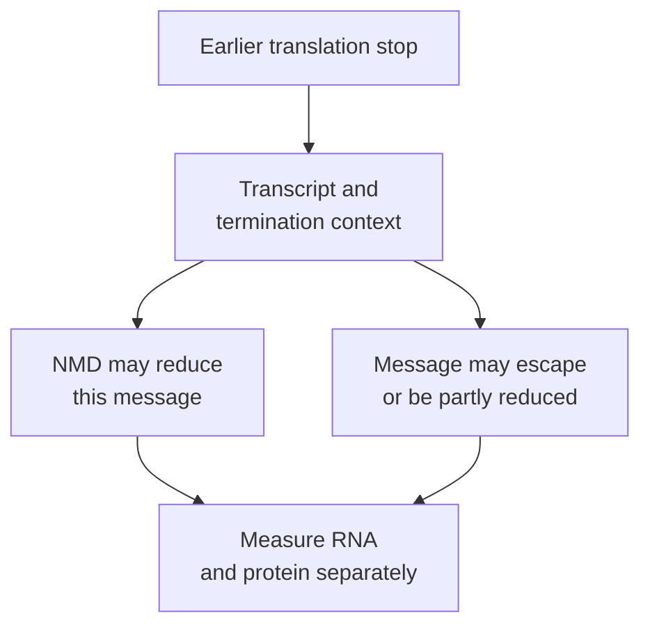

# Nonsense-mediated decay: a context-dependent RNA fate

## In one sentence

Nonsense-mediated decay (NMD) is an RNA-surveillance process that can reduce messages with abnormal translation termination; its effect depends on the transcript and cellular context.

## The intuition

Imagine a reader noticing that an instruction ends unexpectedly and asking whether that copy should be removed. NMD performs a related surveillance job during protein production. The analogy has limits: cells do not compare a message with an ideal finished protein, and an early stop does not always cause the message to disappear.

## How it works

During **translation**, a ribosome reads [messenger RNA (mRNA)](/wiki/education/concepts/biology-basics/molecules/rna-and-mrna) to build an amino-acid chain. A normal stop codon ends that process in an appropriate context. A **premature termination codon**, an earlier stop in the relevant coding sequence, can arise from a [stop-gain variant, frameshift](/wiki/education/concepts/biology-basics/genetics/mutation-types) or altered [splicing](/wiki/education/concepts/biology-basics/genetics/splicing).

One important human NMD route connects splicing to translation termination. Splicing can leave an **exon junction complex**, a group of proteins near a join between retained RNA segments. Translating ribosomes normally remove complexes they pass. Terminating while an appropriate complex remains farther downstream can help recruit decay machinery. Experiments linked these junction-associated proteins to RNA-surveillance factors. [Le Hir 2001](https://pubmed.ncbi.nlm.nih.gov/11532962/).

This is a context-sensitive mechanism. The position of a stop relative to splice junctions matters, but so do features such as proximity to the translation start and exon architecture. In human cancer data, a model with several rules explained RNA effects better than a junction rule alone. [Lindeboom 2016](https://pubmed.ncbi.nlm.nih.gov/27618451/).

The familiar upstream-distance shortcut is useful for forming a hypothesis, rather than guaranteeing an outcome for every transcript. Earlier beta-globin experiments showed that moving the stop or an intron could change RNA loss. Their observed distance boundary belonged to those experimental constructs; it is not a universal clinical cutoff. [Zhang 1998](https://pubmed.ncbi.nlm.nih.gov/9671053/).

*An earlier stop raises a surveillance question; it does not assign one inevitable molecular outcome.*

## Why it matters in cancer

A truncating DNA variant can have different downstream outcomes: reduced mutant message, a shortened protein, residual normal product from another copy or a mixture of products. NMD prediction helps choose what to investigate. It does not sign off on protein absence or tumor-suppressor loss of function.

It also matters when considering a proposed altered peptide. A sequence-based prediction requires that enough relevant message and product exist, then that the peptide is generated and presented. An NMD label alone cannot establish or exclude the whole immune-recognition chain.

## How it is measured

Transcript-resolved or allele-aware RNA evidence can test whether a particular message is reduced. Total gene-level counts can hide changes in one transcript, compensation or RNA from other cells. Compare appropriate controls and account for RNA quality and sample composition.

A controlled perturbation of surveillance can test an NMD hypothesis in a model, but broad cellular effects and altered transcription can complicate interpretation. Protein identity, amount and function need their own validated readouts. RNA decay is not protein degradation, and reduced RNA is not proof of zero residual protein.

## Common confusions

- **Stop-gain versus guaranteed NMD:** the transcript and termination context determine susceptibility.
- **NMD prediction versus observation:** a rules-based annotation is a hypothesis about message fate.
- **Reduced message versus absent protein:** remaining products and their persistence need measurement.
- **No gene-count change versus no NMD:** transcript mixtures or compensation can mask an effect.

## Try it

A fictional gene has an early stop in transcript A and a different final-exon stop in transcript B. A report labels both “truncating.” Can you conclude that both messages are eliminated?

Show the answer

No. Inspect the transcript references, coding starts and junction context. Different structures can have different NMD susceptibility. Then measure the relevant RNA products and test the proposed protein consequences.

## Explain it back

“NMD can change ______, but the stop label alone does not establish ______.”

One answer: “the abundance of a particular message; complete removal of that message or its protein products.”

## Takeaway

**Treat NMD as a transcript-specific, testable explanation for RNA loss, with protein consequences still to establish.**

## Related concepts

- [RNA splicing](/wiki/education/concepts/biology-basics/genetics/splicing).
- [Proteins and peptides](/wiki/education/concepts/biology-basics/molecules/protein-and-peptide).

## Sources and scope

Source check: October 9, 2026. General surveillance mechanisms and research interpretation; the exercise is fictional. Expert and learner review remain pending. Experimental boundaries are not universal thresholds.

- [Zhang and colleagues 1998: intron and stop-position experiments in beta-globin messages](https://pubmed.ncbi.nlm.nih.gov/9671053/).
- [Le Hir and colleagues 2001: exon junction complexes link splicing with export and NMD factors](https://pubmed.ncbi.nlm.nih.gov/11532962/).
- [Lindeboom, Supek and Lehner 2016: multiple NMD rules and RNA effects in human cancers](https://pubmed.ncbi.nlm.nih.gov/27618451/).

<!-- BEGIN GENERATED USED IN -->
## Used in

Browse the [concept index](/wiki/education/concepts/index) for related learning paths.
<!-- END GENERATED USED IN -->
