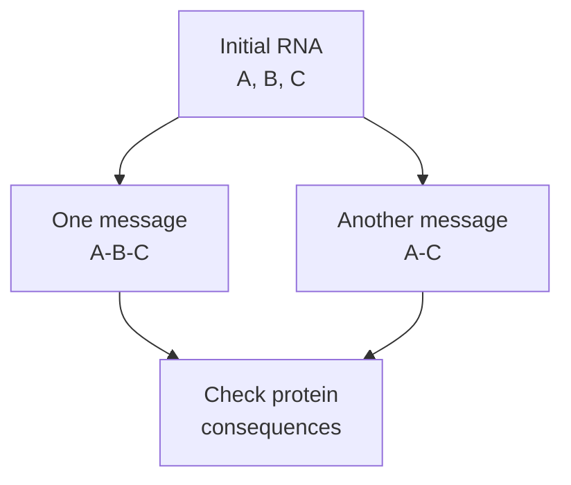

# RNA splicing

## In one sentence

RNA splicing removes introns and joins retained exons into a processed message; different choices can produce different transcripts from the same gene.

## The intuition

Imagine editing a long draft into a usable message. You remove some sections and join the parts that remain. Different edits can produce different versions. Cells do something similar while processing [ribonucleic acid (RNA)](/wiki/education/concepts/biology-basics/genetics/central-dogma). The analogy has limits: the cell follows sequence cues and molecular machinery, and a retained section is not necessarily a protein-coding instruction.

## How it works

A gene is copied from deoxyribonucleic acid (DNA) into an initial RNA transcript. **Exons** are regions retained in a specified processed transcript. **Introns** are intervening regions removed by splicing. Exons can include untranslated sequence, so “exon” does not mean “all of this becomes protein.” [NHGRI exon](https://www.genome.gov/genetics-glossary/Exon), [NHGRI intron](https://www.genome.gov/genetics-glossary/Intron).

For many human messages, a **spliceosome**, a complex of RNA and proteins, recognizes splice boundaries and joins the retained sections. A **donor** marks the start of an intron and an **acceptor** its end. Other sequence cues and regulatory proteins also affect the choice. The familiar boundary labels do not describe the entire process. [From DNA to RNA](https://www.ncbi.nlm.nih.gov/books/NBK26887/).

**Alternative splicing** uses different combinations of splice sites or retained sections. The resulting transcript versions are often called **isoforms**. A [splice-site variant](/wiki/education/concepts/biology-basics/genetics/mutation-types) can alter processing, including exon skipping, intron retention, or use of a normally unused, **cryptic**, boundary. Normal regulation and a damaging variant are different reasons for a changed transcript pattern.

Skipping an exon does not automatically create a frameshift. The effect depends on the coding sequence and boundaries of the resulting transcript. Finding a changed RNA product also does not establish how much usable protein remains. A predicted splice effect, an observed transcript, and a protein consequence need separate descriptions. [HGVS reference sequences](https://hgvs-nomenclature.org/main/background/refseq/).

*The letters track fictional exons; intervening introns are omitted. Different joins do not establish the protein consequences.*

An altered splice product can also introduce a premature stop during protein production. It may yield a shortened protein, or its message may be reduced by [nonsense-mediated decay (NMD)](/wiki/education/concepts/biology-basics/genetics/nonsense-mediated-decay), a cellular RNA-surveillance process. The outcome depends on the transcript and termination context. Human beta-globin experiments showed that changing a stop’s position relative to an intron could change RNA loss; a splice-site prediction alone does not establish either outcome. [Zhang 1998](https://pubmed.ncbi.nlm.nih.gov/9671053/).

## Why it matters in cancer

A DNA variant may raise a processing question without answering it. RNA measurements can show which products are captured. Protein and functional assays then ask whether that change alters a useful product or a cellular process. [The splice-to-repair lesson](/wiki/education/multi-omics-foundations/05-splicing-and-dna-repair) follows this chain through a fictional repair-gene example.

## How it is measured

A **junction read** crosses an RNA join and provides evidence about that transcript structure. Gene-level [bulk RNA sequencing](/wiki/education/concepts/measurement/transcriptomics/bulk-rna-seq) counts cannot by themselves identify every isoform. RNA quality, read placement, coverage, transcript reference and cell mixture affect interpretation. A result from mixed tissue also needs attribution before it is assigned to malignant cells.

## Common confusions

- **RNA present versus normal product:** gene-level signal can coexist with altered transcripts.
- **Exon versus coding sequence:** a retained region may be untranslated.
- **Alternative splicing versus damage:** normal cells also make different transcript versions.
- **Prediction versus observation:** a splice-boundary variant does not specify the measured RNA or protein outcome.

## Try it

A fictional gene remains detectable in RNA sequencing after a splice-site variant is found. Does that prove normal protein production?

Show the answer

No. Identify the transcript products and then test the proposed protein consequence. Total RNA signal answers a different question.

## Related concepts

- [DNA, RNA, and protein](/wiki/education/concepts/biology-basics/genetics/central-dogma).
- [Mutation types](/wiki/education/concepts/biology-basics/genetics/mutation-types).
- [BRCA1 and BRCA2](/wiki/education/concepts/cancer-biology/genome-instability-and-repair/brca1-and-brca2).

## Sources

Source check: 2026-10-09. General processing education; the practice case is fictional. Expert and learner review pending. The textbook explains the mechanism; modern assay and variant interpretation remain method-specific.

- [NHGRI: exon](https://www.genome.gov/genetics-glossary/Exon).
- [NHGRI: intron](https://www.genome.gov/genetics-glossary/Intron).
- [Molecular Biology of the Cell: from DNA to RNA](https://www.ncbi.nlm.nih.gov/books/NBK26887/).
- [HGVS: the reference sequence needed to describe a consequence](https://hgvs-nomenclature.org/main/background/refseq/).

- [Zhang and colleagues 1998: beta-globin experiments on splicing context and nonsense-mediated RNA decay](https://pubmed.ncbi.nlm.nih.gov/9671053/).

<!-- BEGIN GENERATED USED IN -->
## Used in

- [Follow a splice change toward repair function](/wiki/education/multi-omics-foundations/05-splicing-and-dna-repair)
<!-- END GENERATED USED IN -->
