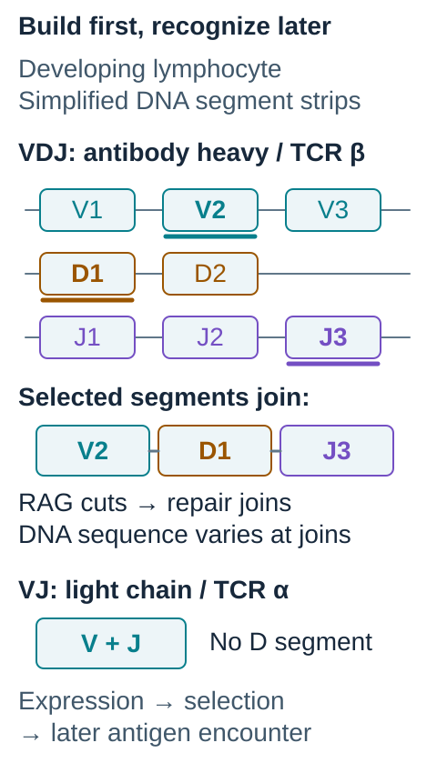
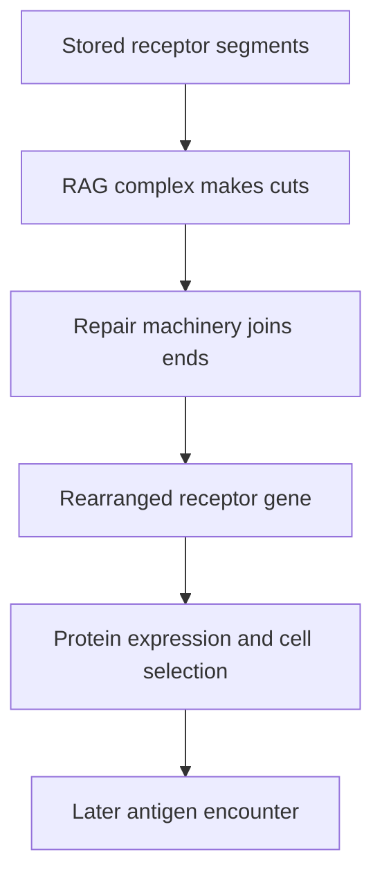

# V(D)J recombination: assembling immune receptors

## In one sentence

V(D)J recombination joins selected gene segments to create the antigen-recognizing parts of B-cell and T-cell receptors.

## The intuition

Imagine building many different keys from a shared box of parts. Developing lymphocytes, the immune cells that include B cells and T cells, assemble receptor genes from stored pieces. Different choices and different joins produce different receptor shapes. The analogy stops at the choice of a lock: the cell does not inspect a tumor and deliberately design the right key. Receptor generation and later selection are separate steps.

**Before you start:** the [[wiki/education/concepts/biology-basics/genetics/central-dogma|central dogma]] explains how a gene becomes a protein; the [[wiki/education/concepts/immunology/t-cells/t-cell-receptor|T-cell receptor]] page explains what one kind of receptor recognizes.

## How it works: from gene pieces to a receptor

*Choose and join receptor-gene pieces before asking what the finished receptor recognizes.*

The colored strips show a **simplified gene-assembly example**, not the number or spacing of real segments. Underlining marks the selected alternatives: V2, D1 and J3. RAG-mediated cutting and repair-mediated joining make a rearranged DNA sequence; joining can also change bases at the boundaries. The second strip contrasts a VJ chain, which has no D segment. These chain examples are antibody heavy/TCR beta versus antibody light/TCR alpha, rather than a claim about every receptor chain. Expression, developmental selection and later antigen encounter are separate steps. [Official chain definitions](https://scirpy.scverse.org/en/latest/glossary.html#v-d-j)

The letters mean **variable (V), diversity (D) and joining (J)**. These segments sit in receptor-gene regions of DNA, deoxyribonucleic acid. Antibody heavy chains and conventional T-cell receptor beta chains use V, D and J segments. Antibody light chains and T-cell receptor alpha chains use V and J. The parentheses remind us that a D segment is not part of every chain. [Official chain definitions](https://scirpy.scverse.org/en/latest/glossary.html#v-d-j)

Proteins encoded by **recombination-activating genes 1 and 2 (RAG1 and RAG2)** recognize nearby DNA signs called **recombination signal sequences**. The RAG complex cuts DNA at the boundaries between a chosen coding segment and its signal. The reaction creates hairpin-shaped coding ends and separate signal ends. Purified RAG proteins reproduced these cutting steps in biochemical experiments. [McBlane et al. 1995](https://doi.org/10.1016/0092-8674(95)90116-7)

DNA-repair machinery then opens, processes and joins the coding ends. The usual joining route is **classical non-homologous end joining**, which joins broken ends without requiring a long matching template. Bases can be removed or added at the joins, creating further sequence variety. RAG proteins also help hold the broken ends together and influence access to repair pathways. They are more than a pair of scissors, but they are not the general repair system for every DNA break. [Arnal et al. 2010](https://doi.org/10.1093/nar/gkp1252)

*Assembling a receptor comes before demonstrating what it recognizes.*

Some joins cannot encode a functional receptor. Cells with usable receptors still pass developmental checks. In a primary mouse experiment, disrupting RAG1 prevented ordinary receptor rearrangement and mature B-cell and T-cell development. That establishes its developmental importance in that model. It does not make a RAG1 variant found in another tissue evidence of a general repair defect. [Mombaerts et al. 1992](https://pubmed.ncbi.nlm.nih.gov/1547488/)

## Why it matters in cancer

[[wiki/education/concepts/measurement/immune-monitoring/tcr-sequencing|T-cell receptor sequencing]] reads the resulting receptor sequences. It can help follow sampled immune populations, but a sequence alone does not identify its antigen or demonstrate cancer-cell killing.

Mistargeted cuts or abnormal joining can contribute to chromosome rearrangements in lymphoid cancers. That is a different claim from finding a RAG1 DNA alteration in an epithelial cancer. The latter needs cell-type-specific expression and functional evidence before invoking RAG biology. [Arnal et al. 2010](https://doi.org/10.1093/nar/gkp1252)

## Common confusions

- **Receptor rearrangement versus inherited variation:** this assembly occurs in developing lymphocytes. It does not rewrite the receptor genes in every body cell.
- **Generation versus recognition:** assembling a receptor does not prove binding, tumor specificity or useful immune activity.
- **Recombination versus later antibody changes:** B cells can also alter antibody sequence or class after activation. Those are distinct processes.
- **RAG expression versus active recombination:** detecting a gene or protein is only one requirement. The partner proteins, DNA targets and cellular context also matter.

## Try it

A fictional tumor sample contains lymphocytes with rearranged receptor sequences. A separate sequencing report lists a RAG1 variant. Can we conclude that cancer cells are actively rearranging receptor genes?

One possible answer

No. The receptor sequences could come from the lymphocytes. First establish which cells carry the variant and express the relevant machinery. Neither a mixed-sample receptor result nor a RAG1 variant alone proves active recombination in malignant cells.

## Explain it back

Explain how receptor generation differs from activation of a cell that already carries a receptor.

## Takeaway

V(D)J recombination generates receptor diversity; later selection and antigen encounters determine which cells persist and respond.

## Related concepts

- [[wiki/education/concepts/biology-basics/genetics/germline-vs-somatic|Germline and somatic variants]]
- [[wiki/education/concepts/measurement/immune-monitoring/tcr-sequencing|T-cell receptor sequencing]]
- [[wiki/education/concepts/measurement/immune-monitoring/tcr-clonality-metrics|T-cell receptor clonality metrics]]

## Sources and scope

Source-checked October 10, 2026. General receptor biology; human expert and learner review pending.

1. [McBlane et al. 1995: purified RAG1/RAG2 cleavage and coding-end formation](https://doi.org/10.1016/0092-8674(95)90116-7).
2. [Mombaerts et al. 1992: RAG1-deficient mouse lymphocyte development](https://pubmed.ncbi.nlm.nih.gov/1547488/).
3. [Arnal et al. 2010: RAG post-cleavage complexes and repair-pathway access](https://doi.org/10.1093/nar/gkp1252).
4. [Scirpy official glossary: VJ and VDJ chain definitions](https://scirpy.scverse.org/en/latest/glossary.html#v-d-j).

<!-- BEGIN GENERATED USED IN -->
## Used in

- [T-cell receptors and TCR sequencing](/wiki/education/molecular-profiling/tcr-and-tcr-sequencing)
<!-- END GENERATED USED IN -->
