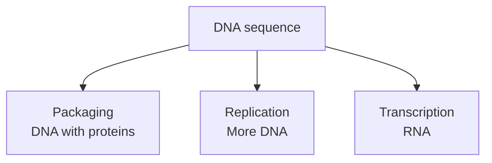

# DNA: storing, copying and reading sequence

## In one sentence

Deoxyribonucleic acid (DNA) is a molecule whose base sequence stores genetic information that cells can copy and use to make RNA.

## The intuition

Think of a long text that can be stored, duplicated or read aloud. Those are different jobs. DNA can likewise be packaged, copied into more DNA or used as a template for RNA. The analogy stops at the chemistry: DNA is a physical molecule, and proteins control which parts are accessible and when each job happens.

## How it works

DNA consists of linked **nucleotides**, building blocks with a sugar, phosphate and base. The bases are adenine, thymine, cytosine and guanine, abbreviated A, T, C and G. A sugar–phosphate backbone holds each strand together. In the familiar double helix, A pairs with T and C with G. The strands run in opposite chemical directions, called **antiparallel**. Complementary pairing lets one strand provide a template for another. [DNA structure](https://www.ncbi.nlm.nih.gov/books/NBK26821/).

In human cells, nuclear DNA is organized into **chromosomes**. DNA and its associated proteins form **chromatin**. DNA wraps around histone proteins in units called **nucleosomes**. This packaging helps organize the molecule and influences access to it; wrapping a region does not rewrite its base sequence. Human [mitochondria](/wiki/education/concepts/biology-basics/cells/organelles-overview) also contain a smaller DNA genome. [NHGRI DNA fact sheet](https://www.genome.gov/about-genomics/fact-sheets/Deoxyribonucleic-Acid-Fact-Sheet), [chromatin](https://www.genome.gov/genetics-glossary/Chromatin).

Keep these processes separate:

| Process | What happens | What it does not establish |
|---|---|---|
| Packaging | DNA associates with proteins and folds within a chromosome | A change in base sequence |
| Replication | DNA is copied before the nuclear genome is passed to daughter cells | That a particular gene is being expressed |
| Transcription | A selected DNA region templates an [RNA molecule](/wiki/education/concepts/biology-basics/molecules/rna-and-mrna) | That its protein product is present or functional |

A [gene](/wiki/education/concepts/biology-basics/molecules/gene) is a functional DNA region, rather than an entire chromosome. Other regions can help control when genes are read. The [central dogma](/wiki/education/concepts/biology-basics/genetics/central-dogma) explains how a protein-coding message leads toward protein production.

*Packaging, replication and transcription act on DNA in different ways.*

## Why it matters in cancer

A [mutation](/wiki/education/concepts/biology-basics/genetics/mutation-types) changes sequence; an extra DNA copy changes how much sequence is present. Neither observation alone measures the resulting RNA, protein or cellular behavior. Damage to DNA is also different from a fixed mutation: [repair](/wiki/education/concepts/cancer-biology/genome-instability-and-repair/dna-damage-and-repair-overview) can remove a lesion before a lasting sequence change appears.

Sequencing reads selected DNA molecules. The assay's coverage, reference and specimen mixture belong to the result. Ordinary base sequencing does not automatically reveal packaging or [methylation](/wiki/education/concepts/biology-basics/genetics/epigenetics-and-methylation); those need suitable methods.

## Common confusions

- **DNA versus a gene:** DNA is the molecule; a gene is a functional region within it.
- **Copying versus reading:** replication makes DNA, while transcription makes RNA.
- **Sequence versus use:** the presence of a gene does not show that a cell is using it.
- **Chromosome picture versus molecular activity:** a compact chromosome drawing cannot identify the active genes.

## Try it

A fictional lab finds the same receptor-gene sequence in two cell types. One makes receptor RNA; the other makes very little. Must their DNA sequences differ?

Show the answer

No. Cells can regulate how they use the same sequence. First confirm the RNA measurement and cell identity, then investigate regulation. The DNA result does not decide the expression question.

## Explain it back

“Packaging changes ______; replication produces ______; transcription produces ______.”

One answer: “DNA organization and access; DNA copies; RNA.”

## Takeaway

**A DNA sequence is information available to a cell; its packaging, copying and use are separate questions.**

## Related concepts

- [Genes](/wiki/education/concepts/biology-basics/molecules/gene).
- [Panel, exome and genome sequencing](/wiki/education/concepts/measurement/sequencing-basics/panel-exome-genome).

## Sources and scope

Source check: October 9, 2026. General molecular biology; the practice case is fictional. Expert and learner review remain pending.

- [NHGRI: DNA fact sheet](https://www.genome.gov/about-genomics/fact-sheets/Deoxyribonucleic-Acid-Fact-Sheet).
- [Molecular Biology of the Cell: the structure and function of DNA](https://www.ncbi.nlm.nih.gov/books/NBK26821/).
- [NHGRI: chromatin](https://www.genome.gov/genetics-glossary/Chromatin).
- [Molecular Biology of the Cell: from DNA to RNA](https://www.ncbi.nlm.nih.gov/books/NBK26887/).

<!-- BEGIN GENERATED USED IN -->
## Used in

- [How to engineer T cells inside the body](/wiki/education/cellular-therapies/06-in-vivo-delivery)
- [HLA and antigen presentation in vaccine design](/wiki/education/designing-a-vaccine/02-hla-and-antigen-presentation)
- [Start with genes, RNA and protein](/wiki/education/multi-omics-foundations/00-genes-rna-and-protein)
<!-- END GENERATED USED IN -->
