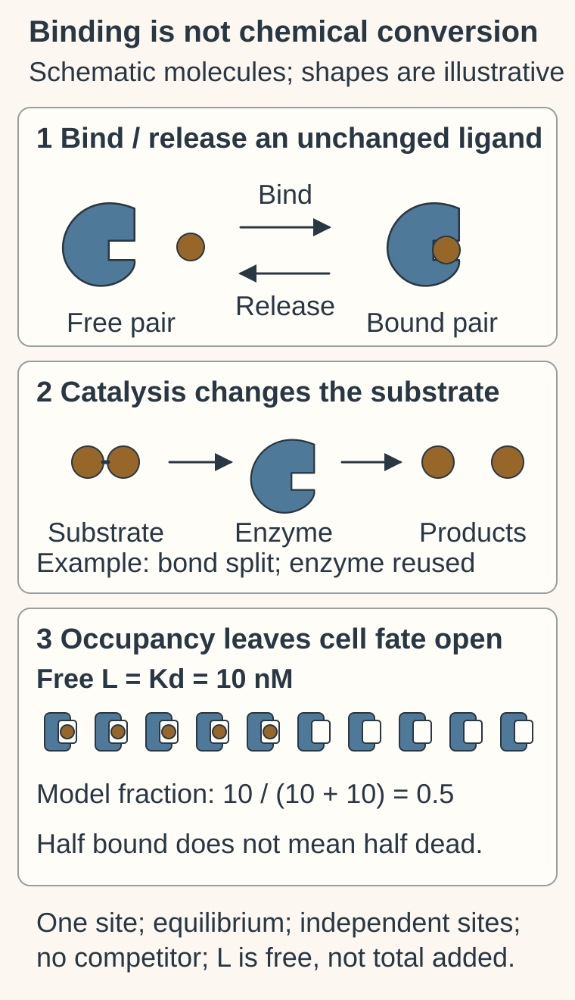
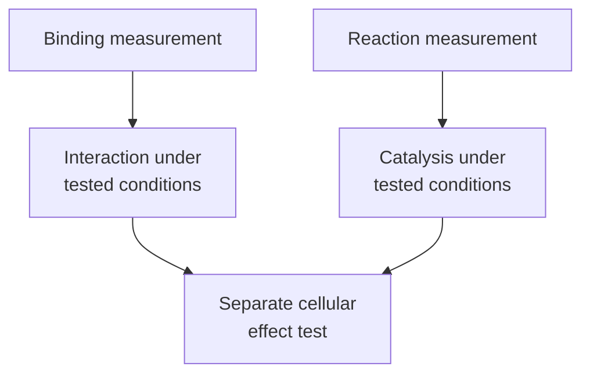

# Enzymes and binding: interaction is not reaction

## In one sentence

Binding is an interaction between molecular partners; an enzyme catalyzes a chemical reaction, so binding strength and reaction rate describe different properties.

## The intuition

Holding an ingredient and transforming it are different jobs. A molecular partner can bind without carrying out a reaction. An enzyme binds a **substrate**, a molecule it acts on, and helps turn it into a product. The analogy ends when it suggests a permanent grip: molecules associate and separate, and their behavior depends on conditions.

## How it works

The ligand stays unchanged when it binds and releases; the separate catalytic sketch changes a substrate bond and reuses the enzyme. Kd is the dissociation constant and nM means nanomolar. Under the stated one-site equilibrium assumptions, free ligand 10 nM and Kd 10 nM predict one-half occupancy. Five of ten illustrated sites visualize that fraction, not an exact observed sample or cell deaths. Binding, Km and IC50 remain different quantities.

**Catalysis** speeds a chemical reaction by lowering its activation barrier. The catalyst is regenerated through the reaction cycle; it does not supply an unlimited energy source. Many enzymes are proteins, while some RNAs also catalyze reactions. An enzyme's **active site** brings relevant groups together for chemistry. Other binding sites can influence its behavior. [Protein function](https://www.ncbi.nlm.nih.gov/books/NBK26911/).

**Affinity** describes an interaction's binding strength under specified conditions. **Specificity** concerns which partners or substrates are favored. A molecule can bind one partner tightly while also binding others. Tight binding alone therefore does not establish tumor selectivity.

For a simple reversible, one-site equilibrium model, the **dissociation constant**, Kd, is:

`Kd = [free partner] × [free ligand] / [bound complex]`.

A lower Kd means tighter binding in that model and condition. If the sites are identical and independent, with no competing ligand, the fraction occupied is `L / (Kd + L)`, where L is the **free** ligand concentration. At L = Kd, the model predicts half occupancy. Total added concentration need not equal free concentration. [One-site binding method](https://pmc.ncbi.nlm.nih.gov/articles/PMC6708923/).

For an enzyme that follows a simple Michaelis–Menten model, **Km**, the Michaelis constant, is the substrate concentration at half the maximum initial reaction rate. It depends on the reaction mechanism and conditions; it is not generally interchangeable with Kd. **Turnover** describes how rapidly an enzyme cycles through reactions, rather than how tightly a molecule binds. [Enzyme assay guidance](https://www.ncbi.nlm.nih.gov/books/NBK92007/).

The **half-maximal inhibitory concentration (IC50)** is the inhibitor concentration producing half inhibition of a specified assay response. Substrate concentration, enzyme amount, incubation and assay design can alter it. An IC50 from a purified-enzyme experiment and one from a cell-growth experiment describe different endpoints. [Mechanism-of-action assays](https://www.ncbi.nlm.nih.gov/books/NBK92001/).

*Measuring an interaction or reaction leaves the effect on a living cell open.*

## Why it matters in cancer

A drug may bind a protein yet fail to reach it in a tumor, fail to alter the relevant activity or affect normal cells too. A measured enzyme change can also be compensated by other cellular routes. [Drug targets and mechanisms](/wiki/education/concepts/therapeutics/how-drugs-work/drug-target-and-mechanism) separate the molecular interaction from its intended effect. [Ligands and receptors](/wiki/education/concepts/biology-basics/signaling/ligand-and-receptor) explain why binding can activate, block or simply localize a molecule.

## Common confusions

- **Binding versus catalysis:** an interaction is not itself evidence of chemical transformation.
- **Kd versus Km versus IC50:** these measure different properties and require stated models or endpoints.
- **Affinity versus specificity:** strong binding to one partner says little about all other partners.
- **Biochemical inhibition versus clinical benefit:** patient benefit needs clinical evidence in the relevant setting.

## Try it

In a fictional one-site equilibrium experiment, Kd is 10 nanomolar and free ligand is 10 nanomolar. A reader says, “Half the sites are occupied, so half the cancer cells will die.” Which part follows?

Show the answer

The model predicts `10 / (10 + 10) = 0.5`, or half occupancy, under its assumptions. Cell death does not follow from that arithmetic. Activity, cellular exposure and response need separate experiments.

## Explain it back

“Binding tells me ______; catalysis tells me ______; neither alone tells me ______.”

One answer: “about an interaction; about a reaction; whether a treatment helps patients.”

## Takeaway

**Read a binding or enzyme number together with its model, conditions and measured endpoint.**

## Related concepts

- [Protein structure and domains](/wiki/education/concepts/biology-basics/molecules/protein-structure-and-domains).
- [Pharmacokinetics and half-life](/wiki/education/concepts/therapeutics/how-drugs-work/pharmacokinetics-and-half-life).

## Sources and scope

Source check: October 9, 2026. General molecular measurements; the occupancy arithmetic is fictional and is not a dose recommendation. Expert and learner review remain pending.

- [Molecular Biology of the Cell: protein function](https://www.ncbi.nlm.nih.gov/books/NBK26911/).
- [A guide to simple, direct and quantitative in vitro binding assays](https://pmc.ncbi.nlm.nih.gov/articles/PMC6708923/).
- [Assay Guidance Manual: basics of enzymatic assays](https://www.ncbi.nlm.nih.gov/books/NBK92007/).
- [Assay Guidance Manual: mechanism-of-action assays for enzymes](https://www.ncbi.nlm.nih.gov/books/NBK92001/).

<!-- BEGIN GENERATED USED IN -->
## Used in

Browse the [concept index](/wiki/education/concepts/index) for related learning paths.
<!-- END GENERATED USED IN -->
