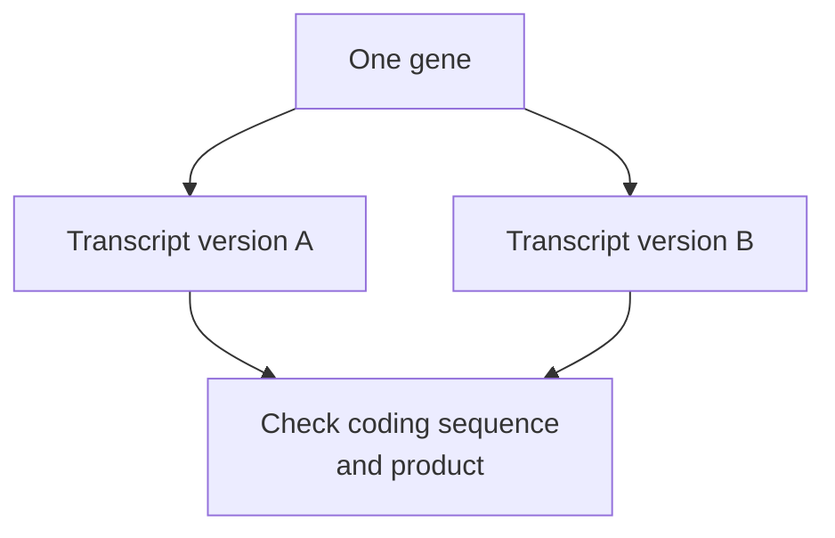

# Gene: a region that produces a functional message

## In one sentence

A gene is a region of DNA used to produce a functional RNA, which may itself do a job or provide instructions for making a protein.

## The intuition

A gene is like one useful entry in a large instruction collection. Some entries describe how to make a tool; others produce a working message that has its own job. The analogy has limits: gene boundaries and regulation can be complex, and one gene can produce several messages. It is rarely a neat one-entry, one-product system.

## How it works

Cells **transcribe**, or copy, a gene's [DNA](/wiki/education/concepts/biology-basics/molecules/dna) into [ribonucleic acid (RNA)](/wiki/education/concepts/biology-basics/molecules/rna-and-mrna). A **protein-coding gene** supplies a message that can be translated into an amino-acid chain. A **noncoding RNA gene** produces an RNA with a role that does not require becoming a protein. Ribosomal RNA, part of the protein-making machinery, is one example. [NHGRI gene](https://www.genome.gov/genetics-glossary/Gene).

A **promoter** is a DNA region where transcription machinery assembles. Other regulatory regions can influence transcription, sometimes from far away. Their effect depends on which regulatory proteins are present and how the DNA is packaged. Finding a gene in a genome therefore differs from finding its RNA product. Different [cell lineages and states](/wiki/education/concepts/biology-basics/cells/cell-lineage-and-differentiation) can use different parts of the genome. [Transcription machinery](https://www.ncbi.nlm.nih.gov/books/NBK26887/).

A **transcript** is an RNA product. Many human genes contain regions called **exons** and **introns**. [Splicing](/wiki/education/concepts/biology-basics/genetics/splicing) removes introns and joins retained exons. An exon can contain untranslated sequence, so exon is not a synonym for protein-coding segment. Alternative processing can generate different transcript versions from the same gene. [NHGRI exon](https://www.genome.gov/genetics-glossary/Exon).

The **coding sequence** is the part of a protein-coding message read to make the protein. Other parts of that message help control its handling. A gene name alone cannot specify which transcript, coding segment or [protein version](/wiki/education/concepts/biology-basics/molecules/protein-and-peptide) a report means.

*Different messages can come from one gene; inspect the actual transcript rather than assuming a single product.*

## Why it matters in cancer

A report may say a gene is altered, amplified or highly expressed. Each phrase asks a different question: sequence, copy number or RNA abundance. None alone says whether the cancer relies on the gene's product.

A variant's consequence also depends on the reference used. The same genomic location can have different consequences in different transcripts. Retain the genome reference and the transcript **accession and version**, the identifier for the exact reference sequence, when reading a detailed variant description. [HGVS reference sequences](https://hgvs-nomenclature.org/stable/background/refseq/).

## How it is measured

DNA sequencing tests sequence within its covered regions. [RNA sequencing](/wiki/education/concepts/measurement/transcriptomics/bulk-rna-seq) samples messages, often summarized by gene. Protein assays measure another physical object. A gene-level count can pool transcript versions and cells; it cannot reveal every splice product or prove that the relevant protein is intact.

## Common confusions

- **Gene versus protein:** the gene is a DNA region; its protein product is a separate molecule.
- **One gene versus one transcript:** several transcript versions may exist.
- **Noncoding versus useless:** an RNA can function without encoding a protein.
- **Gene name versus reference:** a name does not define the coordinates or transcript version.

## Try it

A fictional gene R has two transcript versions. A variant interrupts the coding region of version A but lies outside the coding region of version B. Can “R is disrupted” describe both products without qualification?

Show the answer

No. Name the reference transcript and predicted consequence. Then ask which transcripts are made in the relevant cells and whether usable protein remains. A gene-wide label hides that uncertainty.

## Explain it back

“A gene is ______; a transcript is ______; a protein is ______.”

One answer: “a DNA region that produces a functional RNA; an RNA product; an amino-acid product that may be made from a coding message.”

## Takeaway

**Start with the gene, then identify the exact message and product the claim concerns.**

## Related concepts

- [Central dogma](/wiki/education/concepts/biology-basics/genetics/central-dogma).
- [Alleles and zygosity](/wiki/education/concepts/biology-basics/genetics/allele-and-zygosity).

## Sources and scope

Source check: October 9, 2026. General gene organization and reference interpretation; the example is fictional. Expert and learner review remain pending.

- [NHGRI: gene, including RNA genes](https://www.genome.gov/genetics-glossary/Gene).
- [Molecular Biology of the Cell: from DNA to RNA](https://www.ncbi.nlm.nih.gov/books/NBK26887/).
- [NHGRI: exon](https://www.genome.gov/genetics-glossary/Exon).
- [HGVS: reference sequences](https://hgvs-nomenclature.org/stable/background/refseq/).

<!-- BEGIN GENERATED USED IN -->
## Used in

- [Start with genes, RNA and protein](/wiki/education/multi-omics-foundations/00-genes-rna-and-protein)
<!-- END GENERATED USED IN -->
