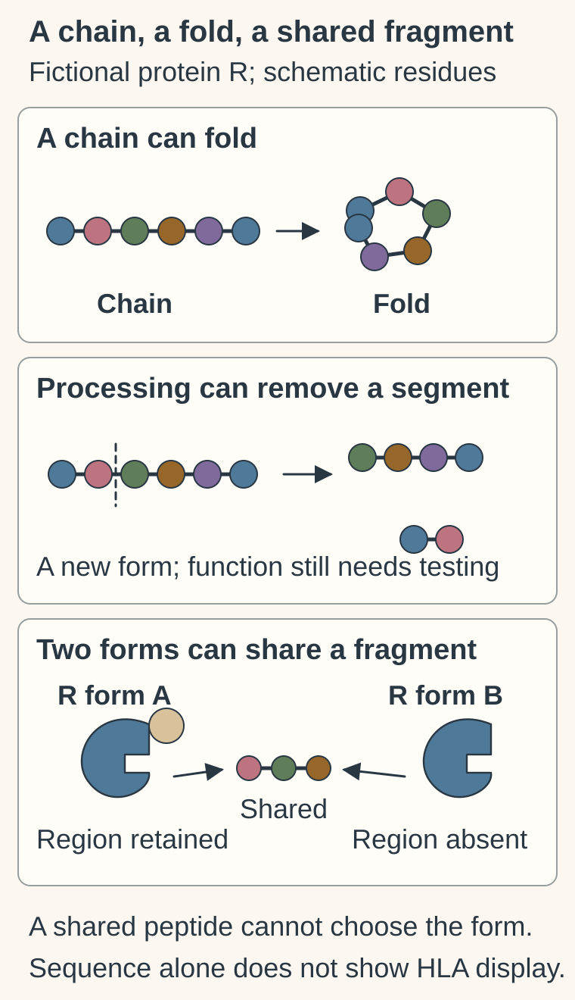
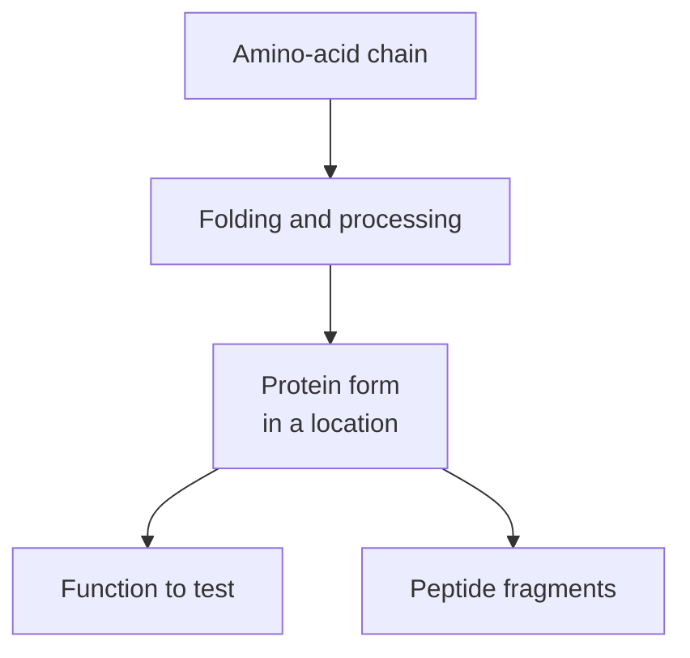

# Proteins and peptides: amino-acid molecules

## In one sentence

Proteins and peptides are molecules built from amino-acid chains; their sequence, processing and physical form help determine what they can do.

## The intuition

Imagine building with a chain of pieces that have different chemical personalities. Some prefer water, some carry charge and some can react with other groups. The order affects how the chain behaves. This is more than a string of identical beads: it can fold, bind partners, be cut or assemble with other chains.

## How it works

The residue icons and shapes are illustrative, not measured sequence lengths or atomic structures. A chain can fold or be processed into another form. In the fictional protein R example, forms A and B share a peptide while only A retains the indicated region; a shared fragment cannot establish which intact form or activity is present. A possible sequence also does not establish HLA presentation.

An **amino acid** is a building block. When amino acids join through **peptide bonds**, they form a chain called a **polypeptide**. Within a chain, each linked amino acid is often called a **residue**. Cells make these chains by translating [messenger RNA](/wiki/education/concepts/biology-basics/molecules/rna-and-mrna). [NHGRI protein](https://www.genome.gov/genetics-glossary/Protein).

“Peptide” often refers to a shorter chain or a fragment; “protein” commonly refers to a larger biological product. These names overlap. There is no single length boundary that explains every usage, and size alone does not establish a molecule's function. A small peptide can carry a signal, while a large protein can provide structure. [NCI peptide](https://www.cancer.gov/publications/dictionaries/cancer-terms/def/peptide).

The chain's sequence influences its [structure and domains](/wiki/education/concepts/biology-basics/molecules/protein-structure-and-domains). A functioning protein may contain one chain or several associated chains. Some regions fold into stable shapes; others remain flexible. Processing can remove a segment, and chemical modifications can change behavior. Where the product goes also matters: a protein inside a cell is different from a drug-accessible protein on its outer [cell membrane](/wiki/education/concepts/biology-basics/cells/cell-and-membrane).

Proteins perform many jobs. [Enzymes](/wiki/education/concepts/biology-basics/molecules/enzymes-and-binding) catalyze reactions. Receptors participate in signaling. Other proteins transport molecules or provide structural support. Production and removal both influence protein abundance; the [ubiquitin–proteasome system](/wiki/education/concepts/cancer-biology/cell-death-and-survival/ubiquitin-and-proteasome) is one route for controlled protein breakdown.

*An intact product and a fragment from that product are different measurement targets.*

## Why it matters in cancer

A gene alteration can change a protein's sequence, amount or processing. It may also have little effect on the relevant product. The [central dogma](/wiki/education/concepts/biology-basics/genetics/central-dogma) helps organize this chain, but each proposed consequence needs evidence.

For immune recognition, a peptide fragment can be displayed by [human leukocyte antigen (HLA) molecules](/wiki/education/concepts/immunology/antigen-presentation/hla). A predicted protein sequence is not proof that a particular peptide is displayed or recognized. The fragment's generation, presentation and immune recognition are separate steps.

## How it is measured

[Immunohistochemistry](/wiki/education/concepts/measurement/pathology-readouts/immunohistochemistry) uses antibodies to detect selected protein features in tissue. An antibody can recognize a fragment or more than one product form. Many [mass spectrometry proteomics](/wiki/education/concepts/measurement/proteins-and-spatial/mass-spectrometry-proteomics) workflows deliberately digest proteins into peptides before measurement. Finding a peptide supports the identity or quantity the method can resolve; it does not automatically prove intact full-length protein.

## Common confusions

- **Amino acid versus peptide:** one is a building block; the other contains linked building blocks.
- **Protein versus its fragments:** a fragment may persist after the intact product is lost.
- **Protein amount versus function:** abundance does not establish useful activity.
- **Peptide sequence versus presented antigen:** sequence prediction does not show surface presentation.

## Try it

A fictional assay detects a peptide shared by two forms of protein R. One form lacks a catalytic region. Can the peptide identify which intact form is present?

Show the answer

No. It is shared evidence. An assay targeting a distinguishing sequence or another validated product feature is needed. Testing catalytic activity asks an additional question.

## Explain it back

“The assay detected ______; whether the intact protein ______ is still open.”

One answer: “a shared peptide fragment; contains the needed region and performs its job.”

## Takeaway

**Ask which molecular form was measured before assigning a protein's function to the signal.**

## Related concepts

- [Protein structure and domains](/wiki/education/concepts/biology-basics/molecules/protein-structure-and-domains).
- [Immunopeptidomics](/wiki/education/concepts/measurement/proteins-and-spatial/immunopeptidomics).

## Sources and scope

Source check: October 9, 2026. General molecules and measurement boundaries; the practice example is fictional. Expert and learner review remain pending.

- [NHGRI: protein](https://www.genome.gov/genetics-glossary/Protein).
- [NCI: peptide](https://www.cancer.gov/publications/dictionaries/cancer-terms/def/peptide).
- [Molecular Biology of the Cell: from RNA to protein, including folding and processing](https://www.ncbi.nlm.nih.gov/books/NBK26829/).

<!-- BEGIN GENERATED USED IN -->
## Used in

- [Ask whether protein is present, placed and active](/wiki/education/molecular-profiling/03-protein-expression-and-activation)
- [Start with genes, RNA and protein](/wiki/education/multi-omics-foundations/00-genes-rna-and-protein)
<!-- END GENERATED USED IN -->
