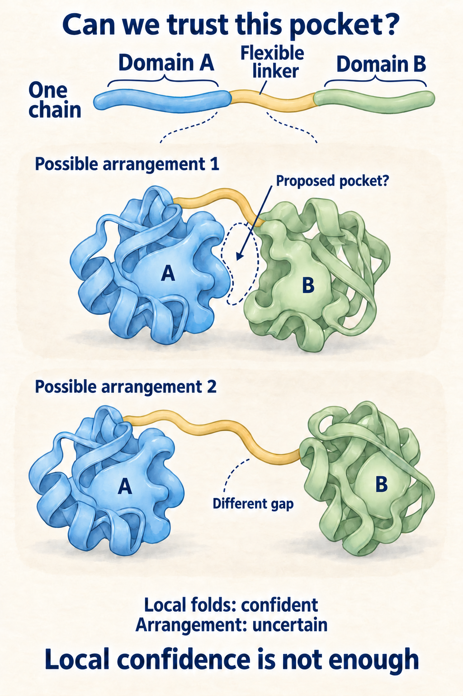
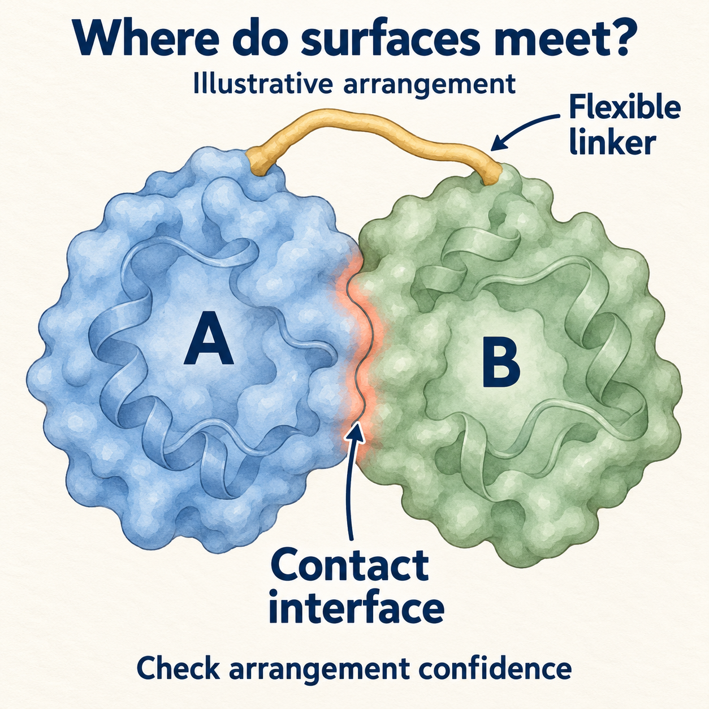
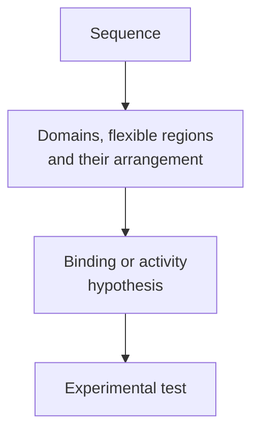

# Protein structure and domains

## In one sentence

Protein structure is the three-dimensional arrangement of an amino-acid chain; domains are regions that form recognizable structural units within a protein.

## The intuition

Picture a folding tool with several working parts. One part grips a partner, another performs a reaction and a flexible hinge changes their arrangement. A protein can contain similar modules. The analogy has limits: domains are molecular structures, their boundaries need evidence, and a protein explores different shapes rather than acting as a rigid metal tool.

## How it works

A protein's **primary structure** is its amino-acid sequence. **Secondary structure** describes local arrangements such as helices and sheets. **Tertiary structure** is the three-dimensional organization of a chain. **Quaternary structure** describes how several chains assemble. These are different ways to describe the same molecular system, rather than four obligatory construction stages. [Protein structure](https://www.ncbi.nlm.nih.gov/books/NBK26830/).

A **domain** is a region that forms a recognizable structural unit, often able to fold relatively independently. A protein may contain one domain or several. Different domains can contribute to binding, catalysis or regulation. Their arrangement matters too: a preserved catalytic domain can behave differently when its regulatory neighbors are changed.

A **motif** is a recurring sequence or structural pattern. It may contribute to a function but is not automatically a whole independently folding domain. An **interface** is a contact surface between molecular partners. Interfaces can involve residues brought together by folding, rather than one uninterrupted sequence segment. [EMBL-EBI domains and motifs](https://www.ebi.ac.uk/training/online/courses/proteins-domains/domains-motifs-and-regions/).

Some protein regions are **intrinsically disordered**: they do not adopt one stable shape in the relevant conditions. They can still regulate interactions or become more ordered with a partner. “Flexible” is not a synonym for “useless.”

*Same locally confident domain folds, two hypothetical arrangements—and two different inter-domain gaps. This fictional sketch shows why a proposed pocket needs relative-position confidence as well as local confidence; the alternatives are not observed motion or evidence of disorder. Neither drawing establishes binding, activity or clinical effect.*

*The highlighted patches mark contact between two apposed domain surfaces in this fictional arrangement. That contact interface differs from the empty questioned pocket above. Local-fold confidence does not establish this arrangement or contact; no observed motion, measured binding, affinity, activity or clinical effect is shown.*

*A structural explanation helps choose a test; it does not replace the test.*

## Why it matters in cancer

A sequence variant may alter an important contact, remove a domain or change a regulatory region. A fusion can join regions from different proteins. Those locations make a mechanism plausible, but they do not by themselves establish a damaging effect, tumor dependence or drug benefit.

An antibody or a drug must encounter the appropriate molecular form and accessible binding site. Sequence, folding, partners, modifications and cellular location can all affect that encounter. The [enzyme and binding concept](/wiki/education/concepts/biology-basics/molecules/enzymes-and-binding) separates a structural hypothesis from a measured interaction.

## How it is measured or modeled

Experimental structures can come from methods such as X-ray crystallography, nuclear magnetic resonance or cryogenic electron microscopy. Each captures information under particular conditions. A structure may omit a flexible region or differ from the arrangement in a living cell.

Computed structures need their own confidence checks. AlphaFold2's **predicted local distance difference test (pLDDT)** estimates local structural confidence. **Predicted aligned error (PAE)** helps assess uncertainty in the relative positions of regions. These are model-confidence measures, not measured protein abundance, binding affinity or clinical effect. A confident domain alone cannot certify the arrangement or activity of the whole protein. [EMBL-EBI confidence guidance](https://www.ebi.ac.uk/training/online/courses/alphafold/inputs-and-outputs/evaluating-alphafolds-predicted-structures-using-confidence-scores/).

## Common confusions

- **Domain versus motif:** a recurring pattern need not be an independently folding unit.
- **Disorder versus damage:** a flexible region can have a normal function.
- **Structure prediction versus variant validation:** a plausible model does not measure a variant's effect.
- **Binding-site shape versus drug benefit:** access, activity, safety and clinical evidence remain separate.

## Try it

A fictional protein model confidently predicts two domains, but their relative position is uncertain. A drug-binding proposal relies on a pocket between them. Is local confidence enough?

Show the answer

No. The proposed pocket depends on the uncertain arrangement. Inspect relative-position confidence and test binding in the relevant molecular form. Even confirmed binding would leave cellular and clinical effects open.

## Explain it back

“A domain describes ______; a confidence score describes ______; activity needs ______.”

One answer: “a structural unit; how reliable a particular prediction may be; an appropriate experimental readout.”

## Takeaway

**Use structure to explain a mechanism and choose an experiment, while keeping prediction and measured function separate.**

## Related concepts

- [Proteins and peptides](/wiki/education/concepts/biology-basics/molecules/protein-and-peptide).
- [Drug targets and mechanisms](/wiki/education/concepts/therapeutics/how-drugs-work/drug-target-and-mechanism).
- [Mutation types](/wiki/education/concepts/biology-basics/genetics/mutation-types).

## Sources and scope

Source check: October 9, 2026. General structural interpretation, with AlphaFold2-specific confidence terminology. The example is fictional. Expert and learner review remain pending.

Visual source check: October 11, 2026. The fictional two-domain comparison draws on selected local-confidence and domain-packing discussions in [Jumper et al. (2021)](https://www.nature.com/articles/s41586-021-03819-2) and [Tunyasuvunakool et al. (2021)](https://www.nature.com/articles/s41586-021-03828-1). Shapes and alternative arrangements are schematic, not a real coordinate model or a measured conformational distribution. This bounded check does not re-certify the page's other claims; expert and learner review remain pending.

Interface visual source check: October 11, 2026. Selected [Kim et al. (2006) primary interface-geometry discussion](https://journals.plos.org/ploscompbiol/article?id=10.1371/journal.pcbi.0020124) identifies an interface through contacting domain faces and distinguishes same-chain from different-chain domain interactions. [EMBL-EBI PDBePISA interface guidance](https://www.ebi.ac.uk/pdbe/prot_int/pi_tips.html) provides complementary contact-surface terminology. The drawing is schematic; no source coordinates, numerical contact thresholds or source figures were used. Expert and learner review remain pending.

- [Molecular Biology of the Cell: the shape and structure of proteins](https://www.ncbi.nlm.nih.gov/books/NBK26830/).
- [EMBL-EBI: domains, motifs, regions and intrinsically disordered regions](https://www.ebi.ac.uk/training/online/courses/proteins-domains/domains-motifs-and-regions/).
- [EMBL-EBI: evaluating AlphaFold2 structures using confidence scores](https://www.ebi.ac.uk/training/online/courses/alphafold/inputs-and-outputs/evaluating-alphafolds-predicted-structures-using-confidence-scores/).

<!-- BEGIN GENERATED USED IN -->
## Used in

Browse the [concept index](/wiki/education/concepts/index) for related learning paths.
<!-- END GENERATED USED IN -->
