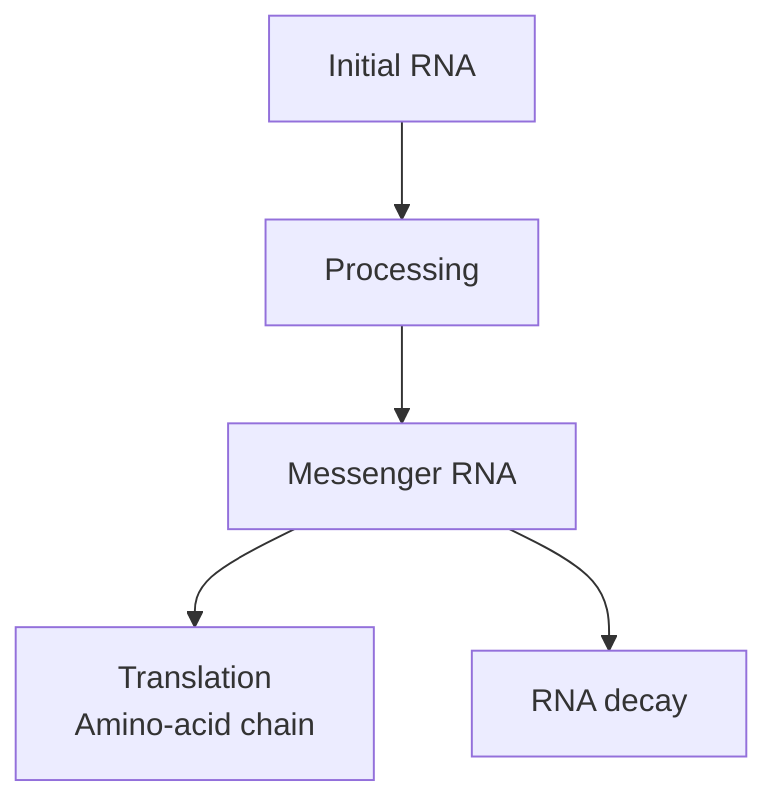

# RNA and messenger RNA: messages with different jobs

## In one sentence

Ribonucleic acid (RNA) is a family of molecules with many cellular jobs; messenger RNA (mRNA) is the kind that supplies a readable template for making a protein.

## The intuition

RNA can be a working message, part of a machine or a regulator. Messenger RNA is one member of that family, like a set of assembly instructions within a busy workshop. The analogy ends when it suggests every RNA must be read into a product. Many RNAs do their work directly.

## How it works

Like DNA, RNA consists of linked **nucleotides**, chemical building blocks. RNA uses the sugar ribose and usually uses uracil, U, where DNA uses thymine, T. RNA is often a single strand, but complementary sections can pair and fold. That folding helps some RNAs perform their jobs. [NHGRI RNA fact sheet](https://www.genome.gov/about-genomics/educational-resources/fact-sheets/ribonucleic-acid-fact-sheet).

Several roles help make the family easier to remember:

| RNA type | Main job in this explanation |
|---|---|
| Messenger RNA | Provides the template read during protein production |
| Ribosomal RNA | Helps form the ribosome and catalyzes peptide-bond formation |
| Transfer RNA | Carries amino acids to the ribosome |
| Regulatory RNA | Influences other messages or gene activity |

For many human nuclear genes, transcription makes an initial RNA. Processing adds a protective **5′ cap**, removes introns through [splicing](/wiki/education/concepts/biology-basics/genetics/splicing), and adds a **poly(A) tail**, a stretch of adenines, at the other end. These features are common, rather than a rule for every RNA molecule. A processed mRNA can then leave the nucleus. [From DNA to RNA](https://www.ncbi.nlm.nih.gov/books/NBK26887/).

A **ribosome**, a machine made of RNA and proteins, reads the message's coding sequence in **codons**, groups of three nucleotides. Transfer RNAs help match those instructions to amino acids. The growing amino-acid chain is a [protein product](/wiki/education/concepts/biology-basics/molecules/protein-and-peptide). Folding, transport and modification remain further steps. [From RNA to protein](https://www.ncbi.nlm.nih.gov/books/NBK26829/).

RNA is also degraded. Its abundance reflects production, processing and removal, rather than transcription alone. Some altered messages are reduced by [nonsense-mediated decay](/wiki/education/concepts/biology-basics/genetics/nonsense-mediated-decay), but their fate depends on the transcript context.

*This map follows a coding message; other RNAs function without this translation step.*

## Why it matters in cancer

RNA helps test whether a proposed gene product has a captured message and which transcript forms exist. It can also help identify cell states. [Bulk RNA sequencing](/wiki/education/concepts/measurement/transcriptomics/bulk-rna-seq) pools messages from a tissue mixture. A high count can reflect more source cells, more RNA per cell or technical preparation differences.

An mRNA vaccine supplies a coding message for cells to translate. That is different from measuring tumor RNA, and a supplied message still needs successful delivery and biological handling.

## Common confusions

- **RNA versus mRNA:** mRNA is one RNA category.
- **Captured message versus full-length message:** short reads do not prove that every captured molecule was intact.
- **RNA abundance versus protein activity:** separate assays address protein amount, location and function.
- **Low RNA versus no transcription:** rapid removal can also lower abundance.

## Try it

A fictional assay finds many RNA fragments assigned to gene Q. No reads distinguish its transcript versions. Does the result prove that the intended full-length mRNA was translated?

Show the answer

No. It supports captured gene-associated RNA under that method. Transcript structure, integrity and translation remain separate questions. Choose measurements that can resolve the product being proposed.

## Explain it back

“mRNA supplies ______, but an RNA count cannot by itself establish ______.”

One answer: “a template for protein production; an intact, correctly located and active protein.”

## Takeaway

**Name the RNA type and the captured feature before turning a message measurement into a product claim.**

## Related concepts

- [RNA integrity](/wiki/education/concepts/measurement/specimens/rna-integrity).
- [mRNA construct anatomy](/wiki/education/concepts/engineering-and-manufacturing/nucleic-acid-design/mrna-construct-anatomy).

## Sources and scope

Source check: October 9, 2026. General RNA biology; the assay example is fictional. Expert and learner review remain pending.

- [NHGRI: ribonucleic acid fact sheet](https://www.genome.gov/about-genomics/educational-resources/fact-sheets/ribonucleic-acid-fact-sheet).
- [Molecular Biology of the Cell: from DNA to RNA](https://www.ncbi.nlm.nih.gov/books/NBK26887/).
- [Molecular Biology of the Cell: from RNA to protein](https://www.ncbi.nlm.nih.gov/books/NBK26829/).

<!-- BEGIN GENERATED USED IN -->
## Used in

- [HLA and antigen presentation in vaccine design](/wiki/education/designing-a-vaccine/02-hla-and-antigen-presentation)
- [Read a neoantigen design board](/wiki/education/designing-a-vaccine/04-how-to-read-a-neoantigen-design-board)
- [Start with genes, RNA and protein](/wiki/education/multi-omics-foundations/00-genes-rna-and-protein)
- [Separate immune presence from tumor recognition](/wiki/education/multi-omics-foundations/06-immune-presence-and-recognition)
- [How dendritic cells help start a T-cell response](/wiki/education/oncology-101/2-dendritic-cells)
<!-- END GENERATED USED IN -->
