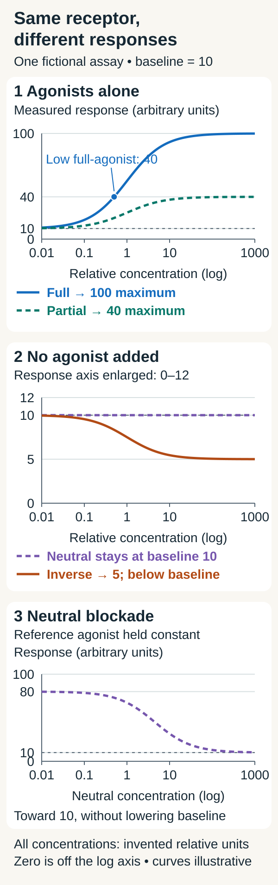

# Agonists and antagonists: binding versus action

## In one sentence

An agonist promotes a receptor's response, an antagonist opposes agonist action, and an inverse agonist reduces a receptor's activity that exists without an agonist.

## The intuition

Holding a key and turning the mechanism are different things. [Ligand–receptor binding](/wiki/education/concepts/biology-basics/signaling/ligand-and-receptor) asks whether a molecule associates with a receptor. Agonism asks what happens through that receptor after association.

The key analogy cannot capture all the possibilities: receptors may have activity before a ligand arrives, and binding at one location can change behavior elsewhere. Start with a named receptor and a defined response, rather than labeling a molecule a universal “activator” or “blocker.”

## How it works

**Affinity** describes a tendency to bind. **Efficacy in receptor pharmacology** describes the capacity to produce a receptor-mediated response; here, it does not mean clinical treatment benefit. The response also depends on receptor amount, cellular partners and the assay.

| Functional description | What happens in the specified system? |
|---|---|
| Full agonist | Can produce the system's maximal measured receptor response. |
| Partial agonist | Has lower activating capacity and may produce a smaller maximum than a full agonist. Receptor abundance and signal amplification can affect the observed maximum. |
| Neutral antagonist | Opposes agonist action without changing the receptor's agonist-independent baseline activity. |
| Inverse agonist | Reduces agonist-independent receptor activity; this requires a system in which that activity can be measured. |

A partial agonist is not simply a small dose of a full agonist. Alone, a partial agonist raises the response above baseline in this system. With a full agonist present, it can lower the response if they compete for the same binding site and it replaces enough full agonist to reduce activation. The result depends on their concentrations and affinities. Antagonists need not all compete at the agonist's site: changing receptor behavior through another site can also oppose agonist action.

**Constitutive activity** means receptor activity without an agonist. It must be distinguishable from background signal or an unnoticed agonist in the assay. An inverse agonist reduces this activity; a neutral antagonist leaves it unchanged while opposing agonist action.

The inverse-agonist distinction has experimental grounding. Chidiac and colleagues studied human beta-2 adrenergic receptors expressed in insect cells and found agonist-independent signaling that certain ligands reduced. That model establishes the distinction; it does not classify every ligand in every tissue.

## Why it matters in cancer

Activating a receptor need not promote tumor growth. A receptor may transmit an inhibitory or immune-regulatory signal. Opposing that signal can increase another cell's activity. You need the [receptor type](/wiki/education/concepts/biology-basics/signaling/receptor-types), responding cell and measured output to interpret the direction.

Likewise, “antagonist” describes a mechanism within a system. It does not establish selective tumor killing, an approved indication or benefit from a particular combination.

## How it is measured

A binding experiment may report a dissociation constant, **Kd**, in molar units such as nanomolar, abbreviated nM. Lower Kd indicates tighter binding under the specified conditions. A functional experiment may report **EC50**, the concentration producing half of the change from baseline to that compound's maximal measured response in that assay. EC50 and Kd answer different questions.

  
  
A lower dose can sit partway up a full agonist's curve; a partial agonist has a lower maximum in this assay. Neutral blockade opposes an added agonist, while inverse agonism lowers activity without an agonist. These are illustrative curves for one fictional receptor assay: baseline 10, limiting responses 100, 40 and 5 arbitrary units. Each compound is varied separately over 0.01–1000 invented relative concentration units; the middle response axis is enlarged. Zero concentration is off the logarithmic axis. Curve shapes, shared concentration scales and maxima are invented, not occupancy measurements or clinical doses.

Compare concentration–response curves, the baseline without added agonist, a reference agonist and appropriate receptor controls. Record cell type, receptor abundance, endpoint and timing. A single low-dose measurement cannot establish a partial agonist's maximum, and lowering a signal through toxicity does not establish inverse agonism.

## Common confusions

- **High affinity versus strong activation:** binding and functional response can diverge.
- **Partial versus underdosed:** lower activating capacity is not defined by using less compound.
- **Inverse versus neutral:** only the inverse agonist lowers agonist-independent receptor activity.
- **Receptor efficacy versus clinical efficacy:** an assay response is not a patient outcome.

## Try it

A fictional, controlled receptor assay has a baseline of 10 arbitrary units without added agonist. A reference agonist reaches 100 units. Compound A reaches 40 across a well-characterized concentration range. Compound B leaves baseline at 10 but opposes the reference agonist. Compound C lowers baseline to 5, with controls showing a receptor-mediated decrease and excluding toxicity, background-signal changes, and unnoticed agonist.

**Answer:** The results are consistent with A being a partial agonist, B a neutral antagonist and C an inverse agonist in this system. Receptor abundance and assay coupling still matter. These invented values are not clinical thresholds or universal properties of the compounds.

## Explain it back

“Binding tells me ___; response curves tell me ___; a baseline without agonist helps distinguish ___ from ___.”

## Takeaway

Read the receptor, baseline and response together before interpreting a drug's functional label.

## Related concepts

- [Enzymes and binding](/wiki/education/concepts/biology-basics/molecules/enzymes-and-binding): binding and molecular function.
- [Chemical probes and target engagement](/wiki/education/concepts/therapeutics/how-drugs-work/chemical-probe-vs-drug-and-target-engagement): evidence that a perturbation acts through its intended target.

## Sources and scope

Source check: October 12, 2026. General receptor pharmacology; practice values are fictional. Expert and learner review remain pending.

- [IUPAC medicinal-chemistry recommendations, A–H (1998)](https://iupac.qmul.ac.uk/medchem/ah.html): affinity, antagonism and receptor efficacy nomenclature.
- [IUPAC medicinal-chemistry recommendations, I–Z (1998)](https://iupac.qmul.ac.uk/medchem/ix.html): partial agonism and the dependence of observed activity on the tissue/system.
- [Neubig et al., NC-IUPHAR quantitative-pharmacology recommendations (2003)](https://pubmed.ncbi.nlm.nih.gov/14657418/): system-dependent functional labels and experimental measures; [official tables](https://www.guidetopharmacology.org/pdfs/termsAndSymbols.pdf).
- [Chidiac et al. (1994)](https://pubmed.ncbi.nlm.nih.gov/7908406/): inverse agonism in experimentally expressed beta-2 adrenergic receptors; [author-hosted full text](https://publish.uwo.ca/~pchidiac/chidiac_pdf/Inverse%20agonist%20activity%20of%20beta-adrenergic%20antagonists.pdf).

<!-- BEGIN GENERATED USED IN -->
## Used in

Browse the [concept index](/wiki/education/concepts/index) for related learning paths.
<!-- END GENERATED USED IN -->
