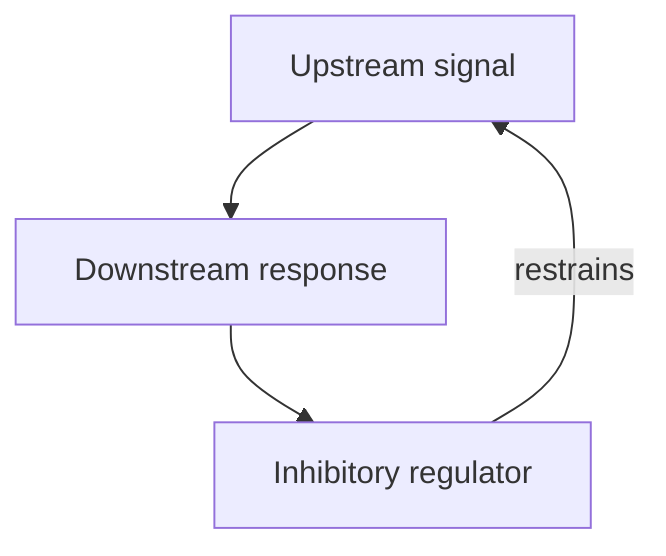

# Feedback loops: when a signal changes its own circuit

## In one sentence

A feedback loop returns an effect to an earlier part of a circuit, where it can restrain or reinforce the activity that helped produce it.

## The intuition

A thermostat uses a room's temperature to influence the heating that changes that temperature. That returning connection is feedback. A heater controlled only by a preset timer has no temperature-return connection, even if the room follows a predictable pattern.

Cells do not consciously choose a target temperature. Their loops emerge from molecular interactions. The thermostat analogy helps identify a returning connection; it does not promise that a cellular circuit will restore a healthy or stable state.

## How it works

[Signal transduction](/wiki/education/concepts/biology-basics/signaling/signal-transduction-and-kinases) includes connections that branch and return. **Negative feedback** means a returning effect restrains the activity that produced it. **Positive feedback** reinforces that activity. The words name the direction of regulation, not whether the result is beneficial or harmful.

This sketch shows a negative-feedback connection. The return arrow represents inhibition, not another activating arrow. The real molecular steps and delays must be established for the system being studied.

**Feedforward** is different: an input reaches a downstream component by both a direct route and an indirect route, without the downstream component returning an effect upstream. The routes may reinforce each other or oppose each other. A rise followed by a fall in a measured signal can arise from more than one circuit design; its shape alone does not identify feedback.

Returning regulation may change [phosphorylation](/wiki/education/concepts/biology-basics/signaling/phosphorylation), protein amount or receptor availability. Different processes take different amounts of time. A response can be transient, sustained or oscillating depending on the connections, delays and cellular state. Positive feedback can support a persistent state, but not every positive loop produces an irreversible switch.

In a primary study of rat PC12 cells used as a neuronal-differentiation model, different growth-factor inputs produced different feedback arrangements and response dynamics within the same signaling network. That is a useful demonstration of context; it does not establish the wiring of a human tumor from one measurement.

## Why it matters in cancer

Blocking one component may release a restraint on another. O'Reilly and colleagues found that inhibiting **mechanistic target of rapamycin (mTOR)** could release feedback restraint and increase **AKT, or protein kinase B**, signaling in studied cancer-cell models; they also observed increased AKT phosphorylation in treated patient tumor samples. The [PI3K–AKT–mTOR pathway](/wiki/education/concepts/cancer-biology/signaling-pathways/pi3k-akt-mtor) explains the distinct components.

These observations explain how an intended biochemical effect and a compensating signal can coexist. They do not prove that every tumor rebounds in the same way or that a proposed drug combination improves patient outcomes. A changing signal can generate a hypothesis about [drug resistance](/wiki/education/concepts/therapeutics/how-drugs-work/drug-resistance); it is not evidence of a new mutation by itself.

## How it is measured

Use measurements at several times, before and after a defined perturbation. Retain the input, cell population, concentration and output units, such as normalized site intensity. Sample more than the suspected loop's final output where feasible.

To test a returning connection, perturb the proposed regulator and ask whether the predicted upstream response changes, with controls for exposure and cell viability. A diagram or correlated time course suggests a mechanism; targeted perturbations and independent measurements help test causality. Different loops can produce similar curves, and mixed cell populations can obscure the response of individual cells.

## Common confusions

- **Negative versus harmful:** restraint can be protective or disadvantageous depending on context.
- **Rebound versus new mutation:** adaptation can occur through existing molecular machinery.
- **Feedback versus feedforward:** only feedback contains a returning connection.
- **A late readout versus a permanent state:** timing and reversibility need to be measured.

## Try it

In a fictional culture, a drug lowers output X after one hour, but X returns toward baseline by 24 hours. No genetic change has been measured. Does this prove acquired mutation-driven resistance?

**Answer:** No. Feedback, another signaling route, changing drug exposure or cell-population shifts could explain the pattern. Measure exposure and intermediate signals, then perturb the proposed compensating connection. The curve alone cannot distinguish those explanations or establish clinical resistance.

## Explain it back

“The proposed return connection is ___; it restrains or reinforces ___; to distinguish it from a parallel route, I would measure or perturb ___.”

## Takeaway

Read a signaling measurement as a moment in a responsive circuit, then test which connections explain the change.

## Related concepts

- [Receptor types](/wiki/education/concepts/biology-basics/signaling/receptor-types): the location and receiving mechanism of an input.
- [Combination-therapy rationale](/wiki/education/concepts/therapeutics/how-drugs-work/combination-therapy-rationale): testing a combination hypothesis beyond a network diagram.

## Sources and scope

Source check: October 9, 2026. General mechanism education; the culture experiment is fictional. Expert and learner review remain pending.

- [O'Reilly et al. (2006)](https://pubmed.ncbi.nlm.nih.gov/16452206/): mTOR inhibition and released feedback in cancer models, with patient-tumor pharmacodynamic observations; not a universal combination-benefit result.
- [Santos et al. (2007)](https://pubmed.ncbi.nlm.nih.gov/17310240/): growth-factor-dependent feedback and signaling dynamics in rat PC12 cells.
- [Mangan and Alon (2003)](https://pubmed.ncbi.nlm.nih.gov/14530388/): theoretical analysis of feedforward motifs in transcription networks; a circuit definition, not a tumor-treatment experiment.
- [Mathematical and computational analysis of adaptation via feedback inhibition (2007)](https://pmc.ncbi.nlm.nih.gov/articles/PMC1913166/): modeled adaptation mechanisms and limits of identifying circuitry from response dynamics.

<!-- BEGIN GENERATED USED IN -->
## Used in

Browse the [concept index](/wiki/education/concepts/index) for related learning paths.
<!-- END GENERATED USED IN -->
