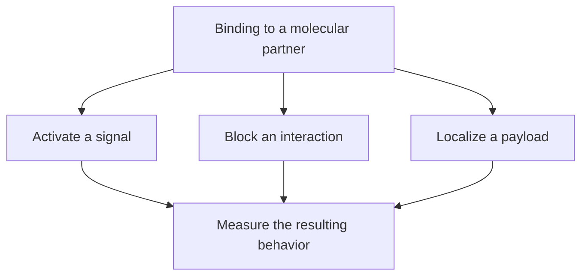

# Ligands and receptors

## In one sentence

A ligand is a molecule that binds a particular partner; a receptor is a protein that senses a signal and can change a cell’s behavior.

## The intuition

Think of a doorbell. Someone presses a button outside; a signal reaches something inside. Binding is the press. Signaling is what happens afterward. The analogy has limits: molecules are flexible, binding is reversible, and several signals can arrive together. Some drugs occupy a binding site without ringing the bell.

## How it works

A ligand can be a protein, a small molecule or a molecule displayed on another cell. Many receptors sit in the cell membrane. Others work inside the cell, as receptors for some hormones do. Location matters when asking whether a drug can reach its target. [Cell-signaling principles](https://www.ncbi.nlm.nih.gov/books/NBK9924/) describe both routes.

An **agonist** activates a receptor. An **antagonist** blocks a relevant interaction or activation. A molecule can bind well yet produce little signal. Receptors also depend on partners, internal signaling machinery and the cell’s state. The same signal can therefore have different effects in different cells.

Not every molecular target is a signaling receptor. An accessible protein can be an address for a drug carrying a payload. That drug may work through payload delivery rather than through the target’s normal function. Ask three separate questions: does it bind, does binding alter a signal, and does the finished treatment produce the intended effect?

*Binding identifies an interaction; the response needs its own measurement.*

## Why it matters in cancer

- Some cancers rely on altered signaling for growth or survival.
- A targeting address does not have to be a growth driver.
- An inhibitory [immune checkpoint](/wiki/education/concepts/immunology/immune-regulation/immune-checkpoint) is a signaling interaction, not a tumor-specific address.

## Worked example

In a fictional experiment, an antibody binds protein A on cancer cells. Cell growth stays unchanged. That establishes binding under those conditions. It does not establish that protein A drives growth, or that this antibody blocks its function. Adding a payload would create a different experiment and a new safety question.

## Common confusions

- “Ligand” does not mean “activator.”
- Strong binding is not the same as strong signaling.
- A target can help deliver a drug without controlling cancer growth.
- A membrane drawing does not describe an intracellular receptor.

## Related concepts

- [Antibody structure](/wiki/education/concepts/immunology/antibodies-and-b-cells/antibody-structure)
- [Cytokines and chemokines](/wiki/education/concepts/immunology/immune-regulation/cytokine-and-chemokine)

## Sources and scope

Source check: October 9, 2026. General molecular interactions; no treatment selection or binding threshold is implied. Expert and learner review remain pending.

- [The Cell: signaling molecules and their receptors](https://www.ncbi.nlm.nih.gov/books/NBK9924/).
- [Molecular Biology of the Cell: cell communication](https://www.ncbi.nlm.nih.gov/books/NBK26813/).
- [NCI: monoclonal antibodies](https://www.cancer.gov/about-cancer/treatment/types/immunotherapy/monoclonal-antibodies).

<!-- BEGIN GENERATED USED IN -->
## Used in

- [Cytokines and programmable receptors](/wiki/education/cellular-therapies/07-cytokines-and-programmable-receptors)
- [PI3K, AKT, and mTOR: competing effects on repair and recycling](/wiki/education/guides/from-variant-to-drug/06-pi3k-akt-mtor-and-repair)
- [Understand how the immune system recognizes cancer](/wiki/education/guides/how-the-immune-system-fights-cancer/index)
- [Notch, Wnt, and FGFR: locate the signal before choosing a target](/wiki/education/molecular-profiling/evee-pathways/03-notch-wnt-and-fgfr)
- [Ask what happens after binding](/wiki/education/oncology-101/1-ligands)
- [Oncology 101: immune foundations](/wiki/education/oncology-101/index)
<!-- END GENERATED USED IN -->
