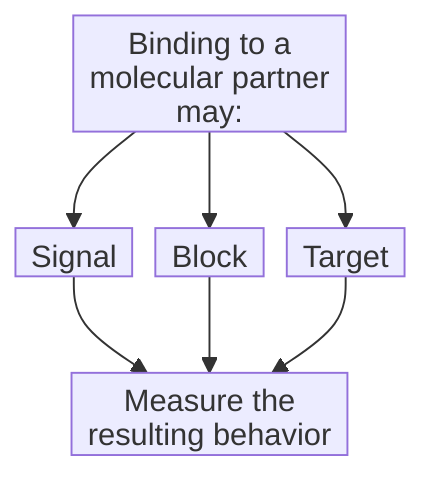
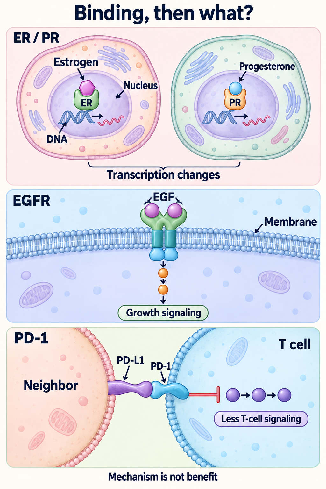

# Ligands and receptors

## In one sentence

A ligand is a molecule that binds a particular partner; a receptor is a protein that senses a signal and can change a cell’s behavior.

## The intuition

Think of a doorbell: a visitor makes contact, and something inside may respond. The analogy separates an interaction from its consequence. It breaks down if it suggests one fixed response. Molecular binding is often reversible, and a cell's partners and state affect what follows.

A molecule can bind without ringing the bell. It might block another visitor or use the address to deliver a package. Those possibilities deserve different experiments.

## How it works

A receptor is a [protein](/wiki/education/concepts/biology-basics/molecules/protein-and-peptide). Some receptors receive signals at the [cell membrane](/wiki/education/concepts/biology-basics/cells/cell-and-membrane); others receive them inside the cell. A ligand must reach the relevant binding site. [Receptor types](/wiki/education/concepts/biology-basics/signaling/receptor-types) explain these receiving mechanisms and why location does not determine every function.

Binding can change a receptor's shape or interactions. That may open an ion channel, alter an enzyme's activity or change gene regulation. An ion is an electrically charged particle. The resulting [signal transduction](/wiki/education/concepts/biology-basics/signaling/signal-transduction-and-kinases) depends on the receptor, cellular partners and timing.

[Agonists and antagonists](/wiki/education/concepts/biology-basics/signaling/agonist-and-antagonist) describe functional effects through a receptor. They are not alternative words for a ligand. A ligand can activate a measured response, oppose another ligand's action or have no detected effect on that response.

The short labels name three possible jobs: signal means activating a signal, block means blocking an interaction, and target means localizing a payload. These are possible jobs, not guaranteed outcomes. Each needs its own action measurement; binding alone does not establish any branch.

An [antibody–drug conjugate](/wiki/education/concepts/therapeutics/antibody-based/antibody-drug-conjugate) illustrates the last job. An accessible protein can serve as an address for delivery without being the cancer's main growth driver. Whether delivery works depends on the finished construct and its target; binding alone does not prove that it does.

### Worked comparison: three ways to receive a signal

Try asking the same question three times: **what does the receiving cell change after binding?** Imagine three separate research notes: a hormone-responsive gene changes its RNA output, an EGFR-expressing cell changes a growth-signaling readout, and a T cell shows a dampened activation response. These are fictional notes for comparing mechanisms, not treatment results.

*Three selected mechanisms answer the same question differently: ER/PR can regulate transcription inside a cell; EGFR receives EGF outside and relays a growth signal inside; PD-1 can dampen signaling in a responding T cell after contact with PD-L1. Receptor shapes, relay dots and molecule counts are schematic. This is a classical ER/PR transcription example and a representative EGFR pair, not an atomic structure, complete pathway or treatment-selection rule.*

**ER and PR: a classical nuclear response.** The [estrogen receptor (ER)](/wiki/education/concepts/breast-cancer/receptors-and-subtypes/estrogen-receptor) and [progesterone receptor (PR)](/wiki/education/concepts/breast-cancer/receptors-and-subtypes/progesterone-receptor) are distinct intracellular hormone receptors. Estrogen and progesterone bind their respective receptors. In the classical mechanism shown, the receptor and its cellular partners regulate **transcription**, making [ribonucleic acid (RNA)](/wiki/education/concepts/biology-basics/molecules/rna-and-mrna) from [deoxyribonucleic acid (DNA)](/wiki/education/concepts/biology-basics/molecules/dna). The useful readout is a specified gene's response, not just whether the hormone bound. ER and PR do not become one receptor or necessarily regulate the same genes. PR forms and cellular context can change the direction of transcriptional regulation. [ER experiments](https://pubmed.ncbi.nlm.nih.gov/3690665/) and [PR isoform experiments](https://pubmed.ncbi.nlm.nih.gov/9407067/) support that distinction. Nuclear-receptor family membership does not mean every molecule stays in the nucleus or every effect requires new transcription; the [receptor-types page](/wiki/education/concepts/biology-basics/signaling/receptor-types) keeps that nuance.

**EGFR: an outside input with an inside relay.** **Epidermal growth factor (EGF)** binds the extracellular portion of the **epidermal growth factor receptor (EGFR)**. A receptor partnership couples that contact to its intracellular kinase machinery; a [kinase](/wiki/education/concepts/biology-basics/signaling/signal-transduction-and-kinases) is an enzyme that transfers phosphate groups. The ligand can remain outside while signaling changes inside. [EGF–EGFR structural experiments](https://pubmed.ncbi.nlm.nih.gov/12297050/) and [EGFR kinase experiments](https://pubmed.ncbi.nlm.nih.gov/16777603/) examined defined molecular systems. The cartoon compresses those mechanisms into one representative pair and a relay. A changed relay readout is not proof that the cells divided, depend on EGFR or would respond to an EGFR-targeted treatment.

**PD-1: an inhibitory immune response.** **Programmed cell death protein 1 (PD-1)** on a responding T cell can bind **programmed death-ligand 1 (PD-L1)** on a neighboring cell. That neighbor may be a cancer cell or another cell. In [primary lymphocyte experiments](https://pubmed.ncbi.nlm.nih.gov/11015443/), this contact reduced activation-related responses. Here the receiver is an immune cell and the signal restrains its response. This is different from turning on a membrane growth relay. The [checkpoint explanation](/wiki/education/concepts/immunology/immune-regulation/immune-checkpoint) covers additional partners and context; PD-1 is not a universal off switch, and removing inhibition does not supply a missing antigen-recognition signal.

Now revisit **agonist versus antagonist**. An agonist promotes the specified receptor's response; an antagonist opposes agonist action in the specified system. Those descriptions concern function, not binding alone. Activating an inhibitory receptor can lower a T-cell response. A molecule that blocks that receptor interaction may therefore release inhibition rather than directly switch off growth. Keep the receptor, receiving cell and measured endpoint beside the functional label. The [IUPAC definitions](https://iupac.qmul.ac.uk/medchem/ah.html) establish the terms; [agonists and antagonists](/wiki/education/concepts/biology-basics/signaling/agonist-and-antagonist) explains partial and inverse agonism without turning an assay response into patient benefit.

**A surface target need not be a signaling receptor.** **Fibroblast activation protein (FAP)** is a cell-surface serine protease: an enzyme that cuts protein substrates. [Primary experiments with natural and recombinant FAP](https://pubmed.ncbi.nlm.nih.gov/10593948/) tested its enzyme activity. A molecule binding FAP can use it as a target; that does not make FAP a hormone, growth-factor or checkpoint receptor in this comparison. Binding, enzyme inhibition and delivery remain different actions.

**Keep the clinical question open.** Inside versus outside helps explain access. It does not establish receptor-defined treatment eligibility, a cancer's dependence, an effective exposure or patient benefit. The two hormone examples also do not turn PR positivity into an instruction to give progesterone. Read actual receptor results using their separate validated clinical rules.

## Why it matters in cancer

Keep four questions apart: can the molecule bind; does it change a function; does the cell depend on that function; and does the treatment help patients? An experiment can answer the first while leaving the other three open.

A receptor's presence does not establish dependence. Conversely, targeting a surface address can support a delivery strategy even when blocking that protein alone does not slow growth. Normal cells may share the address, so accessible binding is not evidence of tumor-only exposure or safety.

## How it is measured

[Affinity](/wiki/education/concepts/biology-basics/molecules/enzymes-and-binding) describes binding strength under specified conditions. A dissociation constant, **Kd**, commonly has molar units, such as nanomolar. A concentration–response experiment measures a defined function instead. Receptor amount and signal amplification can separate these measurements; a binding number is not a response percentage.

Record the partner, accessible location, free versus added ligand concentration, timing and controls. Surface staining, purified-protein binding and a living-cell response are different assays. To test dependence, perturb the proposed function and measure growth and survival, with controls for unrelated effects.

## Common confusions

- **Ligand versus agonist:** a binding partner need not activate the measured response.
- **Strong binding versus strong response:** the cell's receiving machinery matters.
- **Targeting address versus driver:** an address may be useful for delivery without driving growth.
- **Binding versus benefit:** delivery, dependence, exposure and clinical outcomes remain separate tests.

## Try it

In a fictional experiment, an antibody binds surface protein A on viable cells. Growth is unchanged. A colleague concludes, “A cannot be a useful targeting address.” Does that follow?

**Answer:** No. The experiment supports binding without growth inhibition by this antibody under these conditions. It has not tested an attached payload, immune-effector recruitment or a different blocking mechanism. Those require construct-specific experiments, including effects on normal cells. It also has not established that A is a growth dependency.

## Explain it back

“Binding tells me ___; activation or delivery requires ___; dependence requires ___.”

One answer: “which partners interact; a measurement of the proposed action; a controlled perturbation with a relevant cellular outcome.”

## Takeaway

**Name the binding partner, the proposed action and the experiment that actually measured that action.**

## Related concepts

- [Drug targets and mechanisms](/wiki/education/concepts/therapeutics/how-drugs-work/drug-target-and-mechanism).
- [The supporting binding lesson](/wiki/education/oncology-101/1-ligands).

## Sources and scope

Source check: October 10, 2026. General mechanism education; the antibody experiment is fictional. Expert and learner review remain pending.

- [Cooper, Signaling Molecules and Their Receptors (2000)](https://www.ncbi.nlm.nih.gov/books/NBK9924/): textbook receptor locations and receiving mechanisms.
- [Black and Leff (1983)](https://pubmed.ncbi.nlm.nih.gov/6141562/): a pharmacological model separating binding, receptor amount and transduction into response; no clinical benefit model.
- [NCI: targeted therapy](https://www.cancer.gov/about-cancer/treatment/types/targeted-therapies): distinct signaling, immune and payload-delivery mechanisms, with treatment toxicity remaining possible.

Comparison source check: October 12, 2026. The named research studies were checked at primary-abstract depth, including PubMed search text where direct pages were unavailable; full manuscripts and study figures were not inspected. IUPAC's agonist/antagonist entries were read in the official HTML definitions. The laboratory notes and illustration are schematic. Expert and learner review remain pending.

<!-- BEGIN GENERATED USED IN -->
## Used in

- [Cytokines and programmable receptors](/wiki/education/cellular-therapies/07-cytokines-and-programmable-receptors)
- [PI3K, AKT, and mTOR: competing effects on repair and recycling](/wiki/education/guides/from-variant-to-drug/06-pi3k-akt-mtor-and-repair)
- [Understand how the immune system recognizes cancer](/wiki/education/guides/how-the-immune-system-fights-cancer/index)
- [Notch, Wnt, and FGFR: locate the signal before choosing a target](/wiki/education/molecular-profiling/evee-pathways/03-notch-wnt-and-fgfr)
- [Ask what happens after binding](/wiki/education/oncology-101/1-ligands)
- [Oncology 101: immune foundations](/wiki/education/oncology-101/index)
<!-- END GENERATED USED IN -->
