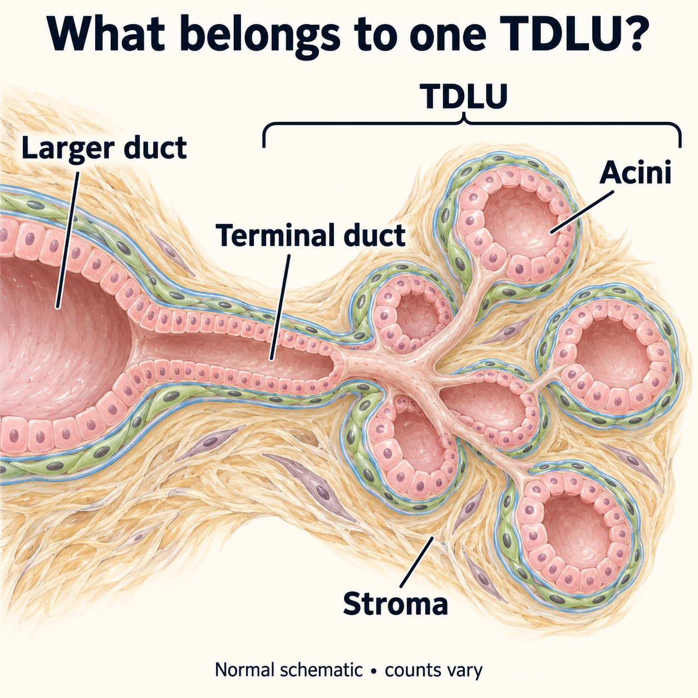
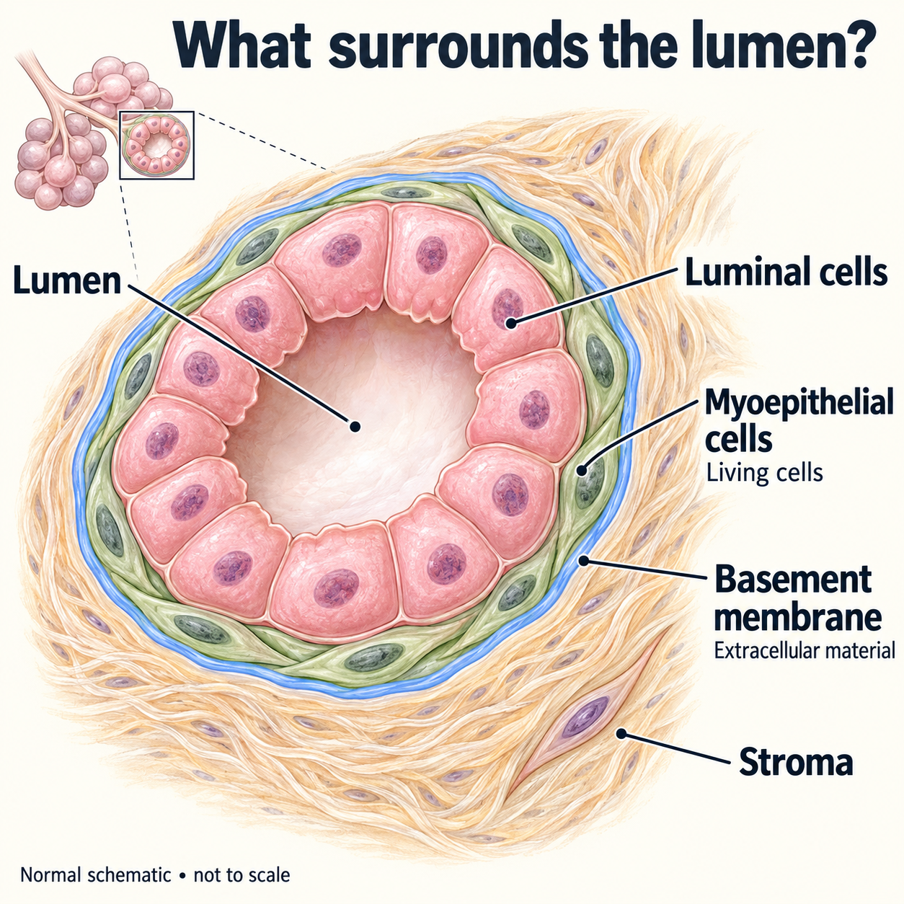
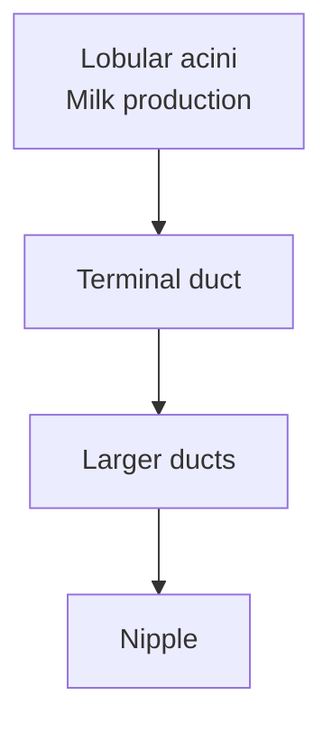

# Breast anatomy: ducts, lobules and tissue compartments

## In one sentence

Breast tissue contains branching ducts connected to milk-producing lobules, with supporting stroma, blood vessels and lymphatics around them.

## The intuition

Picture a branching system with small production rooms at its ends. The rooms help you picture lobules, and the connecting routes help you picture ducts. This is an anatomy aid: milk moves through the duct system during lactation, but a cancer does not have to follow that route or begin in a particular room.

*One illustrative TDLU contains a terminal duct and its associated acini; stroma surrounds and separates them. The grouping bracket is an annotation, not a capsule or basement membrane. Counts and shapes vary; this is normal anatomy, not a cancer route.*

*From the lumen outward: luminal cells, living myoepithelial cells, extracellular basement membrane, then surrounding stroma. Cell membranes and basement membrane are different structures. This simplified cutaway is not to scale or a diagnostic test.*

## How it works

A **duct** is a channel lined by epithelial cells. **Lobules** contain small glandular structures called **acini**, where milk is produced during lactation. Lobules are grouped into larger lobes. The amount and arrangement of glandular and fatty tissue vary with physiology and life stage; a schematic is not a fixed count of structures in every breast.

The **terminal duct lobular unit (TDLU)** combines a small terminal duct with its associated cluster of acini. It is a useful microscopic neighborhood when describing normal breast tissue and many breast lesions. The name identifies an anatomical unit, rather than certifying the exact ancestral cell of a cancer.

**Luminal** epithelial cells face the inner space, or lumen. [Myoepithelial cells and a basement membrane](/wiki/education/concepts/breast-cancer/anatomy-and-histology/myoepithelial-cells-and-basement-membrane) lie toward the outer boundary of typical normal ducts and acini. These are different structures: a living cell layer and extracellular material.

[Stroma](/wiki/education/concepts/biology-basics/cells/epithelium-and-stroma) surrounds and separates glandular structures. It includes connective tissue and its cells, fat, vessels and immune cells. The breast is therefore a mixture of compartments, rather than a bag containing only breast epithelial cells.

*This is a simplified milk route during lactation. The acini and associated terminal duct form a TDLU; the arrows do not describe a cancer's progression.*

## Why it matters in cancer

Anatomy provides the boundary for distinguishing [ductal carcinoma in situ (DCIS)](/wiki/education/concepts/breast-cancer/anatomy-and-histology/dcis) from [invasive carcinoma](/wiki/education/concepts/breast-cancer/anatomy-and-histology/invasive-ductal-carcinoma). It also explains why an epithelial marker can appear in normal tissue. Finding breast epithelial cells is not the same as finding malignant cells.

A location such as a clock position or quadrant describes where a lesion lies within the breast. It does not identify its cell lineage, receptor category or microscopic invasiveness. [Lymphatic drainage](/wiki/education/concepts/breast-cancer/anatomy-and-histology/lymphatic-drainage-and-axilla) describes another network with another job.

## How it is measured

Imaging maps larger structures and abnormalities. [Tissue morphology](/wiki/education/concepts/measurement/pathology-readouts/h-and-e-morphology) shows microscopic organization, while [immunohistochemistry](/wiki/education/concepts/measurement/pathology-readouts/immunohistochemistry) can help locate selected proteins. Each observes a different scale.

A biopsy samples a particular piece of this mixture. Bulk RNA or protein can change because the piece contains more glandular cells or more stroma, even without a change within any cell type. A normal-breast atlas helps identify neighborhoods; it does not independently diagnose malignancy in a new specimen.

## Common confusions

- Lobules and ducts are connected structures with different roles; neither is a synonym for the whole breast.
- A TDLU is a tissue unit, not one cell or one molecular subtype.
- “Luminal” can describe anatomical position; a molecular “luminal subtype” requires its own classification method.
- Epithelial tissue can be normal, in situ or invasive. Location and markers need pathological context.

## Try it

A fictional tissue sample has many duct-lining cells and little stroma. A bulk assay reports abundant epithelial RNA. Has the assay established invasive cancer?

**Answer:** No. Normal ducts also contain epithelial cells. The result identifies a signal in a sampled mixture. Diagnosing invasion requires evaluation of tissue organization and the lesion, rather than epithelial abundance alone.

## Explain it back

Complete: “A TDLU contains ___, while stroma ___.”

**One possible answer:** A terminal duct and its associated lobular acini; stroma supports and surrounds these structures and contains other cell types and extracellular material.

## Takeaway

**Use breast anatomy to locate structures and interpret mixtures; use appropriate pathology to establish what a lesion is.**

## Related concepts

- [Epithelium and stroma](/wiki/education/concepts/biology-basics/cells/epithelium-and-stroma)
- [Breast lymphatic drainage](/wiki/education/concepts/breast-cancer/anatomy-and-histology/lymphatic-drainage-and-axilla)

## Sources and scope

Source check: October 10, 2026. General adult breast anatomy; the exercise is fictional. Expert and learner review remain pending.

- [NCI SEER training: mammary glands](https://training.seer.cancer.gov/anatomy/reproductive/female/glands.html) — lobes, lobules, ducts and surrounding tissue.
- [NCI: terminal duct lobular unit involution](https://dceg.cancer.gov/research/cancer-types/breast-cancer/tdlu-involution-with-komen) — TDLUs, acini and physiological variation.
- [Kumar et al., 2023](https://pubmed.ncbi.nlm.nih.gov/37380767/) — single-cell and spatial measurements of adult human breast compartments; an anatomical research reference, not a diagnostic rule.

Illustration source check: October 11, 2026. The new normal-anatomy schematics use selected adult-breast organization passages in [Kumar et al., 2023](https://pmc.ncbi.nlm.nih.gov/articles/PMC11443819/), normal-tissue Figure 1–3 caption text in [Thi et al., 2024](https://pmc.ncbi.nlm.nih.gov/articles/PMC11459906/), and the bilayer/basement-membrane anatomy described in [Gudjonsson et al., 2002](https://pmc.ncbi.nlm.nih.gov/articles/PMC2933194/). Selected primary text and caption passages support the normal anatomy shown; source figures were not copied. The illustrations do not establish diagnosis or universal cell counts. Earlier source scopes and human-review status remain unchanged.

<!-- BEGIN GENERATED USED IN -->
## Used in

- [See what is inside a tissue sample](/wiki/education/multi-omics-foundations/01-epithelial-and-breast-tissue)
<!-- END GENERATED USED IN -->
