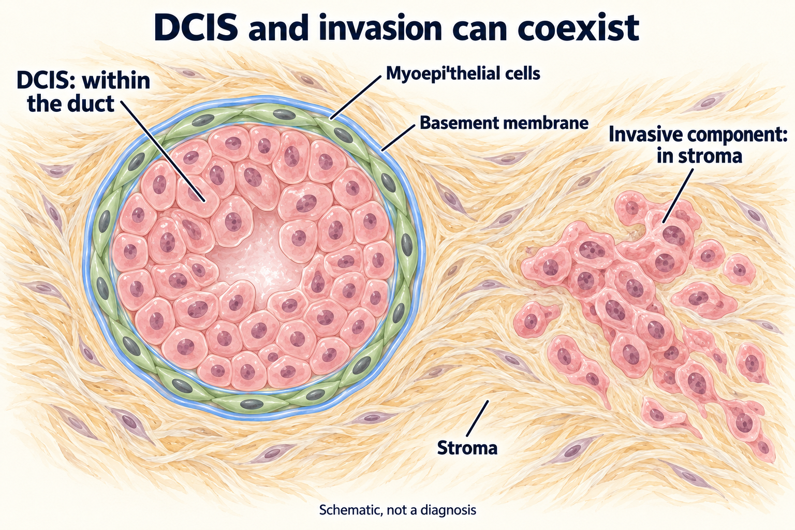

# Ductal carcinoma in situ (DCIS)

## In one sentence

Ductal carcinoma in situ (DCIS) describes abnormal breast cells confined to a milk duct, without invasion into the surrounding breast tissue.

## The intuition

Imagine a room and the space outside its boundary. “In situ” means “in place”: the abnormal cells remain inside the duct's tissue boundary. **Invasive** describes cells that have crossed that boundary. The picture helps explain location. It cannot tell you how an individual lesion will behave or which treatment is appropriate.

## How it works

*DCIS stays within the duct boundary; a coexisting invasive component lies in the surrounding tissue. Rose cells, green living outer cells and the blue extracellular band are drawing conventions. This schematic shows location, not a diagnosis or an inevitable progression.*

Milk ducts are lined by epithelial cells. [Breast-tissue structure](/wiki/education/multi-omics-foundations/01-epithelial-and-breast-tissue) explains that lining and its supporting layers. In DCIS, abnormal cells occupy the duct without invading adjacent tissue. A pathologist examines sampled tissue to distinguish an in-situ component from an invasive component. [NCI: DCIS](https://www.cancer.gov/types/breast/breast-cancer-types/dcis).

The [myoepithelial cell layer and basement membrane](/wiki/education/concepts/breast-cancer/anatomy-and-histology/myoepithelial-cells-and-basement-membrane) are distinct: living outer cells and supporting extracellular material. **Stroma** is the surrounding tissue outside this boundary. Cell shapes, sizes and counts in the drawing are simplified; they do not establish grade or stage.

A report can describe **both** DCIS and invasive cancer in the same breast. Read each component separately. The phrase “DCIS present” does not erase a separately reported invasive diagnosis. Conversely, “in situ” alone does not establish that invasion was found. The [NCI histology reference](https://training.seer.cancer.gov/breast/types.html) distinguishes these tissue patterns.

**Grade** describes microscopic appearance; **stage** describes disease extent under a staging system. High-grade DCIS does not mean distant spread. Stage 0 is a name commonly used for breast carcinoma in situ. See [histologic grade](/wiki/education/concepts/breast-cancer/grade-and-stage/histologic-grade) and [staging](/wiki/education/concepts/breast-cancer/grade-and-stage/tnm-staging) for the different jobs of these labels.

## Why it matters in cancer

A study in DCIS investigates a different disease setting from a study in invasive cancer. Evidence about a preoperative local intervention in DCIS cannot, by itself, establish treatment benefit for invasive triple-negative breast cancer. Carry the diagnosis into the comparison before considering the result.

Names can be confusing: DCIS may be described as precancer, noninvasive breast cancer or stage 0 disease. These descriptions share the important anatomical distinction: invasion has not been identified in that component. Individual care still depends on the full report and clinical assessment.

## Worked example

A fictional pathology report lists “invasive carcinoma” and “associated high-grade DCIS.” Does the second phrase make the whole diagnosis stage 0?

**Answer:** No. It describes an accompanying in-situ component. The invasive component and the other staging findings still need interpretation. Grade cannot answer that staging question.

## Common confusions

- “In situ” describes location; it does not mean every lesion has the same future risk.
- A mammogram can identify an area needing evaluation. Tissue examination establishes the diagnosis.
- DCIS and invasive cancer can coexist; they are not mutually exclusive report entries.
- A result in one disease setting does not establish the same benefit in another.

## Related concepts

- [Triple-negative breast cancer](/wiki/education/concepts/breast-cancer/receptors-and-subtypes/tnbc)
- [Surgical margins](/wiki/education/concepts/breast-cancer/surgery-and-pathology-results/surgical-margins)
- [Neoadjuvant and adjuvant settings](/wiki/education/concepts/breast-cancer/treatment-setting/neoadjuvant-vs-adjuvant)

## Sources and scope

Source check: October 9, 2026. General pathology terminology; the example is fictional. No individual staging, prognosis or treatment recommendation. Expert and learner review pending.

- [NCI: ductal carcinoma in situ](https://www.cancer.gov/types/breast/breast-cancer-types/dcis) — the anatomical distinction, diagnostic assessment and naming conventions.
- [NCI SEER training: breast histologies](https://training.seer.cancer.gov/breast/types.html) — in-situ and invasive tissue patterns.
- [CAP breast resection protocol, version 4.11.0.0, June 2026](https://www.cap.org/wp-content/uploads/2026/06/Breast.Invasive.Res_4.11.0.0.REL_CAPCP.pdf?download=true) — separate reporting of DCIS and invasive components; illustration source check October 12, 2026.
- [Gusterson et al., 1982](https://pubmed.ncbi.nlm.nih.gov/6290045/) — primary human-tissue study separating myoepithelial cells from basement-membrane proteins; abstract checked October 12, 2026, with full text not accessed.

<!-- BEGIN GENERATED USED IN -->
## Used in

- [Read an injected-treatment study](/wiki/education/guides/local-therapy-and-the-immune-system/07-read-an-injected-treatment-study)
- [Read residual disease and margins](/wiki/education/guides/reading-pathology-and-surgery-results/02-read-residual-disease-and-margins)
<!-- END GENERATED USED IN -->
