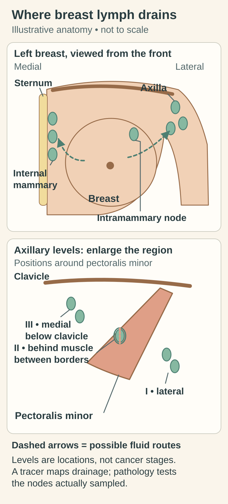
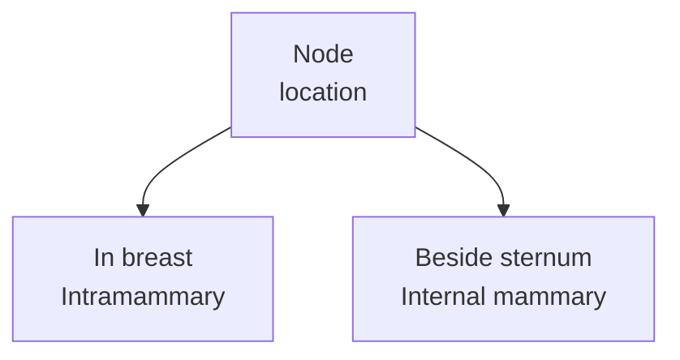

# Internal mammary nodes: regional nodes beside the breastbone

## In one sentence

Internal mammary lymph nodes lie beside the breastbone along the internal thoracic vessels and are a regional nodal group for the breast on the same side.

## The intuition

Treat a node's name like an address. “Axillary” points toward the armpit; “internal mammary” points toward a chain beside the breastbone. The address helps organize a report. It does not tell you whether the node contains cancer or whether an operation sampled it.

## How it works

<!-- BEGIN next-gap-281 VISUAL -->

*The front-view map places internal mammary nodes beside the sternum and an intramammary node within breast tissue. Dashed arrows indicate possible fluid routes, not obligatory drainage or cancer involvement. Axillary levels describe anatomy, and an axillary sample does not test every regional chain.*

The [regional lymphatic anatomy map](/wiki/education/concepts/breast-cancer/anatomy-and-histology/lymphatic-drainage-and-axilla) also shows how axillary levels relate to the pectoralis minor muscle, for comparison.

[Open the light diagram](./images/breast-regional-map-v1-light.svg) · [Open the dark diagram](./images/breast-regional-map-v1-dark.svg)
<!-- END next-gap-281 VISUAL -->

The **sternum** is the breastbone. Internal mammary nodes lie deep in the front of the chest, beside it, along the **internal thoracic vessels**, historically called internal mammary vessels. “Parasternal” means beside the sternum. This location is different from the breast's milk ducts and lobules.

Breast [lymphatic drainage](/wiki/education/concepts/breast-cancer/anatomy-and-histology/lymphatic-drainage-and-axilla) can reach these nodes as well as the axilla. Suami and colleagues traced deeper vessels connecting to internal mammary lymphatics in human cadaver specimens. That supports the existence of the route; it does not specify every living person's drainage or a universal likelihood of cancer spread.

The similarly named **intramammary nodes** sit within breast tissue. In breast-cancer staging they are included with axillary nodes, whereas internal mammary nodes have their own regional staging context. Learning this distinction prevents a small spelling difference from becoming a large interpretation error.

| Name | Location | Breast-cancer reporting context |
|---|---|---|
| Axillary node | Armpit region | Regional axillary group |
| Intramammary node | Within breast tissue | Included with axillary nodes for nodal staging |
| Internal mammary node | Beside the sternum along internal thoracic vessels | Separate regional chain on the same side |

*These are two different addresses, rather than stages in a journey. The table adds the axillary comparison.*

## Why it matters in cancer

**Ipsilateral** means on the same side. Ipsilateral internal mammary nodes are regional nodes in [TNM staging](/wiki/education/concepts/breast-cancer/grade-and-stage/tnm-staging). Their involvement can affect the N category. It is not automatically an M1 finding or stage IV disease.

The exact category depends on the complete context: how involvement was identified, which other regional groups are involved, and whether the report is clinical or pathological and before or after treatment. Naming the chain alone is insufficient. A node on the opposite side also should not be silently interpreted using an ipsilateral rule.

Internal mammary findings can matter to regional treatment planning. Anatomy provides the location; the clinical team combines it with the disease setting and evidence. This concept does not determine which nodes should be sampled or irradiated.

## How it is measured

Imaging can show size, shape, signal or tracer uptake. Those findings have method-specific limits and can be suspicious, indeterminate or reassuring. They are not all synonymous with a tissue-confirmed metastasis. [Needle sampling](/wiki/education/concepts/measurement/specimens/core-needle-biopsy), when obtained, answers a different question about the material examined.

An axillary [sentinel-node biopsy](/wiki/education/concepts/breast-cancer/surgery-and-pathology-results/sentinel-node-and-axillary-dissection) does not automatically sample the internal mammary chain. Keep “not sampled” separate from “sampled and negative.” For staging, clinical detection has defined roles that do not require every finding to have histological confirmation; retain the original evidence type instead of upgrading it in a summary.

## Common confusions

- **Internal mammary** and **intramammary** are different locations, not interchangeable abbreviations.
- “Inside the chest” does not automatically mean distant spread.
- A negative axillary specimen does not establish an internal mammary tissue result.
- Radiological suspicion, clinical classification and histological confirmation should remain visibly distinct.

## Try it

A fictional report says “intramammary lymph node within the breast specimen.” A reader moves it into the internal mammary chain because both names contain “mammary.” What needs correcting?

**Answer:** The address. The reported node is within breast tissue. It should retain that location and the appropriate axillary-group staging context, rather than being relabeled as a parasternal node.

## Explain it back

“Internal mammary describes ___; involvement in that chain must be interpreted with ___.”

**One possible answer:** A regional node location beside the sternum; the side, evidence type, other nodes and treatment/staging context.

## Takeaway

**Locate the node before interpreting the finding: internal mammary is a regional address, not a diagnosis of distant disease.**

## Related concepts

- [TNM staging and its prefixes](/wiki/education/concepts/breast-cancer/grade-and-stage/tnm-staging)
- [Breast lymphatic drainage](/wiki/education/concepts/breast-cancer/anatomy-and-histology/lymphatic-drainage-and-axilla)

## Sources and scope

Source check: October 10, 2026. Anatomy and evidence types; the exercise is fictional. No individual staging or regional-treatment recommendation. Expert and learner review remain pending.

- [NCI: sentinel lymph node biopsy](https://www.cancer.gov/about-cancer/diagnosis-staging/staging/sentinel-node-biopsy-fact-sheet) — breast drainage and the internal mammary/axillary distinction.
- [Suami et al., 2008](https://pubmed.ncbi.nlm.nih.gov/18043970/) — human cadaver tracing of axillary and internal mammary lymphatics.
- [CAP breast resection protocol, version 4.11.0.0, June 2026](https://www.cap.org/wp-content/uploads/2026/06/Breast.Invasive.Res_4.11.0.0.REL_CAPCP.pdf?download=true) — regional classifications, side and clinical/pathological detection context; nodal fields and Note M.

<!-- BEGIN GENERATED USED IN -->
## Used in

Browse the [concept index](/wiki/education/concepts/index) for related learning paths.
<!-- END GENERATED USED IN -->
