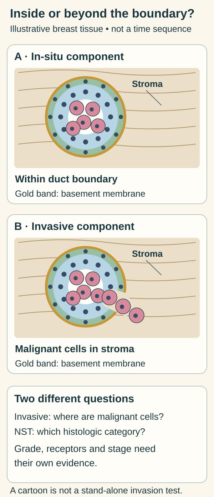
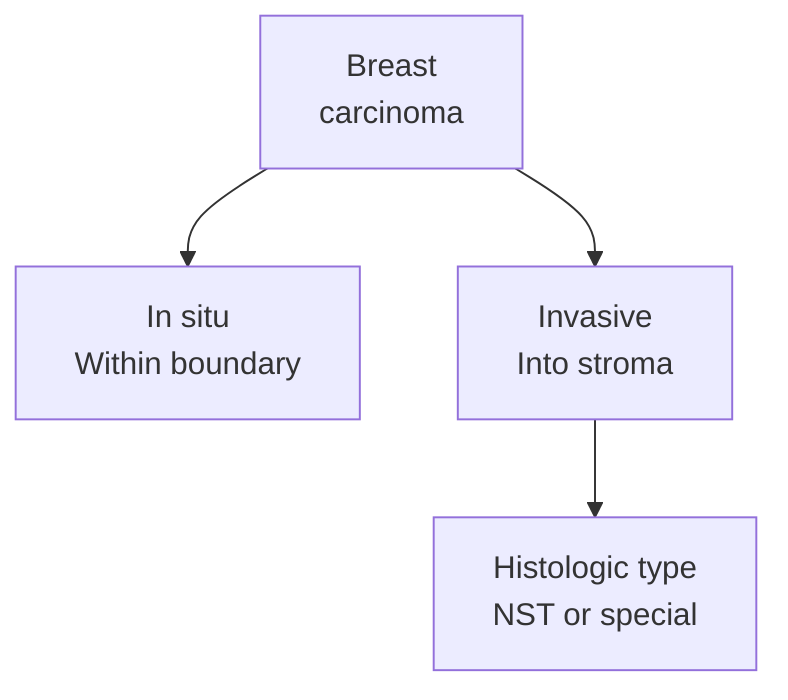

# Invasive ductal carcinoma and the name “no special type”

## In one sentence

Invasive ductal carcinoma usually refers to invasive breast carcinoma of no special type, a histologic category in which malignant epithelial cells invade surrounding tissue without the defining pattern of a special histologic type.

## The intuition

Think of two labels on a specimen: one says whether cancer is invading surrounding tissue, and the other names its microscopic pattern. **Invasive** answers the first question. **No special type** answers the second. The labels describe present tissue; they are not a recording of every earlier step in the cancer's development.

## How it works

<!-- BEGIN next-gap-276 VISUAL -->

*The two scenes contrast a component within a duct boundary with malignant cells in surrounding stroma. They are spatial comparisons, not an inevitable sequence. NST names a histologic category; grade, receptors and stage require separate evidence. Real invasion assessment integrates morphology and supporting tests.*

Compare the [normal breast layer diagram](/wiki/education/concepts/breast-cancer/anatomy-and-histology/myoepithelial-cells-and-basement-membrane) for the living myoepithelial cells and extracellular basement membrane.

[Open the light diagram](./images/idc-within-boundary-and-stroma-v1-light.svg) · [Open the dark diagram](./images/idc-within-boundary-and-stroma-v1-dark.svg)
<!-- END next-gap-276 VISUAL -->

A **carcinoma** is a malignancy of epithelial cells. In the breast, [ductal carcinoma in situ (DCIS)](/wiki/education/concepts/breast-cancer/anatomy-and-histology/dcis) remains within the duct-lobular tissue boundary. Invasive carcinoma has entered surrounding tissue, including [stroma](/wiki/education/concepts/biology-basics/cells/epithelium-and-stroma). This is local invasion. It does not require a finding of distant metastasis.

**Histologic type** classifies microscopic growth and cell features. **Invasive breast carcinoma of no special type (IBC-NST)** is the commonly used category when the tumor lacks the defining features needed for a special type, such as classic invasive lobular or tubular carcinoma. “No special type” does not mean “unknown primary site,” “no information” or “a tumor without distinctive molecular findings.”

**Invasive ductal carcinoma (IDC)** and “infiltrating ductal carcinoma” are widely encountered names for this category. Current College of American Pathologists (CAP) reporting uses “invasive carcinoma of no special type (ductal).” Exact wording and mixed or specific patterns still matter; keep the pathologist's full diagnosis rather than replacing it with a convenient abbreviation.

*A specimen may contain both in-situ and invasive components. The branches classify findings, rather than depicting an inevitable progression.*

The word **ductal** should not be treated as proof that the exact ancestral cell came from a particular larger milk duct. Ductal and lobular naming rests on tissue features and classification. [Breast anatomy](/wiki/education/concepts/breast-cancer/anatomy-and-histology/breast-anatomy) describes the interconnected duct-lobular system; cell-of-origin research asks a different question from routine histologic naming.

## Why it matters in cancer

Histologic type, [grade](/wiki/education/concepts/breast-cancer/grade-and-stage/histologic-grade), [stage](/wiki/education/concepts/breast-cancer/grade-and-stage/tnm-staging) and [receptor classification](/wiki/education/concepts/breast-cancer/receptors-and-subtypes/tnbc) describe different axes. IDC/NST can occur with different grades, receptor results and disease extents. Its name alone does not establish triple-negative status, a transcriptional subtype, a treatment target or an individual prognosis.

An associated DCIS component does not cancel an invasive diagnosis. Conversely, a report identifying only DCIS in a particular sample has not established invasion in that sample.

## How it is measured

A pathologist examines [hematoxylin-and-eosin morphology](/wiki/education/concepts/measurement/pathology-readouts/h-and-e-morphology), considering cells, their arrangement and the surrounding tissue. Additional [immunohistochemistry](/wiki/education/concepts/measurement/pathology-readouts/immunohistochemistry) can help resolve a difficult distinction. [Myoepithelial markers](/wiki/education/concepts/breast-cancer/anatomy-and-histology/myoepithelial-cells-and-basement-membrane) are supporting evidence, rather than a stand-alone binary invasion test.

A limited biopsy cannot display the whole lesion. A later, larger specimen may clarify its extent or show additional components. Preserve specimen type, treatment timing and the full diagnosis when comparing reports.

## Common confusions

- Invasive disease is not synonymous with metastatic disease.
- NST is a histologic category, not a receptor or molecular subtype.
- “Ductal” naming does not prove a precise ancestral-cell location.
- Histologic type and histologic grade are different entries; neither replaces staging.

## Try it

A fictional report says “invasive carcinoma, NST, with associated DCIS.” A reader concludes that the disease is both stage 0 and automatically triple-negative. Which conclusions follow?

**Answer:** Neither. DCIS describes an accompanying in-situ component; the invasive component remains invasive. Receptor testing establishes triple-negative classification, and the complete staging information establishes extent.

## Explain it back

“NST tells me ___, while invasion tells me ___.”

**One possible answer:** The histologic category; that malignant cells have entered surrounding tissue.

## Takeaway

**Read IDC/NST as a tissue diagnosis, then read grade, receptors and stage separately.**

## Related concepts

- [DCIS](/wiki/education/concepts/breast-cancer/anatomy-and-histology/dcis)
- [Molecular and intrinsic subtypes](/wiki/education/concepts/breast-cancer/receptors-and-subtypes/intrinsic-subtype)

## Sources and scope

Source check: October 10, 2026. Histologic naming and interpretation; the exercise is fictional. No individual diagnosis or forecast. Expert and learner review remain pending.

- [CAP breast resection protocol, version 4.11.0.0, June 2026](https://www.cap.org/wp-content/uploads/2026/06/Breast.Invasive.Res_4.11.0.0.REL_CAPCP.pdf?download=true) — current histologic categories and Note D.
- [NCI SEER training: breast histologies](https://training.seer.cancer.gov/breast/types.html) — invasive and in-situ terminology; a training summary rather than a cell-lineage experiment.
- [NCI SEER terminology inquiry, 2013](https://seer.cancer.gov/seer-inquiry/inquiry-detail/20130170/) — historical mapping between ductal not otherwise specified (NOS) and NST terminology; current reporting is anchored to the 2026 CAP protocol.
- [WHO/IARC: Breast Tumours classification structure](https://whobluebooks.iarc.who.int/structures/breast-tumours/) — separately listed in-situ, NST and special histologic types; the public category structure, not the subscription chapter text.

<!-- BEGIN GENERATED USED IN -->
## Used in

Browse the [concept index](/wiki/education/concepts/index) for related learning paths.
<!-- END GENERATED USED IN -->
