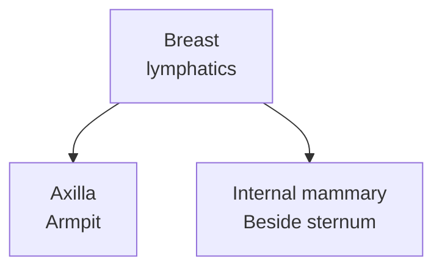

# Breast lymphatic drainage and the axilla

## In one sentence

Breast lymphatic drainage carries tissue fluid through lymphatic vessels to regional nodes, commonly in the axilla, with additional routes including the internal mammary chain.

## The intuition

Imagine collection routes leading from a neighborhood to several nearby meeting places. That helps picture drainage into lymph nodes. It is not a rigid one-way ladder that cancer must climb: routes vary, nodes also serve immune functions, and lymphatic spread is only one way cancer can spread.

## How it works

[Lymphatic vessels](/wiki/education/concepts/immunology/the-immune-system/lymph-nodes-and-lymphatics) collect tissue fluid and carry material and cells. A **draining node** receives lymph from a tissue territory. Breast tissue has superficial and deeper lymphatic routes; human cadaver studies have directly traced routes toward both axillary and internal mammary lymphatics.

The **axilla** is the armpit region. Its lymph nodes are an important regional drainage group for the breast. Axillary levels describe position relative to the pectoralis minor muscle: level I is lateral to it, level II lies between its medial and lateral borders, and level III is medial to it, below the clavicle. These are anatomical levels, rather than a person's overall cancer stage or a compulsory sequence of spread.

[Internal mammary nodes](/wiki/education/concepts/breast-cancer/anatomy-and-histology/internal-mammary-nodes) form a different chain beside the breastbone. **Intramammary nodes** lie within breast tissue. Despite their similar names, they are different locations. For breast-cancer nodal staging, intramammary nodes are grouped with axillary nodes under the College of American Pathologists (CAP) reporting protocol.

*Two important regional drainage routes. This map omits many vessels and other regional groups; it does not assign a first node or a stage to an individual.*

Drainage is not identical in everyone. A [sentinel-node procedure](/wiki/education/concepts/breast-cancer/surgery-and-pathology-results/sentinel-node-and-axillary-dissection) uses a tracer to identify particular draining nodes. Surgery, disease and prior treatment can affect the mapping context. A routine location diagram cannot substitute for that procedure's findings.

## Why it matters in cancer

Tumor in a regional node contributes to the **N** component of [TNM staging](/wiki/education/concepts/breast-cancer/grade-and-stage/tnm-staging). Distant disease contributes to **M**. A positive regional node does not, by itself, establish distant metastasis. The same is true of [extranodal extension](/wiki/education/concepts/breast-cancer/surgery-and-pathology-results/extranodal-extension), which describes tumor extending beyond a node's capsule into nearby tissue.

Nodes can also enlarge during immune responses. Enlargement is an observation; cancer involvement is a separate interpretation requiring the appropriate evidence.

## How it is measured

Clinical examination and imaging assess selected nodal regions. Needle or surgical sampling can establish what is present in the tissue actually examined. Preserve the side, named region, examination method, treatment timing and any pathological confirmation.

“Two axillary nodes examined” is a sampling statement. It does not mean every axillary node was examined, and it gives no direct tissue result for the internal mammary chain. Conversely, a suspicious image does not become a histologically proven deposit merely because its location is regional.

## Common confusions

- **Axillary levels** are anatomical positions; **N categories** are staging classifications.
- **Internal mammary** means beside the breastbone; **intramammary** means within breast tissue.
- Regional nodal involvement and distant metastasis are different findings.
- A draining node can contain immune activity, cancer, both or neither in the sampled sections.

## Try it

In a fictional report, sampled axillary nodes are negative, while imaging separately describes an indeterminate internal mammary node. Can you summarize this as “all regional nodes proved negative”?

**Answer:** No. The axillary tissue result applies to the nodes examined. The other region has a different, unresolved observation. Keep the location and evidence type attached to each finding.

## Explain it back

“Regional” describes ___, while “sampled” describes ___.

**One possible answer:** A nodal territory in the staging system; which particular tissue was obtained and examined.

## Takeaway

**Carry the nodal location and the measurement method together; a result from one region does not survey every drainage route.**

## Related concepts

- [Lymph nodes and lymphatics](/wiki/education/concepts/immunology/the-immune-system/lymph-nodes-and-lymphatics)
- [Sentinel sampling versus axillary dissection](/wiki/education/concepts/breast-cancer/surgery-and-pathology-results/sentinel-node-and-axillary-dissection)

## Sources and scope

Source check: October 10, 2026. Regional anatomy and reading scope; the exercise is fictional. No individual stage or surgical recommendation. Expert and learner review remain pending.

- [NCI: sentinel lymph node biopsy](https://www.cancer.gov/about-cancer/diagnosis-staging/staging/sentinel-node-biopsy-fact-sheet) — breast drainage, mapping and sampling limitations.
- [Suami et al., 2008](https://pubmed.ncbi.nlm.nih.gov/18043970/) — direct lymphatic tracing in human cadaver breasts; anatomical evidence, not a living-patient mapping guarantee.
- [CAP breast resection protocol, version 4.11.0.0, June 2026](https://www.cap.org/wp-content/uploads/2026/06/Breast.Invasive.Res_4.11.0.0.REL_CAPCP.pdf?download=true) — axillary levels and regional-node reporting, particularly Note M.

<!-- BEGIN GENERATED USED IN -->
## Used in

- [Read the jobs in the treatment plan](/wiki/education/guides/treating-early-tnbc/01-read-the-jobs-in-the-plan)
<!-- END GENERATED USED IN -->
