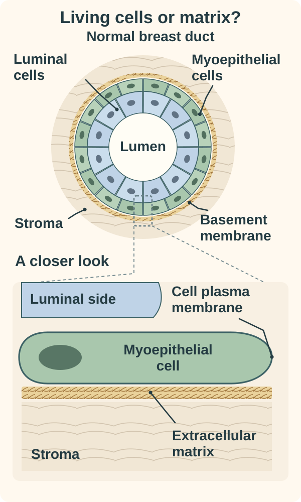
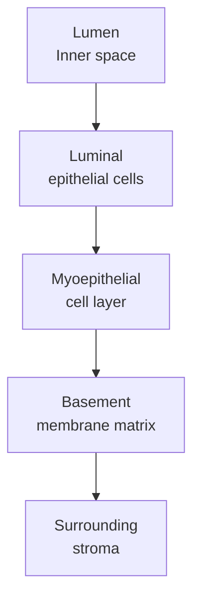

# Myoepithelial cells and the breast basement membrane

## In one sentence

Myoepithelial cells form an outer epithelial layer around typical normal breast ducts and acini, while the basement membrane is a separate layer of extracellular material between the epithelial structure and surrounding stroma.

## The intuition

Picture a room's lining, an outer layer of living helpers and the material underneath them. This separates luminal cells, myoepithelial cells and basement membrane. The analogy is only spatial: the cells actively contract and signal, and the matrix supports tissue organization. They are not three interchangeable walls.

## How it works

*From the lumen outward: luminal cells, living myoepithelial cells, extracellular basement membrane and stroma. The close-up separates a cell’s plasma membrane from the matrix outside it. This is simplified normal anatomy, with schematic sizes and cell counts; it does not show a stain result or diagnose invasion.*

**Luminal epithelial cells** face the duct or acinus lumen, the inner space. **Myoepithelial cells** lie toward the outside. “Myo” refers to their contractile features; they are epithelial cells with muscle-like properties, rather than the chest muscle. Their contraction helps expel milk during lactation.

The **basement membrane** is specialized [extracellular matrix](/wiki/education/concepts/cancer-biology/tumor-microenvironment/extracellular-matrix), including proteins such as laminins and type IV collagen. It lies beneath the epithelial structure. It is not the [plasma membrane](/wiki/education/concepts/biology-basics/cells/cell-and-membrane) enclosing an individual cell, and it is not itself a layer of living cells.

This arrangement supports **polarity**: cells organize different features toward their inner and outer surfaces. Gudjonsson and colleagues showed in a human-cell culture model that normal myoepithelial cells or a particular laminin could restore the orientation of luminal structures in collagen gels. That experiment illustrates a matrix-dependent organizing role; it is not proof that adding those cells treats a human cancer.

*Read from inside toward outside in a simplified normal breast structure. Arrows show spatial order, not cell differentiation or an inevitable invasion sequence.*

## Why it matters in cancer

The relationship between malignant cells and the surrounding tissue helps distinguish [ductal carcinoma in situ (DCIS)](/wiki/education/concepts/breast-cancer/anatomy-and-histology/dcis) from [invasive carcinoma](/wiki/education/concepts/breast-cancer/anatomy-and-histology/invasive-ductal-carcinoma). Pathologists can use myoepithelial stains to support that assessment when morphology is difficult.

The layers are not universal switches. Normal structures, in-situ lesions and special lesions can have different appearances or staining patterns. Detecting a basement-membrane protein does not by itself establish a complete intact boundary around a lesion. Historical human tissue studies found such proteins in some invasive carcinomas, emphasizing the need to interpret organization rather than mere protein presence.

## How it is measured

[Immunohistochemistry (IHC)](/wiki/education/concepts/measurement/pathology-readouts/immunohistochemistry) can highlight myoepithelial features. **p63** is a nuclear protein marker; **smooth muscle myosin heavy chain** and **calponin** are cytoplasmic markers. A pathologist asks where the staining lies, which cells are stained and whether the controls worked.

Werling and colleagues compared these markers in human breast lesions. Their study found limitations in both directions: apparent gaps around some noninvasive structures, staining of other stromal cells with muscle-associated markers, and p63 staining in some carcinoma cells. A selected marker panel, morphology and appropriate controls are therefore more informative than “one stain positive” or “one stain absent.”

A **basal-like** RNA classification also does not establish myoepithelial ancestry. Shared markers and a demonstrated [cell lineage](/wiki/education/concepts/biology-basics/cells/cell-lineage-and-differentiation) are different evidence claims.

## Common confusions

- Myoepithelial cells are living cells; basement membrane is extracellular material.
- Basement membrane and plasma membrane surround different structures.
- Absence of one stain is not automatic proof of invasion.
- Presence of a marker somewhere in tissue does not locate a complete outer layer.

## Try it

A fictional section has an apparently absent p63 rim, but the control tissue failed to stain. Has invasion been proven?

**Answer:** No. A failed control undermines the negative staining result. The lesion still needs morphological assessment and technically interpretable supporting evidence. Even with successful controls, a single marker is not a universal invasion test.

## Explain it back

“The layer is made of ___; the basement membrane is made of ___.”

**One possible answer:** Myoepithelial cells; extracellular matrix proteins arranged beneath the epithelial structure.

## Takeaway

**Use these layers as anatomical context and supporting pathology evidence, with the lesion, staining location and controls kept together.**

## Related concepts

- [Epithelium and stroma](/wiki/education/concepts/biology-basics/cells/epithelium-and-stroma)
- [IHC controls and localization](/wiki/education/concepts/measurement/pathology-readouts/immunohistochemistry)

## Sources and scope

Source check: October 10, 2026. Breast architecture and diagnostic-marker limits; the exercise is fictional. Expert and learner review remain pending.

- [Kumar et al., 2023](https://pubmed.ncbi.nlm.nih.gov/37380767/) — adult human breast cell types and spatial compartments.
- [Gudjonsson et al., 2002](https://pubmed.ncbi.nlm.nih.gov/11801722/) — polarity and matrix interactions in a human-cell culture model.
- [Werling et al., 2003](https://pubmed.ncbi.nlm.nih.gov/12502930/) — comparative human-lesion study of p63, calponin and smooth muscle myosin heavy chain.
- [Gusterson et al., 1982](https://pubmed.ncbi.nlm.nih.gov/6290045/) — human tissue localization of myoepithelial and basement-membrane proteins; a historical study, not a current diagnostic performance guarantee.
- [CAP breast resection protocol, version 4.11.0.0, June 2026](https://www.cap.org/wp-content/uploads/2026/06/Breast.Invasive.Res_4.11.0.0.REL_CAPCP.pdf?download=true) — morphology and supporting myoepithelial studies in assessment of invasion.

<!-- BEGIN GENERATED USED IN -->
## Used in

- [See what is inside a tissue sample](/wiki/education/multi-omics-foundations/01-epithelial-and-breast-tissue)
<!-- END GENERATED USED IN -->
