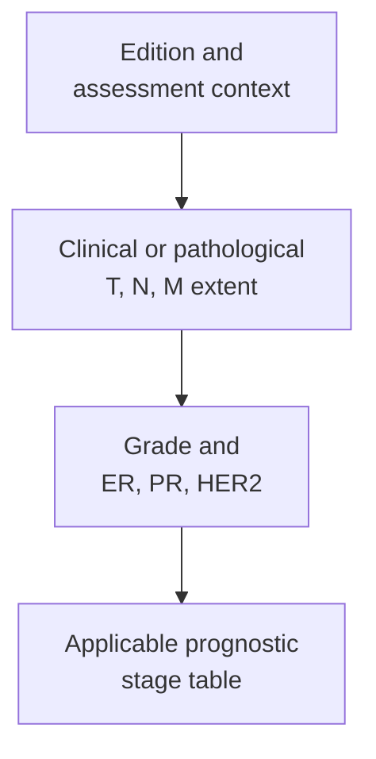

# AJCC prognostic staging: extent, biology, and the right context

## In one sentence

AJCC breast prognostic staging combines anatomical disease extent with histologic grade and receptor results under edition-specific rules for clinical or surgery-first pathological staging.

## The intuition

An anatomical stage is like a map of where disease has been found. A prognostic stage adds selected information about the disease's biology. Two maps can show the same extent yet belong to different prognostic groups.

The analogy does not make a stage a personal forecast. These groups summarize outcomes in populations and depend on the rules and treatment context used to develop them. They do not encode every feature of a person or tumor.

## How it works

The **American Joint Committee on Cancer (AJCC)** defines cancer staging systems. Its breast rules distinguish [tumor, node, metastasis (TNM)](/wiki/education/concepts/breast-cancer/grade-and-stage/tnm-staging) extent from prognostic grouping. The examples here use **AJCC eighth-edition breast rules**. Check the disease-specific edition named in a report; a newer version for another cancer does not update breast staging automatically.

The biological inputs include [histologic grade](/wiki/education/concepts/breast-cancer/grade-and-stage/histologic-grade), [estrogen receptor (ER)](/wiki/education/concepts/breast-cancer/receptors-and-subtypes/estrogen-receptor), [progesterone receptor (PR)](/wiki/education/concepts/breast-cancer/receptors-and-subtypes/progesterone-receptor), and [human epidermal growth factor receptor 2 (HER2)](/wiki/education/concepts/breast-cancer/receptors-and-subtypes/her2). Grade concerns microscopic features; it is not another measure of spread.

| Description | What it uses | Important boundary |
|---|---|---|
| Anatomical stage group | T, N, and M extent | Does not incorporate grade or receptor status |
| Clinical prognostic stage | Pretreatment clinical TNM, grade, and receptor results | Uses clinical assessment, imaging, and available biopsy information |
| Pathological prognostic stage | Surgical pathological T and N, with the applicable M category, grade, and receptor results | Applies when surgery is the initial treatment |
| Post-neoadjuvant findings | Residual extent described with yc or yp prefixes and response information | Do not assign the surgery-first pathological prognostic stage table |

[Neoadjuvant treatment](/wiki/education/concepts/breast-cancer/treatment-setting/neoadjuvant-vs-adjuvant) means treatment before the definitive operation. These patients retain their pretreatment clinical stage, while postoperative **ypT and ypN** describe what remains after therapy. The restriction on pathological prognostic grouping does not invalidate the residual pathological measurements.

Some narrowly defined hormone-receptor-positive, HER2-negative settings allow a specified multigene test to contribute to staging. This is not permission to substitute any RNA signature, a [TNBC research subtype](/wiki/education/concepts/breast-cancer/receptors-and-subtypes/tnbc-molecular-subtypes), or a gene-expression risk score for the prescribed inputs.

## Why it matters in cancer

A stage number without its system, edition, and assessment context can be misleading. An anatomical stage and a clinical prognostic stage are different descriptions, not necessarily competing diagnoses.

Prognostic groups were developed in populations generally offered appropriate systemic treatment. A biomarker's relationship to outcomes can therefore reflect available therapy as well as biology. The stage is not an estimate of untreated survival, a guaranteed outcome, or a complete treatment plan.

## How it is measured

Staging is a synthesis of observations rather than one laboratory assay. Check the record in this order:

1. **System and edition:** breast AJCC rules, with the edition stated.
2. **Assessment and timing:** pretreatment clinical, surgery-first pathological, or after neoadjuvant therapy.
3. **Inputs:** documented T, [N](/wiki/education/concepts/breast-cancer/grade-and-stage/n-categories-and-nodal-burden), M, grade, and receptor results, with specimen context.
4. **Completeness:** missing or uncertain findings remain visible; they are not guessed to complete a table.

Clinical assessment can include biopsy confirmation. A biopsy is not automatically a complete pathological stage. Likewise, pathological M0 is not a valid designation: absence of distant disease is recorded clinically, while pM1 requires pathological confirmation under the rules.

## Common confusions

- **Grade versus stage:** microscopic differentiation and anatomical extent answer different questions.
- **Anatomical versus prognostic group:** the same TNM can yield different groups when biological inputs are included.
- **ypN versus pretreatment N:** a response measurement does not erase the original extent.
- **Stage versus treatment benefit:** grouping by prognosis does not quantify benefit from a proposed intervention.

## Try it

A fictional patient has a pretreatment clinical prognostic stage. After systemic therapy, surgery reports ypT2 and ypN1a. Should these be entered into the surgery-first pathological prognostic table?

**Answer:** No. Preserve the pretreatment clinical stage and record the post-treatment findings and response separately. The team interprets residual disease in its appropriate context; the surgery-first table does not apply.

## Explain it back

What four labels make a stage easier to interpret?

One answer: the staging system, edition, assessment type, and timing relative to treatment.

## Takeaway

**Read a stage together with its rules, inputs, and treatment context.**

## Related concepts

- [N categories and nodal burden](/wiki/education/concepts/breast-cancer/grade-and-stage/n-categories-and-nodal-burden).
- [Residual cancer burden](/wiki/education/concepts/breast-cancer/surgery-and-pathology-results/residual-cancer-burden).

## Sources and scope

Source check: October 10, 2026. Staging literacy, not a self-staging calculator or individual forecast. The example is fictional; expert and learner review pending.

- [NCI professional PDQ: TNM and prognostic-stage rules](https://www.cancer.gov/types/breast/hp/breast-treatment-pdq) — AJCC eighth-edition tables, neoadjuvant restrictions, and treatment-context notes.
- [NCI: breast-cancer stages](https://www.cancer.gov/types/breast/stages) — clinical versus surgery-first pathological prognostic assessment.
- [AJCC current staging-system table, 2026](https://www.facs.org/media/c5ik5tkr/ajcc-current-staging-system-2026.pdf) — breast remains listed under edition eight at this source check.

<!-- BEGIN GENERATED USED IN -->
## Used in

- [Place the specimen in time](/wiki/education/guides/reading-pathology-and-surgery-results/01-place-the-specimen-in-time)
- [Read pathology and surgery results](/wiki/education/guides/reading-pathology-and-surgery-results/index)
<!-- END GENERATED USED IN -->
