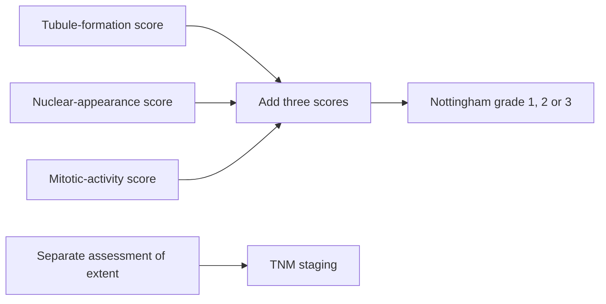

# Histologic grade

## In one sentence

Histologic grade describes a breast cancer's microscopic features; the Nottingham system combines tubule formation, nuclear appearance and mitotic activity into grades 1, 2 or 3.

## The intuition

Grade describes what the cancer looks like under a microscope. Stage describes its extent in the body. Think of one as a description of the tissue and the other as a map of where disease is found. A striking microscopic appearance does not tell you how far the cancer has traveled.

The distinction is useful when the numbers sound alike: **grade 3 is not stage III**. They can appear together or separately because they answer different questions.

## How it works

For invasive breast cancer, the **Nottingham system** scores three features:

| Feature | What the pathologist assesses |
| --- | --- |
| Tubule formation | How much of the tumor forms gland-like or tubular structures |
| Nuclear pleomorphism | How much the nuclei vary in size and appearance compared with normal breast cells |
| Mitotic activity | How many recognizable dividing cells appear in specified microscope fields |

A **nucleus** contains the cell's genetic material. **Pleomorphism** means variation in appearance. A **mitotic figure** is a cell visibly dividing; a dark or damaged nucleus does not automatically count as one.

Each component receives a score from **1 to 3**. The scores are added, then mapped to the overall grade: **3–5 means grade 1; 6–7 means grade 2; 8–9 means grade 3**. [The CAP invasive-breast protocol](https://www.cap.org/wp-content/uploads/2026/06/Breast.Invasive.Res_4.11.0.0.REL_CAPCP.pdf?download=true) specifies this system. The mitotic scoring thresholds account for microscope field area; a raw count without its method is incomplete.

The diagram deliberately keeps the microscopic score separate from [tumor, node and metastasis (TNM) staging](/wiki/education/concepts/breast-cancer/grade-and-stage/tnm-staging). Breast-cancer **prognostic stage** can incorporate grade and receptor findings alongside extent. That combination does not make the individual measurements interchangeable.

## Why it matters in cancer

Grade adds prognostic information: across groups of patients, higher-grade tumors generally behave differently from lower-grade tumors. [NCI explains why grade is considered with stage and other features](https://www.cancer.gov/about-cancer/diagnosis-staging/diagnosis/tumor-grade). It is one part of a clinical assessment, not a personal forecast or a standalone treatment rule.

It also helps a reader distinguish three descriptions on a pathology report. **Histologic type** names the kind of tumor, such as ductal or lobular. **Grade** scores microscopic features. **Stage** describes extent under a specified system. A report can contain all three.

## Worked example

A fictional invasive breast tumor has component scores of 2 for tubule formation, 3 for nuclear appearance and 3 for mitotic activity. The sum is 8, so its Nottingham grade is 3. Those scores do not supply tumor size, lymph-node status or distant-metastasis information. You cannot assign stage III from them.

If a later specimen contains a different-looking area, first check which tissue was sampled and whether treatment occurred in between. One sample is not a microscope view of every part of the cancer.

## Common confusions

- Grade 3 is not stage III, and a high grade does not prove distant spread.
- Grade is not just a [Ki-67](/wiki/education/concepts/breast-cancer/grade-and-stage/ki-67) percentage. Mitotic activity is one component of grade; Ki-67 measures a broader cell-cycle-associated stain.
- Nottingham grading of invasive cancer is not identical to nuclear grading of **ductal carcinoma in situ (DCIS)**, a noninvasive lesion.
- A low grade does not mean benign, and a high grade does not determine an individual's outcome.

## How it is measured

A pathologist evaluates tissue morphology and counts mitotic figures under defined conditions. Read the overall grade and component scores, specimen identity and any limitations. Small biopsies, heterogeneity and treatment-related changes can affect what is assessable and how specimens compare.

## Explain it back

What extra information would you need to turn a grade-3 report into a stage assessment? The tumor's extent, regional-node findings, distant-spread assessment and the applicable staging rules; grade alone supplies none of that map.

## Related concepts

- [TNM staging](/wiki/education/concepts/breast-cancer/grade-and-stage/tnm-staging)
- [Ki-67](/wiki/education/concepts/breast-cancer/grade-and-stage/ki-67)
- [Treatment timing](/wiki/education/concepts/breast-cancer/treatment-setting/neoadjuvant-vs-adjuvant)

## Sources and scope

General education about invasive breast cancer; fictional example. Source-checked October 9, 2026. Expert and learner review remain pending.

- [CAP, invasive-breast resection protocol, version 4.11.0.0 (June 2026)](https://www.cap.org/wp-content/uploads/2026/06/Breast.Invasive.Res_4.11.0.0.REL_CAPCP.pdf?download=true): Nottingham components, sums and field-area requirements.
- [NCI, tumor grade](https://www.cancer.gov/about-cancer/diagnosis-staging/diagnosis/tumor-grade): grade versus stage and combined interpretation.
- [NCI, breast-cancer treatment PDQ, staging](https://www.cancer.gov/types/breast/hp/breast-treatment-pdq): anatomic versus prognostic stage.

<!-- BEGIN GENERATED USED IN -->
## Used in

- [Place the specimen in time](/wiki/education/guides/reading-pathology-and-surgery-results/01-place-the-specimen-in-time)
- [Read pathology and surgery results](/wiki/education/guides/reading-pathology-and-surgery-results/index)
- [Read each label as an answer to a question](/wiki/education/guides/start-here/01-read-the-labels)
- [Start here: read the biology, then the evidence](/wiki/education/guides/start-here/index)
<!-- END GENERATED USED IN -->
