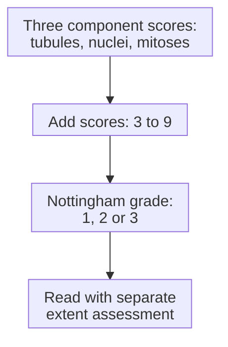
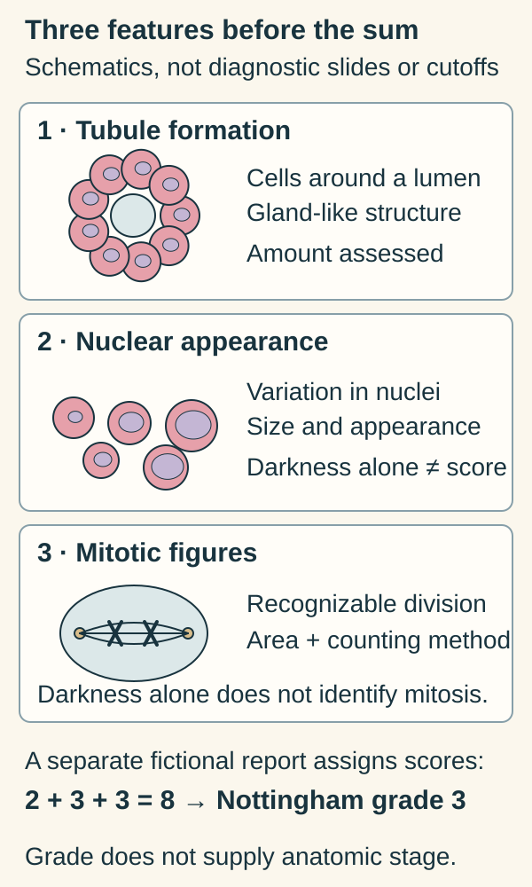

# Histologic grade

## In one sentence

Histologic grade describes a breast cancer's microscopic features; the Nottingham system combines tubule formation, nuclear appearance and mitotic activity into grades 1, 2 or 3.

## The intuition

Grade describes what the cancer looks like under a microscope. Anatomic stage describes its extent in the body. Think of one as a tissue description and the other as a map of where disease is found. A striking appearance does not tell us how far the cancer has traveled.

The analogy leaves out how clinical assessments combine information: breast-cancer prognostic stage can incorporate grade and receptor findings alongside extent. Still, **grade 3 is not stage III**. The individual measurements answer different questions.

## How it works

For invasive breast cancer, the **Nottingham system** combines three features:

| Feature | What the pathologist assesses |
| --- | --- |
| Tubule formation | How much tumor forms gland-like or tubular structures |
| Nuclear pleomorphism | Variation in nuclear size and appearance compared with normal breast cells |
| Mitotic activity | Recognizable dividing cells in specified microscope fields |

A **nucleus** contains genetic material; **pleomorphism** means variation in appearance. A **mitotic figure** is a cell visibly dividing. A dark, damaged or dying nucleus does not automatically qualify.

Each feature receives a score from **1 to 3**. Add the three scores: **3–5 gives grade 1; 6–7 gives grade 2; 8–9 gives grade 3**. These are component scores and a mapped category, rather than percentages.

The mitotic score depends on the observation area. The College of American Pathologists (CAP) describes counting clearly identifiable figures across ten consecutive high-power fields in the most mitotically active region. A **high-power field** is the area visible at that microscope setting. Its area must be established because two microscopes can show different areas at the same nominal magnification. A raw count without field area and method is incomplete.

The map summarizes scoring. It does not turn grade into [tumor, node and metastasis (TNM) categories](/wiki/education/concepts/breast-cancer/grade-and-stage/tnm-staging).

*Look for three different features before you look at their sum.*

Start with the objects: a hollow center surrounded by cells, nuclei that vary in appearance, and a visibly dividing cell. These sketches introduce the component names; they supply neither diagnostic slides nor scoring cutoffs. The score line uses the separate fictional report in the worked example; its numbers are not inferred from these drawings. Counting mitotic figures still needs the specified field area and method. [Component definitions](https://www.cap.org/wp-content/uploads/2026/06/Breast.Invasive.Res_4.11.0.0.REL_CAPCP.pdf?download=true).

**Read the features:** Would a dark nucleus alone identify a mitotic figure? **Answer:** No. Darkness can have other causes; the figure must be recognizable as division under the counting method.

## Why it matters in cancer

Grade adds prognostic information: across patient groups, tumors with different grades can have different outcomes. It is part of an assessment with stage, receptor findings and clinical context. It is not a personal forecast or a standalone treatment rule.

Three report terms can now stay distinct. **Histologic type** describes the tumor's morphology, such as [invasive carcinoma of no special type](/wiki/education/concepts/breast-cancer/anatomy-and-histology/invasive-ductal-carcinoma). **Grade** scores microscopic features. **Stage** describes extent or combines it with specified prognostic inputs under a particular system.

## How it is measured

| Observation | What to retain |
| --- | --- |
| Measures and method | Tissue morphology and defined mitotic counting under the Nottingham system |
| Input and tissue use | Named biopsy/resection, tissue sections and treatment timing; microscopy samples part of the tissue |
| Output and units | Three component scores, their sum and grade; mitotic count with field-area context |
| Quality and failure | Limited tissue, heterogeneous regions or treatment effects can restrict assessment and comparison |
| Cannot infer | Tumor size, nodal involvement, distant spread or an individual's treatment benefit |
| Validation context | Invasive breast carcinoma; in situ nuclear grading is a different assessment |

## Worked example

A fictional report assigns 2 for tubule formation, 3 for nuclear appearance and 3 for mitotic activity. The sum is 8, so the Nottingham grade is 3. If another sample looks different, first check the tissue sampled and whether treatment occurred between collections. One section is not a view of every part of the cancer.

## Try it

Can those three scores establish stage III? Could a Ki-67 percentage replace the mitotic score?

**Answer:** No. The scores do not supply tumor extent, regional-node findings or distant-spread assessment. [Ki-67](/wiki/education/concepts/breast-cancer/grade-and-stage/ki-67) stains cells across active cycle phases, while mitotic counting identifies visible division under defined conditions; it does not replace that component.

## Common confusions

- Grade 3 does not prove distant spread, and low grade does not mean benign.
- A Nottingham sum of 8 is a score, not “8%” or a stage.
- Invasive-cancer grade differs from nuclear grading of ductal carcinoma in situ (DCIS).
- Equal mitotic counts can require different scoring interpretation if the observation areas differ.

## Explain it back

Explain which extra measurements are needed to describe extent after reading a grade-3 report.

## Takeaway

Read all three microscopic components and their method, then keep grade distinct from extent and personal outcome.

## Related concepts

- [TNM staging](/wiki/education/concepts/breast-cancer/grade-and-stage/tnm-staging)
- [Ki-67](/wiki/education/concepts/breast-cancer/grade-and-stage/ki-67)
- [Treatment timing](/wiki/education/concepts/breast-cancer/treatment-setting/neoadjuvant-vs-adjuvant)

## Sources and scope

General education about invasive breast cancer; fictional example. Source-checked October 10, 2026. Expert and learner review remain pending.

- [CAP, invasive-breast protocol v4.11.0.0 (June 2026)](https://www.cap.org/wp-content/uploads/2026/06/Breast.Invasive.Res_4.11.0.0.REL_CAPCP.pdf?download=true): components, sums and mitotic field-area requirements.
- [NCI, tumor grade](https://www.cancer.gov/about-cancer/diagnosis-staging/diagnosis/tumor-grade): grade versus stage and combined interpretation.
- [NCI, breast-cancer treatment PDQ](https://www.cancer.gov/types/breast/hp/breast-treatment-pdq): anatomic and prognostic staging context.

<!-- BEGIN GENERATED USED IN -->
## Used in

- [Place the specimen in time](/wiki/education/guides/reading-pathology-and-surgery-results/01-place-the-specimen-in-time)
- [Read pathology and surgery results](/wiki/education/guides/reading-pathology-and-surgery-results/index)
- [Read each label as an answer to a question](/wiki/education/guides/start-here/01-read-the-labels)
- [Start here: read the biology, then the evidence](/wiki/education/guides/start-here/index)
<!-- END GENERATED USED IN -->
