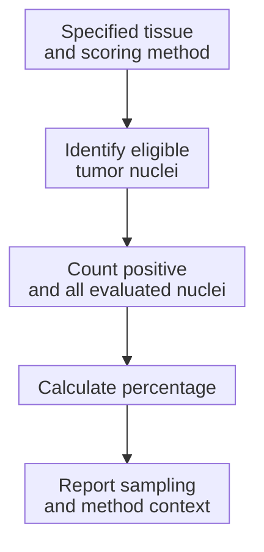
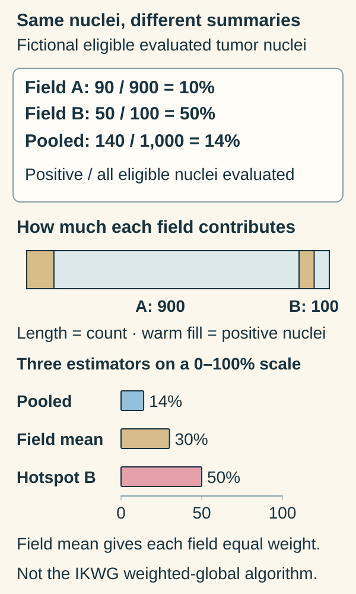

# Ki-67 proliferation index

## In one sentence

Ki-67 is a protein associated with the active cell cycle; its proliferation index is the percentage of evaluated tumor-cell nuclei that stain positive under a specified method.

## The intuition

Think of Ki-67 as a snapshot of cells engaged in the [cell cycle](/wiki/education/concepts/biology-basics/cells/cell-cycle): preparing to divide, copying genetic material or dividing. A snapshot describes a fraction carrying a marker. It cannot tell you how fast the whole tumor will double in size.

Say the denominator aloud: “positive tumor-cell nuclei out of eligible tumor-cell nuclei evaluated.” That is more concrete than calling the result a growth score. The snapshot analogy cannot capture changes in cell loss or the duration of different cycle phases.

## How it works

Ki-67 is a nuclear protein associated with active cell-cycle phases and generally absent from the resting **G0** state outside the active cycle. Several phases precede visible division, so Ki-67 staining is not a count of mitotic figures.

[Immunohistochemistry (IHC)](/wiki/education/concepts/measurement/pathology-readouts/immunohistochemistry) uses an antibody stain. **MIB-1** names a commonly used antibody, rather than a separate growth process. The scorer identifies eligible invasive tumor-cell nuclei and counts positive nuclei among all evaluated eligible nuclei. Staining intensity does not replace that denominator. In a simple fictional field, 30 positive nuclei out of 100 evaluated nuclei means 30% for that field.

This count map illustrates the denominator. It is not the complete algorithm for every validated scoring method.

A **hotspot** is a region with especially high staining. A broader method evaluates regions across the sample. The International Ki67 in Breast Cancer Working Group (IKWG) weighted-global approach estimates area proportions for negligible, low, medium and high staining regions, then counts nuclei within field types after calibration. It is not simply an unweighted average of hotspots or always a pooled count.

## Why it matters in cancer

Ki-67 adds proliferation-related information and can be studied before and after treatment. A decrease does not by itself demonstrate cell killing or improved outcomes.

The working group's clinical-utility conclusions concern selected, anatomically favorable [estrogen receptor (ER)-positive](/wiki/education/concepts/breast-cancer/receptors-and-subtypes/estrogen-receptor), [human epidermal growth factor receptor 2 (HER2)-negative](/wiki/education/concepts/breast-cancer/receptors-and-subtypes/her2) early breast cancers under standardized scoring. They do not supply a universal treatment-selection rule or cutoff for [triple-negative breast cancer (TNBC)](/wiki/education/concepts/breast-cancer/receptors-and-subtypes/tnbc). The College of American Pathologists (CAP) reporting template treats Ki-67 as optional, distinct from the core receptor profile.

## How it is measured

| Observation | What to retain |
| --- | --- |
| Measures and method | Nuclear protein staining in identified tumor cells under a specified scoring approach |
| Input and tissue use | Named tissue section, biopsy/resection and treatment time point; staining uses section material |
| Output and units | Percentage, evaluated denominator and sampled regions or scoring algorithm |
| Quality and failure | Fixation, antibody/platform, counterstaining, controls and scorer calibration; poorly seen negative nuclei can distort the fraction |
| Cannot infer | Doubling time, visible division rate, cell killing, personal recurrence risk or treatment benefit |
| Validation context | Method, specimen and intended population; compare these before comparing percentages |

## Try it

Two fictional fields have 90 positive nuclei out of 900 eligible nuclei, and 50 out of 100. What are the pooled percentage, unweighted mean of the field percentages and second-field hotspot percentage?

**Answer:** The pooled count is (90 + 50)/(900 + 100) = 140/1,000 = **14%**. The field percentages are 10% and 50%, whose unweighted mean is **30%**. The second field alone is **50%**. These are different estimators, not arithmetic errors. This is a pooled-count teaching exercise, **not the IKWG weighted-global algorithm**, a clinical cutoff or proof that these fields represent the entire tumor.

*A field can have a high percentage while contributing relatively few counted nuclei.*

Follow the denominators from the exercise into the wide bar: field A supplies 900 eligible evaluated tumor nuclei and B supplies 100. Warm fill represents 90 and 50 positive nuclei. Bar length represents counts, not tissue area or individual drawn nuclei. The unweighted field mean instead gives each field half the weight, and the selected hotspot uses B alone. Those choices explain the three summaries. This is the existing fictional pooled-count exercise, not the International Ki67 in Breast Cancer Working Group weighted-global algorithm or a clinical cutoff. [Authors’ scoring-method explanation](https://pmc.ncbi.nlm.nih.gov/articles/PMC8487652/).

## Common confusions

- Ki-67 is neither stage nor the complete [histologic grade](/wiki/education/concepts/breast-cancer/grade-and-stage/histologic-grade).
- Thirty percent staining is not 30% growth per day or a 30% recurrence risk.
- A high value needs its method and intended-use context; it is not a universal decision threshold.
- [Ribonucleic acid (RNA) proliferation scores](/wiki/education/concepts/measurement/transcriptomics/rna-pathway-scoring) and Ki-67 IHC measure different features.

## Explain it back

Explain why pooling counted nuclei, averaging field percentages and selecting a hotspot can yield different numbers from the same fictional fields.

## Takeaway

Keep the eligible nuclei, sampling rule and scoring method beside the percentage before interpreting a difference.

## Related concepts

- [Histologic grade](/wiki/education/concepts/breast-cancer/grade-and-stage/histologic-grade)
- [Immunohistochemistry](/wiki/education/concepts/measurement/pathology-readouts/immunohistochemistry)
- [Intrinsic subtype](/wiki/education/concepts/breast-cancer/receptors-and-subtypes/intrinsic-subtype)

## Sources and scope

General education; fictional arithmetic. Source-checked October 10, 2026. Expert and learner review remain pending. No clinical decision threshold is supplied.

- [Nielsen et al., IKWG recommendations (2021)](https://pmc.ncbi.nlm.nih.gov/articles/PMC8487652/): cell-cycle biology, scoring/calibration, Box 1, Table 1 and population-specific utility; doi: 10.1093/jnci/djaa201.
- [CAP, breast biomarker template v1.6.2.0 (September 2026)](https://www.cap.org/wp-content/uploads/2026/09/Breast.Bmk_1.6.2.0.REL_CAPCP.pdf?download=true): optional reporting and method context.

<!-- BEGIN GENERATED USED IN -->
## Used in

- [Place the specimen in time](/wiki/education/guides/reading-pathology-and-surgery-results/01-place-the-specimen-in-time)
- [Read pathology and surgery results](/wiki/education/guides/reading-pathology-and-surgery-results/index)
<!-- END GENERATED USED IN -->
